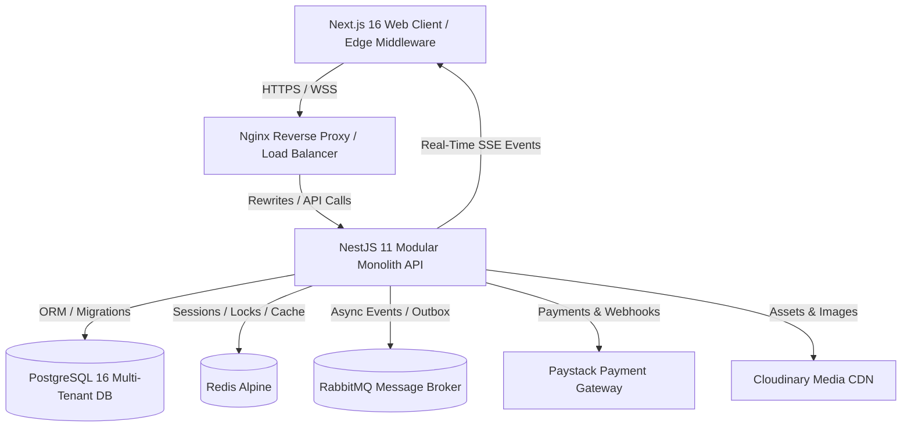
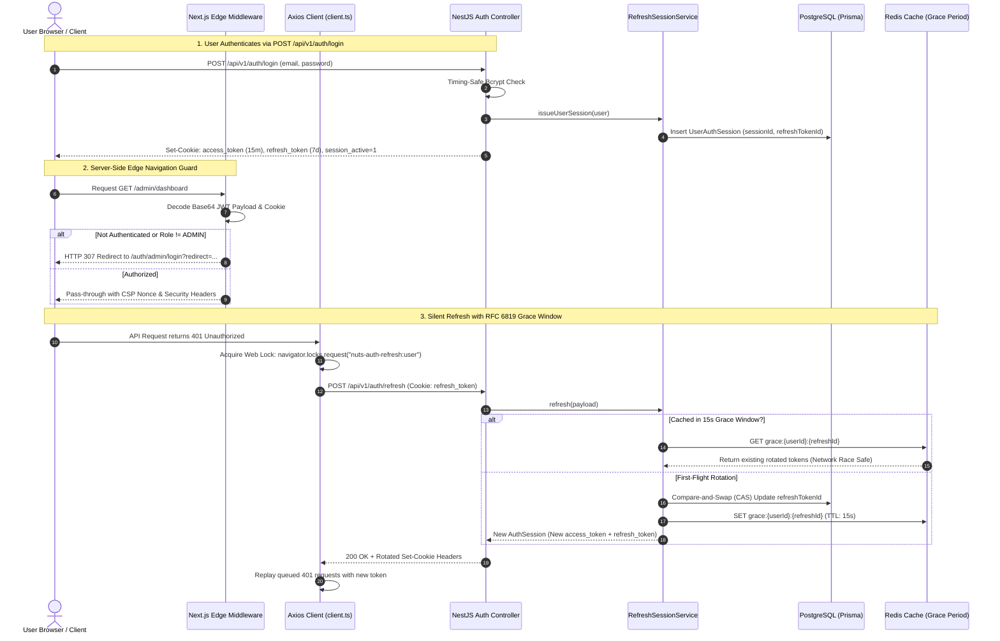
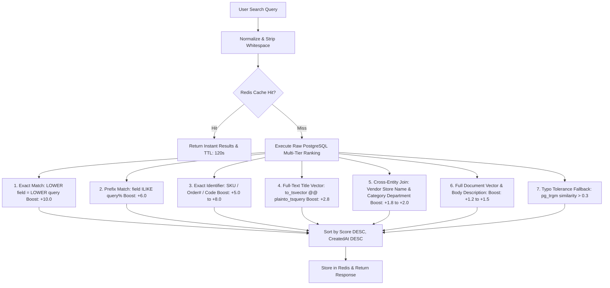
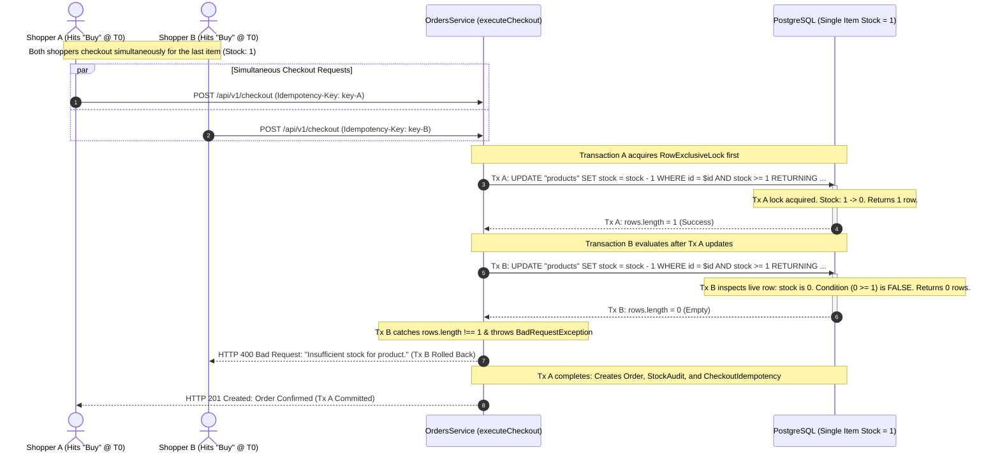
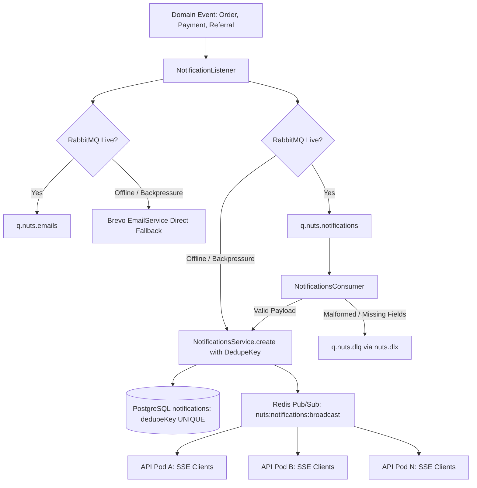

# NUTS Platform — Enterprise Multi-Vendor E-Commerce Platform

[](https://github.com/UGOCHUKWU1124/nuts-platform/actions/workflows/ci.yml)
[](https://www.typescriptlang.org/)
[](https://nestjs.com/)
[](https://nextjs.org/)
[](https://react.dev/)
[](https://www.prisma.io/)
[](https://www.postgresql.org/)
[](https://redis.io/)
[](https://www.rabbitmq.com/)

> **NUTS Platform** is a production-grade, multi-vendor enterprise e-commerce system built as a modular monolith adhering to Domain-Driven Design (DDD) principles. It is engineered for high throughput, sub-millisecond edge routing, zero-downtime database migrations, resilient asynchronous messaging, and banking-grade authentication and session security.

---

## Contents

1. [Summary & Architectural Philosophy](#1-executive-summary--architectural-philosophy)
2. [Monorepo Architecture & Bounded Contexts](#2-monorepo-architecture--bounded-contexts)
3. [Deep Dive: The Authentication & Authorization Engine](#3-deep-dive-the-authentication--authorization-engine)
   - [Triple-Tier Identity Model](#triple-tier-identity-model)
   - [Dual-Channel Authentication & Bearer Token Architecture](#dual-channel-authentication--bearer-token-architecture)
   - [Dual-Token Lifecycle & RFC 6819 Single-Use Rotation](#dual-token-lifecycle--rfc-6819-single-use-rotation)
   - [The 15-Second Redis Grace-Period Concurrency Window](#the-15-second-redis-grace-period-concurrency-window)
   - [Cross-Subdomain & Cookie Isolation Architecture](#cross-subdomain--cookie-isolation-architecture)
   - [Client Single-Flight Refresh Lock (Web Locks API)](#client-single-flight-refresh-lock-web-locks-api)
   - [Next.js 16 Network Boundary Proxy & Server Component Layout Auth Boundaries](#nextjs-16-network-boundary-proxy--server-component-layout-auth-boundaries)
   - [Single-Source-of-Truth Projections & Password Defense](#single-source-of-truth-projections--password-defense)
   - [Redis Security Stamp & Active Revocation Engine](#redis-security-stamp--active-revocation-engine)
   - [Timing-Safe Cryptographic Defenses](#timing-safe-cryptographic-defenses)
   - [Account Lifecycle: Deactivation & 1-Click Reactivation](#account-lifecycle-deactivation--1-click-reactivation)
4. [Domain Bounded Contexts](#4-domain-bounded-contexts)
   - [Catalog & Multi-Variant Inventory Matrix](#catalog--multi-variant-inventory-matrix)
   - [Enterprise Multi-Tier Relevance Search Engine](#enterprise-multi-tier-relevance-search-engine)
   - [Checkout, Cart & Order Processing](#checkout-cart--order-processing)
   - [Billing, Paystack Gateway & Webhook Idempotency](#billing-paystack-gateway--webhook-idempotency)
   - [Real-Time Notification Pipeline (SSE & RabbitMQ)](#real-time-notification-pipeline-sse--rabbitmq)
   - [Transactional Outbox & Domain Event Dispatcher](#transactional-outbox--domain-event-dispatcher)
5. [Performance, Memory & Infrastructure Engineering](#5-performance-memory--infrastructure-engineering)
   - [512MB RAM Ceiling Optimization (Render / Cloud Containers)](#512mb-ram-ceiling-optimization-render--cloud-containers)
   - [Next.js Standalone Build & Tree-Shaking](#nextjs-standalone-build--tree-shaking)
   - [Response Interceptor Content-Negotiation & Stream Bypassing](#response-interceptor-content-negotiation--stream-bypassing)
6. [Security, OpenAPI & Network Hardening](#6-security-openapi--network-hardening)
   - [OpenAPI 3.0 / Swagger Specification & Developer Reference](#openapi-30--swagger-specification--developer-reference)
   - [Dynamic Content-Security-Policy (CSP) & Web Crypto Nonce](#dynamic-content-security-policy-csp--web-crypto-nonce)
   - [Double-Submit Cookie CSRF Defense](#double-submit-cookie-csrf-defense)
   - [Sliding-Window Rate Limiting & Account Lockout](#sliding-window-rate-limiting--account-lockout)
7. [Directory Structure](#7-directory-structure)
8. [Local Development & Docker Workflows](#8-local-development--docker-workflows)
   - [Docker Compose Multi-Profile Architecture](#docker-compose-multi-profile-architecture)
   - [Nginx Reverse Proxy & Load Balancer Architecture](#nginx-reverse-proxy--load-balancer-architecture)
9. [Automated Testing & Quality Gates](#9-automated-testing--quality-gates)

---

## 1. Executive Summary & Architectural Philosophy

NUTS Platform was designed with three foundational engineering tenets:

1. **Clean Architecture & Domain Isolation:** The codebase is partitioned into distinct bounded contexts (Identity, Catalog, Checkout, Billing, Notifications, Analytics) with strict boundary ownership. No direct circular cross-context dependencies are permitted; asynchronous cross-boundary workflows communicate via typed Domain Events and the Transactional Outbox pattern.
2. **Zero Trust & Defense-in-Depth:** Security is implemented at every tier—from the Edge Router Middleware (before HTML renders) to API rate limiters, double-submit CSRF guards, timing-safe bcrypt comparisons, single-use refresh token rotation, and database-level unique constraints.
3. **Resilience Under Resource Constraints:** The system is engineered to run reliably on resource-constrained cloud containers (e.g. 512MB RAM starter nodes on Render or AWS t4g.nano) without memory leaks, GC thrashing, or connection starvation.



---

## 2. Monorepo Architecture & Bounded Contexts

The repository is structured as a high-performance **npm workspaces** monorepo orchestrated by **Turborepo**:

```
NUTS-P/
├── apps/
│   ├── api/          # NestJS 11 Enterprise REST API & Event Engine
│   └── web/          # Next.js 16 App Router (Storefront + Vendor + Admin)
├── packages/
│   ├── config/       # Shared TypeScript, ESLint, and PostCSS configurations
│   ├── database/     # Canonical Prisma 7 schema and migration scripts
│   └── types/        # Shared cross-boundary DTO and domain contracts
├── nginx/            # Production Nginx reverse-proxy and TLS configuration
└── docker-compose.yml# Multi-profile container orchestration (dev,staging & prod)
```

---

## 3. Deep Dive: The Authentication & Authorization Engine

The authentication engine is built to financial-grade specifications, balancing user convenience (seamless token refresh without re-login) with uncompromising security (immediate token family revocation upon replay attack detection).



### Triple-Tier Identity Model
Authentication is segregated across three distinct operational actors:
1. **`ROLE.USER` (Customers):** Shoppers on the storefront. Can browse catalog, manage carts, execute checkout, track shipments, manage wishlists, and self-manage accounts.
2. **`ROLE.VENDOR` (Merchants):** Store owners on the merchant portal (`/vendor/*`). Must be approved (`isApproved = true`) and active (`isActive = true`). Granted capabilities to manage products, variants, pricing, discount codes, inventory, and order fulfilment.
3. **`ROLE.ADMIN` (Platform Operators):** Internal platform administrators (`/admin/*`). Oversee vendor approvals, customer account moderation, cache invalidation, financial metrics, and platform-wide analytics.

### Dual-Channel Authentication & Bearer Token Architecture
NUTS Platform operates a **Defense-in-Depth Hybrid Authentication Model**, marrying browser CSRF immunity with standard REST API bearer interoperability:

```
                         ┌────────────────────────────────────────┐
                         │              HTTP Request              │
                         └───────────────────┬────────────────────┘
                                             │
                                             ▼
                      ┌──────────────────────────────────────────────┐
                      │ extractAccessToken(req) in JwtStrategy       │
                      │ apps/api/src/modules/auth/strategies/access/ │
                      │ jwt.strategy.ts                              │
                      └──────────────────────┬───────────────────────┘
                                             │
                    ┌────────────────────────┴────────────────────────┐
                    │                                                 │
          Priority 1: Bearer Token                          Priority 2: Fallback
                    ▼                                                 ▼
     ┌─────────────────────────────┐                  ┌───────────────────────────────┐
     │ Authorization: Bearer <jwt> │                  │ HttpOnly Cookie: access_token │
     │ (Standard REST API contract)│                  │ (Next.js SSR / Edge Fallback) │
     └─────────────────────────────┘                  └───────────────────────────────┘
```

1. **Backend Verification Priority ([`JwtStrategy`](file:///c:/MY%20PROJECT/NUTS-P/apps/api/src/modules/auth/strategies/access/jwt.strategy.ts)):**
   - The Passport JWT extractor inspects the request in strict priority order:
     ```typescript
     function extractAccessToken(req: Request): string | null {
       // 1. Authorization: Bearer <token> (Priority 1: Standard API contract)
       const authHeader = ExtractJwt.fromAuthHeaderAsBearerToken()(req);
       if (authHeader) return authHeader;

       // 2. HttpOnly Cookie: access_token (Priority 2: Edge & SSR fallback)
       return jwtFromCookie(AUTH_ACCESS_COOKIE)(req);
     }
     ```
   - When authenticating via `/api/v1/auth/login`, `/register`, or `/refresh`, the backend writes secure `HttpOnly` cookies **and** returns `{ user, accessToken }` directly in the JSON response payload.
2. **In-Memory Token Isolation ([`token-storage.ts`](file:///c:/MY%20PROJECT/NUTS-P/apps/web/src/api/core/token-storage.ts)):**
   - Compliant with **OWASP ASVS Level 3 Guidelines**: Short-lived access tokens are stored strictly in private in-memory JavaScript closures keyed by account role (`user`, `admin`, `vendor`).
   - Tokens are **never written to `localStorage` or `sessionStorage`**, rendering the system completely immune to token exfiltration via Cross-Site Scripting (XSS).
3. **Axios Client Request Interceptor ([`client.ts`](file:///c:/MY%20PROJECT/NUTS-P/apps/web/src/api/core/client.ts)):**
   - Outbound API calls automatically extract the role-scoped in-memory token and attach `Authorization: Bearer <token>`.
   - On `401 Unauthorized`, Axios executes a single-flight refresh via the **Web Locks API**, updates `Authorization: Bearer <freshToken>`, and transparently replays the request without user interruption.
4. **Why Dual-Channel Architecture?**
   - **CSRF Immunity:** Browsers do not automatically attach custom `Authorization` headers on cross-site requests, protecting state-changing API operations.
   - **Interoperability:** External microservices, mobile apps, curl, and Swagger UI authenticate directly using standard Bearer headers without managing cookie jars.
   - **SSR / Edge Compatibility:** Next.js Edge Router Middleware and Server Components can read the secure cookie at the edge using Web Crypto HMAC verification.

### Dual-Token Lifecycle & RFC 6819 Single-Use Rotation
- **`access_token` (Short-Lived JWT — 15 minutes):**
  - Carries user identity: `sub`, `email`, `role`, `tokenVersion`, `sessionId`.
  - Stored in memory on the client and transported via standard `HttpOnly` cookie or `Authorization: Bearer <token>` header.
- **`refresh_token` (Long-Lived JWT — 7 days):**
  - Carries session metadata: `sub`, `role`, `refreshId`, `sessionId`.
  - Transported strictly via `HttpOnly`, `SameSite=Lax`, `Secure` cookie.
  - **Single-Use Rotation:** Every time `/api/v1/auth/refresh` is called, the provided `refreshId` is retired, and a new cryptographically random 32-byte hexadecimal `refreshId` is issued. The database uses a compare-and-swap (CAS) atomic query:
    ```sql
    UPDATE "UserAuthSession"
    SET "refreshTokenId" = $newRefreshId, "refreshToken" = $newHash
    WHERE "id" = $sessionId AND "refreshTokenId" = $oldRefreshId;
    ```

### The 15-Second Redis Grace-Period Concurrency Window
A major pitfall of standard refresh token rotation in production is **network concurrency races**. If a browser page triggers 5 parallel API calls (e.g., cart, profile, notifications, categories, wishlist) when the 15-minute access token expires, all 5 requests return 401 simultaneously.
- Without a grace window: The first request rotates the token. The remaining 4 requests arrive with the old token. The server sees an already-rotated token, treats it as a **malicious replay attack**, and revokes the user's entire session family, forcing an unwanted sign-out.
- **The NUTS Solution:** In [`RefreshSessionService`](file:///c:/MY%20PROJECT/NUTS-P/apps/api/src/modules/auth/sessions/refresh-session.service.ts), whenever a refresh succeeds, the newly issued session is cached in Redis under `grace:{userId}:{oldRefreshId}` with a 15-second TTL (RFC 6819 standard). Any concurrent request arriving within this 15-second window receives the valid rotated session instead of triggering revocation.
- **True Breach Detection:** If a token is presented *after* the 15-second grace window has elapsed, `RefreshSessionService` logs a security alert and immediately triggers `revokeSession()`, wiping all active sessions for that account.

### Cross-Subdomain & Cookie Isolation Architecture
Cookies are issued via [`AuthCookieService`](file:///c:/MY%20PROJECT/NUTS-P/apps/api/src/modules/auth/cookies/auth-cookie.service.ts):
- **`access_token`:** `HttpOnly: true`, `SameSite: Lax`, `Secure: true`, `Path: /`, `Max-Age: 15m`.
- **`refresh_token`:** `HttpOnly: true`, `SameSite: Lax`, `Secure: true`, `Path: /`, `Max-Age: 7d`.
- **`session_active`:** `HttpOnly: false`, `SameSite: Lax`, `Secure: true`, `Path: /`, `Max-Age: 7d`.
  * *Purpose:* A non-sensitive boolean marker (`1`) readable by JavaScript and Next.js middleware, allowing immediate offline/hydration status checks without parsing protected JWTs.
- **Legacy Cookie Eviction:** To prevent cookie poisoning and browser storage bloat from previous releases, both `setAuthCookies()` and `clearAuthCookies()` issue zero-max-age tombstone headers for legacy names (`user_refresh_token`, `admin_refresh_token`, `vendor_refresh_token`, `user_session`, `admin_session`, `vendor_session`).

### Client Single-Flight Refresh Lock (Web Locks API)
In [`apps/web/src/api/core/client.ts`](file:///c:/MY%20PROJECT/NUTS-P/apps/web/src/api/core/client.ts):
- Concurrent refresh attempts across multiple browser tabs are synchronized using the browser's native **Web Locks API**:
  ```ts
  navigator.locks.request(`nuts-auth-refresh:${role}`, { mode: "exclusive" }, runRefresh);
  ```
- If Tab A initiates a refresh, Tab B awaits the lock rather than firing a redundant HTTP request. When Tab A finishes, Tab B reads the freshly persisted token.
- All failed 401 Axios requests are held in an in-memory execution queue, re-attached with the new Bearer token, and transparently replayed.

### Next.js 16 Network Boundary Proxy & Server Component Layout Auth Boundaries
Located in [`apps/web/src/proxy.ts`](file:///c:/MY%20PROJECT/NUTS-P/apps/web/src/proxy.ts) and [`apps/web/src/lib/server-auth.ts`](file:///c:/MY%20PROJECT/NUTS-P/apps/web/src/lib/server-auth.ts):
- **Next.js 16 Network Boundary Proxy (`proxy.ts`):**
  - **Zero Hardcoded Route Lists:** Eliminates fragile, brittle hardcoded route string arrays in edge routing. The network proxy does not maintain arbitrary sets of route paths or subpaths.
  - **Perimeter Defense & Dynamic CSP Nonces:** Operates strictly at the network boundary, generating 16-byte cryptographically secure CSP nonces (`crypto.getRandomValues`), enforcing strict Content-Security-Policy (CSP), HSTS, `X-Frame-Options: DENY`, `X-Content-Type-Options: nosniff`, and `Permissions-Policy`.
  - **Spoofed Header Stripping:** Unconditionally strips client-supplied identity headers (`x-user-id`, `x-user-role`, `x-authenticated`) before downstream request routing.
  - **Nonce Propagation:** Injects `x-nonce` into internal request headers, allowing React Server Components to access nonces via `headers().get('x-nonce')` for Paystack and dynamic inline scripts.
- **Server Component Layout Auth Boundaries (Filesystem as Source of Truth):**
  - **Decentralized Route Group Isolation:** Rather than centralized, brittle URL pattern matching, route protection is enforced at the layout boundary of each route group:
    - **Platform Admin:** [`apps/web/src/app/(admin)/admin/layout.tsx`](file:///c:/MY%20PROJECT/NUTS-P/apps/web/src/app/(admin)/admin/layout.tsx) validates active admin sessions via `enforceAuth('admin', '/auth/admin/login')`. Any new page added under `(admin)/admin` is automatically protected.
    - **Vendor Merchant Portal:** [`apps/web/src/app/(vendor)/vendor/layout.tsx`](file:///c:/MY%20PROJECT/NUTS-P/apps/web/src/app/(vendor)/vendor/layout.tsx) validates active merchant sessions via `enforceAuth('vendor', '/auth/vendor/login')`.
    - **Customer Protected Areas:** [`apps/web/src/components/domain/auth/ProtectedLayout.tsx`](file:///c:/MY%20PROJECT/NUTS-P/apps/web/src/components/domain/auth/ProtectedLayout.tsx) automatically gates `/account`, `/checkout`, `/order`, `/wallet`, and `/review`.
  - **Cryptographic Token Verification (`edge-jwt`):**
    - The server authentication helper ([`server-auth.ts`](file:///c:/MY%20PROJECT/NUTS-P/apps/web/src/lib/server-auth.ts)) reads HTTP-only cookies securely via `cookies()` and verifies HMAC-SHA256 signatures with Web Crypto API (`crypto.subtle`).
    - **Silent Refresh Grace Window:** If an access token expires while a genuine `refresh_token` cookie is present, layouts allow the page shell to mount so client-side Axios refresh interceptors (coordinated via Web Locks API) can rotate tokens silently in the background.
  - **Safe Internal Path Sanitization:** Destination redirects are sanitized via [`safeInternalPath`](file:///c:/MY%20PROJECT/NUTS-P/apps/web/src/lib/safe-internal-path.ts), rejecting open redirect vectors.

### Single-Source-of-Truth Projections & Password Defense
- **Compile-Time Safe Selects (`auth.selects.ts`):** To eliminate the risk of accidental password projection into client responses or cache dumps, all user, vendor, and admin authentication queries route through central Prisma select definitions:
  - `authAccountSelect`: Projects strictly `{ id, email, firstName, lastName, role, isActive, isApproved, tokenVersion }`.
  - Sensitive password hashes (`password`) and internal secrets are queried only inside dedicated authentication routines using explicit select blocks, guaranteeing that public payloads and JWT tokens can never leak credentials.
- **Unified Identity Resolution:** Identity lookup across Customer, Merchant, and Operator portals is consolidated into `AuthService.findAccountForLogin()` with strict role verification.

### Redis Security Stamp & Active Revocation Engine
- In high-throughput architectures, verifying session validity against a relational database on every HTTP request creates severe database bottlenecking.
- [`AuthSessionService`](file:///c:/MY%20PROJECT/NUTS-P/apps/api/src/modules/auth/sessions/auth-session.service.ts) implements an ultra-fast **Redis Security Stamp cache** (`auth:stamp:{role}:{userId}`) with a 60-second TTL:
  - High-frequency API calls verify token validity, account active status, vendor approval, and `tokenVersion` in sub-millisecond memory lookups.
  - State-altering security events (password changes, admin account locks, session revocations, logouts) execute immediate Redis stamp deletion (`invalidateAccountStamp`), enforcing real-time revocation across the entire cluster without waiting for JWT expiration.

### Timing-Safe Cryptographic Defenses
- **Password Verification:** Uses `bcrypt` with cost factor 12.
- **User-Enumeration Prevention:** In [`AuthService.login`](file:///c:/MY%20PROJECT/NUTS-P/apps/api/src/modules/auth/auth.service.ts), if an email does not exist in the database, `bcrypt.compare()` is still executed against a dummy hash (`UNKNOWN_ACCOUNT_PASSWORD_HASH`). This ensures that login requests take identical processing time regardless of whether the email is registered or not, thwarting timing-based username enumeration.
- **Automatic Hash Upgrades:** If a user logs in with an older bcrypt cost factor, the hash is upgraded asynchronously on the fly.

### Account Lifecycle: Deactivation & 1-Click Reactivation
- Users can self-deactivate their account, initiating a **60-day grace period** before permanent deletion.
- When valid credentials are provided for a deactivated account, the API returns a distinct `ACCOUNT_DEACTIVATED` code (or admin suspension notice if `deactivatedBy` is present).
- The login interface captures this error and dynamically displays a contextual reactivation prompt, allowing users to restore their account and log in with a single click.

---

## 4. Domain Bounded Contexts

### Catalog & Multi-Variant Inventory Matrix
- **Hierarchical Taxonomy:** Self-referential `Category` model (`parentId` / `children`) supporting nested multi-level categorization with path and slug normalization.
- **Variant Matrix:** Products decouple parent metadata (`name`, `description`, `brand`) from sellable stock-keeping units (`ProductVariant`), tracking individual SKU, barcode, price, compare-at price, inventory quantity, attributes (e.g. Size, Color), and variant-specific image galleries.

### Enterprise Multi-Tier Relevance Search Engine
Located in [`apps/api/src/modules/shared/search/search.service.ts`](file:///c:/MY%20PROJECT/NUTS-P/apps/api/src/modules/shared/search/search.service.ts):
The search engine is built on an enterprise 12-tier relevance ranking model, addressing standard e-commerce search pitfalls (rigid word order, isolated product fields, and flat scoring):



#### Multi-Tier Scoring & Ranking Hierarchy

| Priority | Match Condition | Score Boost | Purpose / Behavior |
| :--- | :--- | :--- | :--- |
| **1** | `LOWER(name) = LOWER(query)` | **+10.0 + similarity** | **Exact Title Hit:** Exact product/store/category name; placed at the very top. |
| **2** | `LOWER(sku / code / orderNumber) = LOWER(query)` | **+8.0 to +10.0** | **Exact Identifier Hit:** Targeted SKU, promo code, or order lookup. |
| **3** | `name ILIKE 'query%'` | **+6.0 + similarity** | **Prefix Title Hit:** Instant typing autocomplete suggestion. |
| **4** | `sku / code ILIKE 'query%'` | **+4.0 to +5.0** | **Prefix Identifier Hit:** Inventory code prefix match. |
| **5** | `name ILIKE '%query%'` | **+3.0 + similarity** | **Substring Hit:** Query exists verbatim inside title. |
| **6** | `to_tsvector('simple', name) @@ plainto_tsquery('simple', query)` | **+2.8 + similarity** | **Full-Text Title Match:** Matches multi-word terms in *any* order. |
| **7** | `sku ILIKE '%query%'` | **+2.5 + similarity** | **Substring Identifier Hit:** Substring SKU hit. |
| **8** | `v."storeName" ILIKE '%query%'` | **+2.0 + similarity** | **Brand Association:** Products discoverable by vendor/seller name. |
| **9** | `c.name ILIKE '%query%'` | **+1.8 + similarity** | **Department Association:** Products discoverable by category name. |
| **10** | `to_tsvector(name || description || vendor || category) @@ query` | **+1.5 + similarity** | **Full-Text Document Discovery:** Broad multi-term matching across entire entity. |
| **11** | `COALESCE(description, '') ILIKE '%query%'` | **+1.2 + similarity** | **Body Text Match:** Keywords found in product body copy. |
| **12** | `similarity(name, query) > 0.3` | **Base similarity** | **Typo Tolerance:** PostgreSQL `pg_trgm` fuzzy matching (e.g., "iphne" -> "iPhone"). |

- **Multi-Word Query Resilience:** By combining `to_tsvector` and `plainto_tsquery`, searches like `"black leather boots"` match products titled `"Boots - Genuine Leather (Black)"` without requiring exact word adjacency.
- **Cross-Index Coverage:** The search engine dispatches queries across 6 separate business domains: `products`, `vendors`, `categories`, `users`, `orders`, and `discount_codes`.
- **Graceful Redis Caching:** Search hits and autocomplete responses are cached in Redis with a 120-second TTL. If Redis is unavailable, the service logs a warning and falls through directly to the database without throwing a user-facing error.

### Checkout, Cart & Order Processing
The checkout pipeline is architected to guarantee absolute consistency, zero overselling, and deadlock freedom under high-concurrency traffic:



#### Concurrency & Edge-Case Engineering Guarantees

1. **The "Last Item" (Stock = 1) Overselling Prevention:**
   - **The Problem:** In standard naive e-commerce systems (`findProduct() -> check stock > 0 -> updateProduct()`), two shoppers querying at the same millisecond both read `stock = 1`, both succeed, and inventory drops to `-1` (overselling).
   - **The NUTS Implementation:** Stock deductions in [`OrdersService.executeCheckout`](file:///c:/MY%20PROJECT/NUTS-P/apps/api/src/modules/checkout/orders/orders.service.ts) execute as an atomic conditional SQL operation with a `RETURNING` clause:
     ```sql
     UPDATE "products"
     SET "stock" = "stock" - :quantity, "updatedAt" = NOW()
     WHERE "id" = :productId
       AND "isActive" = true
       AND "isDeleted" = false
       AND "stock" >= :quantity
     RETURNING "id", ("stock" + :quantity) AS "oldStock", "stock" AS "newStock";
     ```
   - **Execution Flow:** PostgreSQL enforces an exclusive row-level lock (`RowExclusiveLock`). The first transaction to acquire the lock decrements the stock from `1` to `0` and receives `rows.length === 1`. The second transaction evaluates the row *after* the update, finds `stock = 0`, fails the `stock >= 1` predicate, and returns `rows.length === 0`.
   - **Rollback:** When `rows.length !== 1`, `OrdersService` immediately throws `BadRequestException("Insufficient stock...")`, causing PostgreSQL to execute an **atomic transaction rollback**. No order row is generated, no payment is initialized, and inventory never drops below zero.

2. **Deterministic Row Lock Sorting (PostgreSQL Deadlock Prevention — SQLSTATE 40P01):**
   - **The Problem:** If Shopper A's cart contains `[Item 1, Item 2]` and Shopper B's cart contains `[Item 2, Item 1]`, concurrent checkouts can cause Shopper A to lock Item 1 and wait for Item 2, while Shopper B locks Item 2 and waits for Item 1. This triggers a cyclic transaction deadlock in PostgreSQL (`SQLSTATE 40P01: deadlock detected`).
   - **The NUTS Solution:** All cart items are sorted lexicographically by identifier (`variantId ?? productId`) before any row lock is requested:
     ```ts
     const itemsToDeduct = [...cart.cartItems].sort((a, b) => {
       const aKey = a.variantId ?? a.productId;
       const bKey = b.variantId ?? b.productId;
       return aKey.localeCompare(bKey);
     });
     ```
   - Because all transactions acquire row locks in the exact same deterministic sequence across the entire cluster, cyclic dependencies are eliminated.

3. **Active Cart Concurrency Guard (`SELECT ... FOR UPDATE`):**
   - To prevent shoppers from double-submitting a cart across multiple browser tabs, `executeCheckout` acquires an exclusive lock on the cart row:
     ```sql
     SELECT "id" FROM "carts"
     WHERE "userId" = :userId AND "checkedOut" = false
     ORDER BY "createdAt" DESC LIMIT 1 FOR UPDATE;
     ```
   - Any concurrent request is queued behind the lock until the cart is marked `checkedOut = true`.

4. **Database-Level Idempotency Protection (`checkout_idempotency`):**
   - Every checkout requires a client-supplied `Idempotency-Key` header.
   - Guarded by a composite unique constraint `@@unique([userId, idempotencyKey])`.
   - If an identical checkout request arrives concurrently or due to a network replay, the collision is caught via Prisma's `P2002` error code. The winning order is retrieved and returned safely without double-charging or deducting duplicate inventory.

5. **Live Price & Vendor Integrity Revalidation:**
   - Carts might contain items added hours or days prior. `OrdersService` verifies every cart item's price against the authoritative live database price (`item.product.price`) before computing totals. If a vendor changed a price, the cart is re-synchronized to prevent shoppers from checking out with tampered or stale prices.
   - All calculations utilize `Prisma.Decimal` to ensure exact fixed-point precision.

6. **State Machine Auditing:**
   - Every order transition (`PENDING` → `PROCESSING` → `SHIPPED` → `DELIVERED` → `CANCELLED` → `REFUNDED`) is validated against an allowed transition graph and recorded immutably in `OrderStatusHistory` with operator ID, timestamps, and contextual transition notes.

### Billing, Wallets & Financial Integrity
Located in [`apps/api/src/modules/billing`](file:///c:/MY%20PROJECT/NUTS-P/apps/api/src/modules/billing):

1. **Fixed-Point Decimal Arithmetic:**
   - All financial balances (`UserWallet.balance`, `VendorWallet.balance`, `Order.totalAmount`, `Payment.amount`) are stored as PostgreSQL `DECIMAL(10, 2)`.
   - Zero JavaScript IEEE 754 floating-point inaccuracies. All discounts, platform fees, and tax calculations use `Prisma.Decimal` methods (`.mul()`, `.add()`, `.sub()`, `.toDecimalPlaces(2)`).

2. **Atomic Wallet Debit (Double-Spend Prevention):**
   - [`WalletService.debitUserWallet`](file:///c:/MY%20PROJECT/NUTS-P/apps/api/src/modules/billing/wallets/wallet.service.ts) eliminates the read-modify-write race condition by executing an atomic conditional update:
     ```sql
     UPDATE "user_wallets"
     SET "balance" = "balance" - :amount
     WHERE "userId" = :userId AND "balance" >= :amount;
     ```
   - Returns `count === 0` and rejects the debit with `BadRequestException` if balance is insufficient.

3. **Two-Phase Vendor Escrow & Platform Commission:**
   - On successful payment confirmation, the order enters `PROCESSING`.
   - The platform fee is deducted immediately:
     $$\text{Vendor Earning} = \text{Item Price} \times \text{Quantity} \times 0.85$$
     (Retaining the 15% marketplace commission defined by `VENDOR_COMMISSION_RATE = 0.85`).
   - Earnings are credited to the vendor's `pendingBalance` (not withdrawable).
   - Only when the customer or admin marks the order as `DELIVERED` does [`settleVendorEarning`](file:///c:/MY%20PROJECT/NUTS-P/apps/api/src/modules/billing/wallets/wallet.service.ts) atomize the transfer from `pendingBalance` to available `balance`.
   - If an order is cancelled or refunded prior to delivery, pending funds are cleanly reversed (`debitVendorPending`) without impacting settled revenue.

4. **Webhook Concurrency Gates & Replay Protection:**
   - **Timing-Safe HMAC Verification:** Validates `x-paystack-signature` using HMAC-SHA512 with `crypto.timingSafeEqual()` over the raw request payload buffer.
   - **Atomic State-Machine Gate:** When Paystack webhooks arrive, [`PaymentsService.confirmPayment`](file:///c:/MY%20PROJECT/NUTS-P/apps/api/src/modules/billing/payments/payments.service.ts) executes:
     ```typescript
     const claimed = await tx.payment.updateMany({
       where: { id: payment.id, status: PaymentStatus.PENDING },
       data: { status: PaymentStatus.SUCCESS, transactionId: verified.data.id }
     });
     ```
   - If multiple duplicate webhooks or simultaneous user redirect callbacks arrive, exactly one process receives `claimed.count === 1`. All subsequent deliveries receive `claimed.count === 0` and terminate safely without double-crediting wallets or generating duplicate notification events.
   - **Server-to-Server Re-Verification:** The webhook payload is never trusted blindly. `PaymentsService` calls Paystack's official verification endpoint (`/transaction/verify/:reference`), validating that the received currency and kobo amount (`toPaystackAmount`) match the order's expected total.

### Real-Time Notification Pipeline (SSE & RabbitMQ)
Located in [`apps/api/src/modules/notifications`](file:///c:/MY%20PROJECT/NUTS-P/apps/api/src/modules/notifications):

The notification architecture provides unified in-app notification tracking, real-time Server-Sent Events (SSE) streaming, and asynchronous email processing across clustered nodes:



1. **Enterprise Multi-Pod Cluster Distribution via Redis Pub/Sub:**
   - Instead of single-process in-memory event buses that fail under horizontal scaling, [`NotificationsService`](file:///c:/MY%20PROJECT/NUTS-P/apps/api/src/modules/notifications/notifications.service.ts) maintains a dedicated Redis subscriber connected to `nuts:notifications:broadcast`.
   - When a notification is generated on any backend instance, it publishes an atomic broadcast event to Redis, instantly reaching connected SSE clients across all running cluster pods.
   - If Redis is absent or offline, the service automatically degrades to local in-memory RxJS `Subject` distribution without crashing.

2. **Database-Level Deduplication & Idempotency:**
   - Every notification schema definition includes `dedupeKey String? @unique` and a composite index `@@index([userId, role, isRead, createdAt])`.
   - Notification deduplication keys follow strict deterministic naming conventions:
     - Orders: `ORDER_CONFIRMED:${orderId}:USER:${userId}`
     - Vendors: `ORDER_CONFIRMED:${orderId}:VENDOR:${vendorId}`
     - Admins: `ORDER_PLACED:${orderId}:ADMIN:${adminId}`
     - Payments: `PAYMENT_RECEIVED:${paymentId}:USER:${userId}`
   - When duplicate events occur (e.g., retried webhooks or message replays), Prisma's unique constraint collision (`P2002`) is trapped atomically, returning the existing row without duplicate database entries or repeated SSE emissions.

3. **Role-Scoped Stream Isolation & Event IDs:**
   - Client SSE connections at `/api/v1/notifications/sse/stream` filter events strictly by both `userId` and active `role`, preventing event cross-contamination on accounts holding multiple roles.
   - Every SSE payload includes a persistent message `id` matching the database record ID, empowering standard browser reconnection resumption via `Last-Event-ID`.

4. **Connection Rate Caps & Real-Time Security Revocation:**
   - **Socket Ceiling:** Concurrent SSE connections are throttled to a maximum of 5 per user using Redis counters (with in-memory fallback), responding with `429 Too Many Requests` to prevent socket exhaustion and runaway browser tab leaks.
   - **Revocation on Heartbeat:** Heartbeat pings emit every 15 seconds. On every heartbeat tick, the stream evaluates [`AuthSessionService.isSessionActive()`](file:///c:/MY%20PROJECT/NUTS-P/apps/api/src/modules/auth/sessions/auth-session.service.ts). If an account was deactivated, suspended, or its session revoked, the stream terminates immediately.

5. **Asynchronous Work Queues & Fail-Safe Delivery:**
   - High-throughput email deliveries and notification events route through dedicated RabbitMQ topic queues (`q.nuts.emails`, `q.nuts.notifications`).
   - If the broker is offline or encountering backpressure, [`NotificationListener`](file:///c:/MY%20PROJECT/NUTS-P/apps/api/src/modules/notifications/listeners/notification.listener.ts) safely falls back directly to the circuit-breaker protected `EmailService` and atomic database creation.
   - Corrupted or unparseable messages in [`NotificationsConsumer`](file:///c:/MY%20PROJECT/NUTS-P/apps/api/src/modules/notifications/consumers/notifications.consumer.ts) throw explicitly, routing immediately to `q.nuts.dlq` through the Dead Letter Exchange (`nuts.dlx`).
   - Fan-outs across multiple vendors or platform administrators utilize `Promise.allSettled()` with per-recipient error boundaries, preventing single-recipient failures from interrupting the batch.

6. **Automated Daily Retention Cleanup Cron:**
   - [`NotificationRetentionCron`](file:///c:/MY%20PROJECT/NUTS-P/apps/api/src/modules/cron/notification-retention/notification-retention.cron.ts) executes daily at midnight (Africa/Lagos) under a distributed Redis mutex lock.
   - Prunes read notifications older than 90 days and unread notifications older than 180 days in bounded batches of 1,000 to prevent database table bloat and query degradation.

7. **Frontend Resilience & Cache Hydration (`apps/web`):**
   - **Zero Stale Cache on Unauthenticated Loads:** [`use-notifications.ts`](file:///c:/MY%20PROJECT/NUTS-P/apps/web/src/hooks/use-notifications.ts) purges persisted Zustand notification caches immediately upon unauthenticated mount, preventing sensitive notification leakage across shared browser profiles.
   - **Reconnect Sync:** Stream reconnections automatically fetch both current unread counts and page-1 notification lists, catching up on any missed updates during disconnects.
   - **Network Error Auto-Retry:** Reverse-proxy 502 Bad Gateway responses and connection timeouts now retry with exponential backoff rather than exhausting retries permanently.

### Transactional Outbox & Domain Event Dispatcher
- Prevents the **Dual-Write Vulnerability** (where a database write succeeds but a message broker publish fails).
- Business transactions write both the domain entity and the outbox record inside the same PostgreSQL transaction.
- An asynchronous worker reads uncommitted outbox rows, publishes them to RabbitMQ, and marks them processed.

---

## 5. Performance, Memory & Infrastructure Engineering

### 512MB RAM Ceiling Optimization (Render / Cloud Containers)
Starter cloud instances (such as Render Free/Starter) enforce a hard **512MB RAM ceiling**. Exceeding this limit triggers an immediate SIGKILL container termination.

```
                    512MB Container Ceiling
┌─────────────────────────────────────────────────────────────┐
│  Node.js V8 Heap: --max-old-space-size=384MB                │
│  (Objects, Closures, AST, Server Components)               │
│  ┌───────────────────────────────────────────────────────┐  │
│  │ Max Old Space: 384MB                                  │  │
│  └───────────────────────────────────────────────────────┘  │
│  Native Headroom: 128MB                                     │
│  (libuv buffers, native C++ modules, OpenSSL, TCP sockets)  │
└─────────────────────────────────────────────────────────────┘
```

1. **V8 Max Old Space Limit:** Configured `--max-old-space-size=384` across all web and API runner scripts, preventing Node's mark-compact garbage collector from thrashing near heap limits.
2. **Barrel File Optimization:** Configured `experimental.optimizePackageImports: ["lucide-react", "@tanstack/react-query", "sonner"]` in `next.config.ts`, drastically reducing the number of JavaScript modules retained in server memory.

### Next.js Standalone Build & Tree-Shaking
- `output: "standalone"` traces the exact dependency tree and generates a self-contained production bundle, stripping away extraneous dev dependencies and build caches.

### Response Interceptor Content-Negotiation & Stream Bypassing
- In [`ResponseInterceptor`](file:///c:/MY%20PROJECT/NUTS-P/apps/api/src/modules/shared/interceptors/response.interceptor.ts), SSE streams (`Accept: text/event-stream` or `Content-Type: text/event-stream`) bypass the default JSON envelope wrapper (`{ success: true, data: ... }`), preventing stream buffering and memory inflation.

## 6. Security, OpenAPI & Network Hardening

### OpenAPI 3.0 / Swagger Specification & Developer Reference

NUTS Platform provides an enterprise-grade OpenAPI 3.0 interactive developer portal powered by `@nestjs/swagger` and modularly isolated in [`apps/api/src/swagger.setup.ts`](file:///c:/MY%20PROJECT/NUTS-P/apps/api/src/swagger.setup.ts):

- **Zero-Trust Environment Gating:**
  - **Strictly Disabled in Production (`NODE_ENV=production`):** Swagger routes (`/api/docs`, `/api/docs-json`, `/api/docs-yaml`) and convenience redirects (`/docs`, `/documentation`) are physically unmounted to prevent schema reconnaissance, endpoint enumeration, and internal data structure disclosure.
  - **Active in Staging & Development:** Enabled exclusively in development and staging environments to empower developers and QA engineers.
- **Interactive Documentation UI:** Hosted at `/api/docs` (with automatic convenience redirects from `/docs` and `/documentation`).
- **Machine-Readable Exports:**
  - Standard JSON: `/api/docs-json` (or `/api/docs.json`)
  - Standard YAML: `/api/docs-yaml`
- **Developer-First Production Optimizations:**
  - **Collapsed by Default (`docExpansion: 'none'`):** Prevents browser freezes from expanding 100+ endpoints simultaneously, rendering a clean, alphabetical tag directory.
  - **Instant Client-Side Filtering (`filter: true`):** Real-time search bar across all controller tags and operation paths.
  - **Authorization Persistence (`persistAuthorization: true`):** Stores entered JWT bearer credentials in browser `localStorage` across page refreshes during API testing.
  - **Latency Benchmarking (`showRequestDuration: true`):** Measures server roundtrip response times directly in the interactive test runner.
  - **Unified Security Schemes:**
    - `JWT-auth`: Standard HTTP Bearer scheme (`Authorization: Bearer <jwt>`) with role-scoped tagging (`ADMIN`, `VENDOR`, `CUSTOMER`).
    - `cookieAuth`: HttpOnly cookie authentication (`nuts_access_token`, `nuts_refresh_token`).


### Dynamic Content-Security-Policy (CSP) & Web Crypto Nonce
In [`apps/web/src/middleware.ts`](file:///c:/MY%20PROJECT/NUTS-P/apps/web/src/middleware.ts):
- Every request generates a cryptographically random base64 nonce using the Web Crypto API.
- Generates strict CSP directives:
  - `default-src 'self'`
  - `script-src 'self' 'nonce-<random>' 'strict-dynamic' https://js.paystack.co`
  - `connect-src 'self' https://api.paystack.co <NEXT_PUBLIC_API_URL> <NEXT_PUBLIC_BACKEND_URL>`
  - `img-src 'self' data: blob: https://res.cloudinary.com https://images.unsplash.com https://lh3.googleusercontent.com`
  - `frame-src https://checkout.paystack.com`
  - `upgrade-insecure-requests` (in Production and Staging)
- Standard security headers: `X-Frame-Options: DENY`, `X-Content-Type-Options: nosniff`, `Referrer-Policy: strict-origin-when-cross-origin`, `Strict-Transport-Security`.

### Double-Submit Cookie CSRF Defense
In [`CsrfMiddleware`](file:///c:/MY%20PROJECT/NUTS-P/apps/api/src/modules/security/middleware/csrf.middleware.ts):
- Mutating operations (`POST`, `PUT`, `PATCH`, `DELETE`) require an `x-csrf-token` header matching the client's CSRF cookie.
- Validates the `Origin` and `Fetch-Site` headers against trusted CORS domains to prevent cross-origin state-changing submissions.

### Sliding-Window Rate Limiting & Account Lockout
- **Distributed Redis Rate Limiter:** Backed by Redis storage (`RedisThrottlerStorage`), sharing request rate windows across clustered API instances.
- **Tiered Throttles:** Strict limits on `/auth/login` (5 req/min), `/auth/register` (3 req/min), and `/auth/password-reset` (3 req/min).
- **Account Lockout:** Multiple consecutive password failures on an account trigger an automatic 15-minute lock via [`AccountLockService`](file:///c:/MY%20PROJECT/NUTS-P/apps/api/src/modules/security/services/account-lock.service.ts).

---

## 7. Directory Structure

```
.
├── apps/
│   ├── api/
│   │   ├── src/
│   │   │   ├── modules/
│   │   │   │   ├── analytics/        # Business intelligence & metrics
│   │   │   │   ├── auth/             # Core IAM, sessions, cookies, OTP
│   │   │   │   ├── billing/          # Payments, Paystack webhooks, wallets
│   │   │   │   ├── catalog/          # Products, variants, categories
│   │   │   │   ├── checkout/         # Orders, carts, idempotency
│   │   │   │   ├── identity/         # User, admin, vendor domains
│   │   │   │   ├── infrastructure/   # Prisma, Redis, RabbitMQ, Mail
│   │   │   │   ├── notifications/    # SSE streams, listeners, bells
│   │   │   │   ├── search/           # Full-text search and query logs
│   │   │   │   └── security/         # CSRF, rate-limiting, IP guards
│   │   │   ├── main.ts               # Application entrypoint & OpenAPI
│   │   │   └── app.module.ts         # Root modular monolith composition
│   │   └── Dockerfile                # Multi-stage production container build
│   │
│   └── web/
│       ├── src/
│       │   ├── api/                  # Axios core client, token storage
│       │   ├── app/                  # Next.js App Router
│       │   │   ├── (admin)/          # Operator administration portal
│       │   │   ├── (auth)/           # Login, register, reactivate pages
│       │   │   ├── (storefront)/     # Customer shopping experience
│       │   │   └── (vendor)/         # Merchant workspace & analytics
│       │   ├── components/           # Reusable UI & domain components
│       │   ├── lib/                  # Path sanitization, auth broadcasts
│       │   ├── zustand/              # State stores (auth, cart, notifications)
│       │   └── middleware.ts         # Edge Router authentication & CSP gateway
│       ├── next.config.ts            # Standalone build & memory configurations
│       └── Dockerfile                # Production Next.js standalone container
│
├── packages/
│   ├── database/
│   │   └── schema.prisma             # Canonical Prisma schema
│   ├── config/                       # Shared linter and compiler configs
│   └── types/                        # Cross-application shared types
│
├── docker-compose.yml                # Unified dev & prod multi-profile stack
└── docker-compose.db.yml             # Local PostgreSQL + Redis development stack
```

---

## 8. Local Development & Docker Workflows

### Prerequisites
- **Node.js:** `v22.x` or `v24.x`
- **npm:** `v10.x` or `v11.x`
- **Docker & Docker Compose:** Latest engine version

### Quick Start (Local Node + Containerized DB)

1. **Clone the repository:**
   ```bash
   git clone https://github.com/UGOCHUKWU1124/nuts-platform.git
   cd nuts-platform
   ```

2. **Install monorepo dependencies:**
   ```bash
   npm ci
   ```

3. **Start local database and cache (PostgreSQL on :5433, Redis on :6379):**
   ```bash
   npm run db:up
   ```

4. **Generate Prisma Client & run migrations:**
   ```bash
   npm run db:generate
   npm run migrate:dev
   ```

5. **Start applications in development mode (API on :3001, Web on :5173):**
   ```bash
   npm run dev
   ```

---

### Dockerized Workflows

#### Development Profile (Bind-mounted hot reload)
```bash
# Launch development stack in the foreground
docker compose --profile dev up --build

# Or in background detached mode
docker compose --profile dev up -d --build

# Stream logs from the API or Web container
docker compose --profile dev logs -f api
docker compose --profile dev logs -f client

# Teardown dev containers
docker compose --profile dev down
```

#### Staging Profile (Production-parity testing with TLS & Nginx)
```bash
# Build and start staging stack (uses .env.staging and production-optimized multi-stage runner)
docker compose --profile staging up -d --build

# View staging container status and health checks
docker compose --profile staging ps

# Stream logs from Nginx or API in staging
docker compose --profile staging logs -f nginx
docker compose --profile staging logs -f api-prod

# Graceful teardown of staging stack
docker compose --profile staging down
```

#### Production Profile (Multi-stage runners + Nginx reverse proxy & load balancer)
```bash
# Build and start full production stack with TLS proxy
docker compose --profile prod up -d --build

# View production status and health checks
docker compose ps
docker stats

# Stream Nginx access logs and rate-limiting triggers
docker compose --profile prod logs -f nginx

# Teardown production containers
docker compose --profile prod down
```

---

### Nginx Reverse Proxy & Load Balancer Architecture

NUTS Platform features an enterprise-grade Nginx reverse-proxy configuration running on Alpine Linux:
- **TLS Termination & SSL Hardening:** Enforces TLSv1.2 & TLSv1.3 with session caching (`10m`), zero ticket reuse, HSTS (`max-age=31536000`), `X-Frame-Options: DENY`, and `nosniff`.
- **Pre-Generated Dev/Staging Certs:** Includes self-signed 2048-bit RSA development certificates in `nginx/certs/origin.pem` so local and staging Docker compose runs work out of the box without missing-certificate mount errors.
- **Microservice Routing & Upstream Balancing:**
  - `/_next/static/*` → Directly routed to `client-prod:3000` with immutable caching headers (`max-age=31536000, immutable`).
  - `/api/v1/*` → Routed to `api_upstream` (`api-prod:3001` / `api-staging:3001`) with persistent keepalive connections.
  - `/api/v1/*/notifications/sse/stream` → Real-Time Server-Sent Events bypass proxy buffering (`proxy_buffering off; proxy_read_timeout 1h;`) for zero-latency event streaming.
  - `/` → Forwarded to Next.js server with WebSockets upgrade headers and security proxies.
  - `/healthz` → Direct HTTP port 80 health check probe returning `200 healthy` for Docker and cloud load balancers without SSL handshake overhead.
- **Rate-Limiting Defense:** Token bucket limiters (`api_limit: 30r/s`, `general_limit: 50r/s`) protecting backend resources from denial-of-service attempts.

---

## 9. Automated Testing & Quality Gates

The repository enforces automated verification via GitHub Actions on every push and pull request to `main`, `staging`, and `development`:

```bash
# Run all frontend unit tests (including router edge middleware tests)
npm run test:unit --prefix apps/web

# Run all backend unit and integration test suites
npm run test:api

# Run targeted backend security and auth test suites
npm run test --prefix apps/api -- src/modules/auth src/modules/security

# TypeScript typecheck verification across monorepo
npm run typecheck

# Code quality & ESLint verification
npm run lint
```

---

## License

This project is licensed under the [UNLICENSED](LICENSE) proprietary terms. All rights reserved.