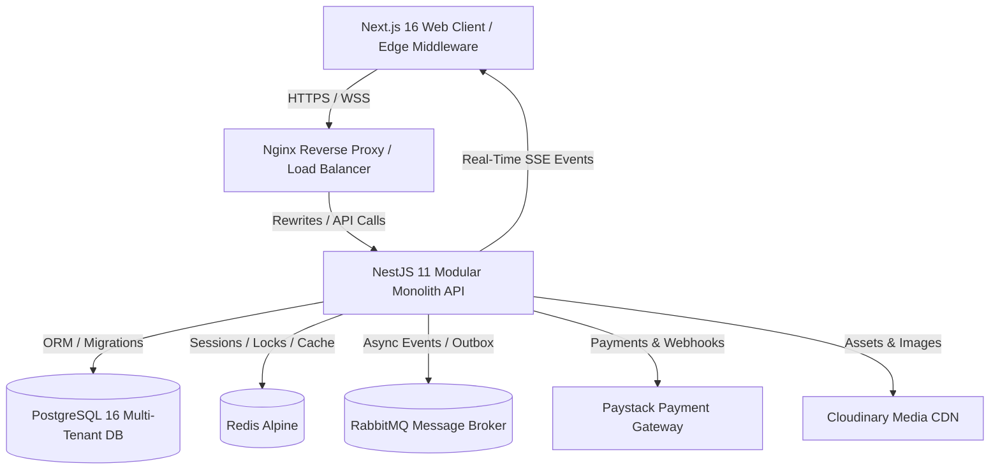
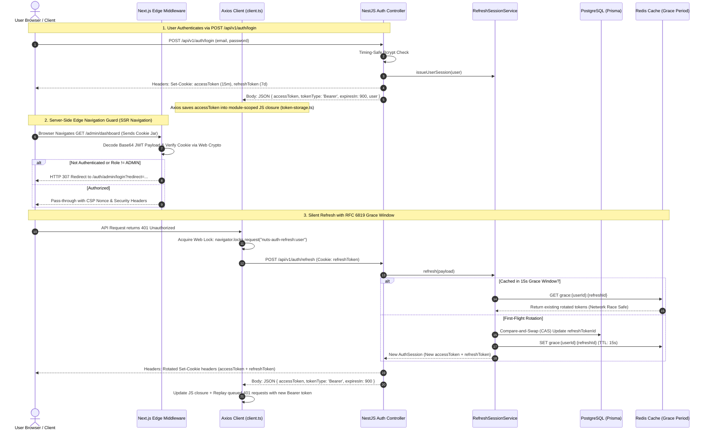
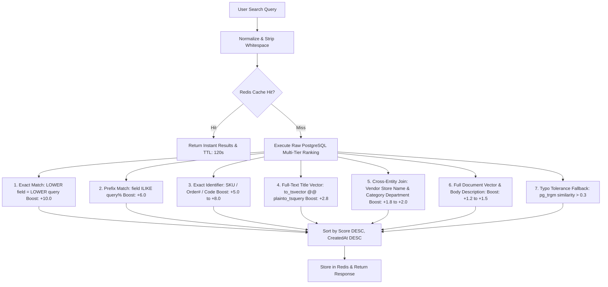
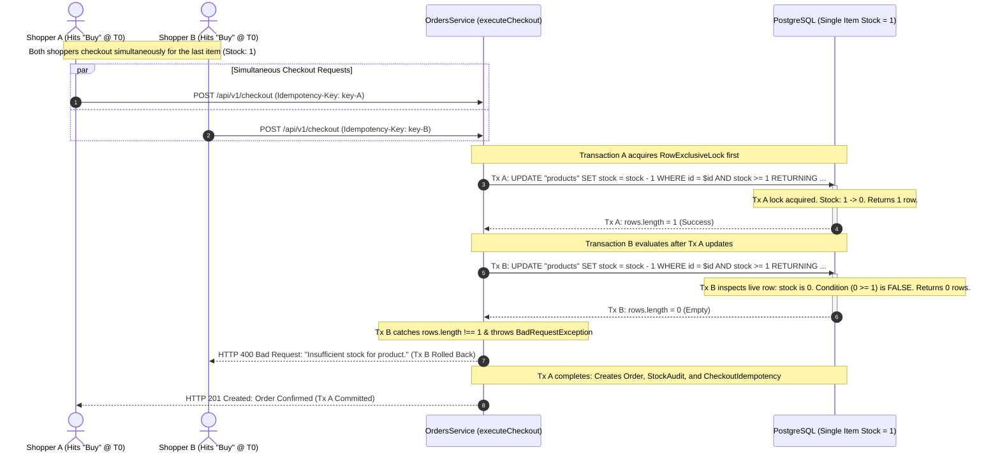
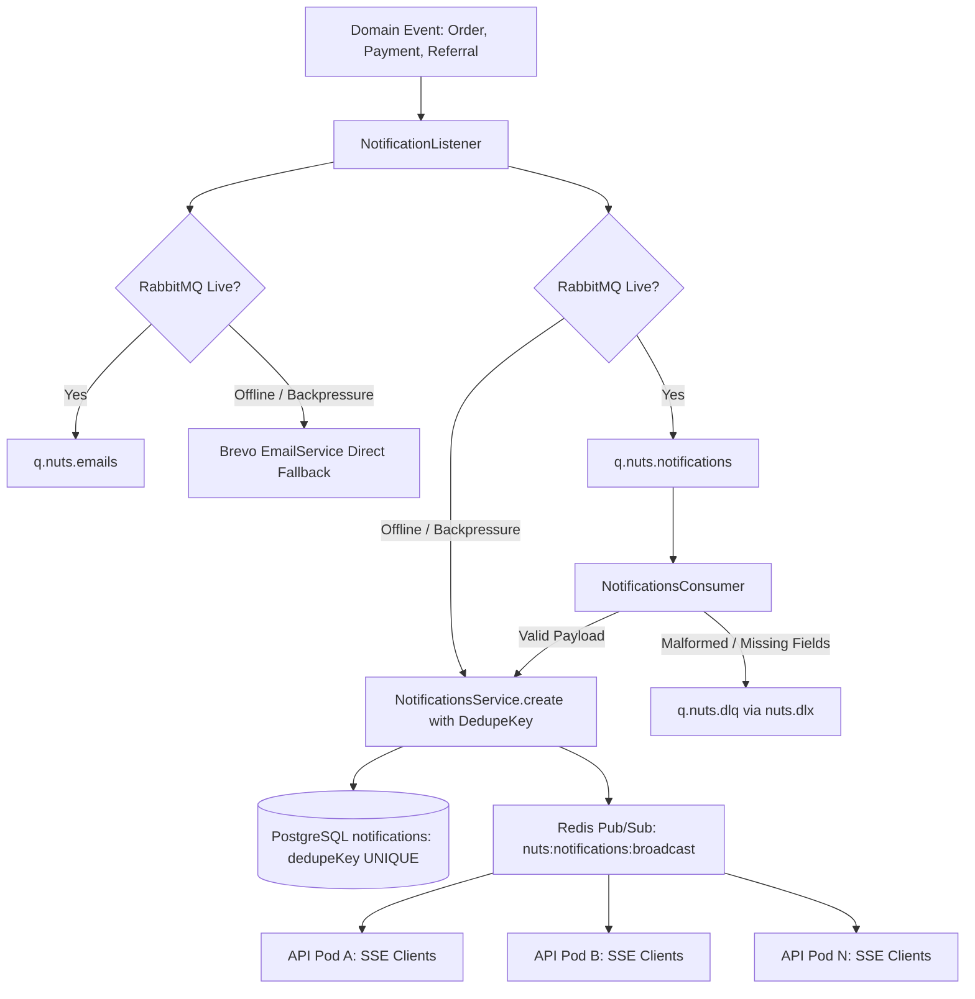
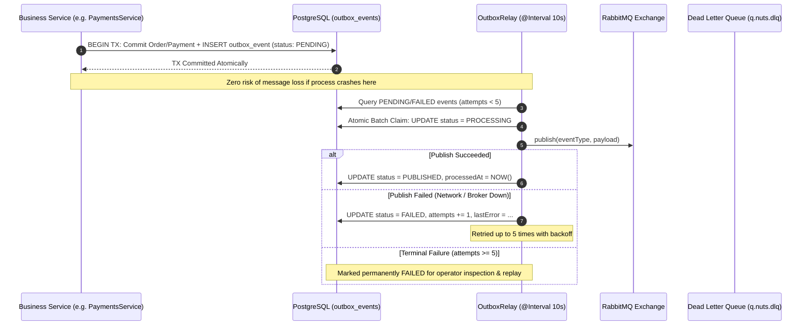
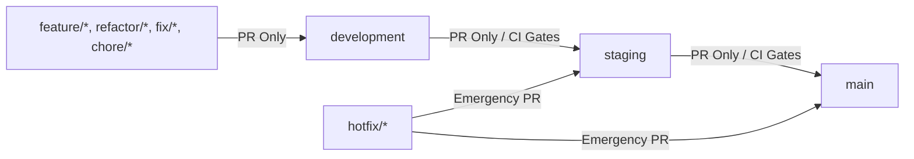

# NUTS Platform — Enterprise Multi-Vendor E-Commerce Platform

[](https://github.com/UGOCHUKWU1124/nuts-platform/actions/workflows/ci.yml)
[](https://www.typescriptlang.org/)
[](https://nestjs.com/)
[](https://nextjs.org/)
[](https://react.dev/)
[](https://www.prisma.io/)
[](https://www.postgresql.org/)
[](https://redis.io/)
[](https://www.rabbitmq.com/)
[](https://www.docker.com/)

> **NUTS Platform** is a production-grade, multi-vendor enterprise e-commerce system architected with NestJS 11, TypeScript 5.8, PostgreSQL 16, Prisma 7, Redis Alpine, RabbitMQ, and Docker containerization, adhering strictly to Domain-Driven Design (DDD) principles. It is engineered for high throughput, sub-millisecond edge routing, zero-downtime database migrations, resilient asynchronous messaging, and high-grade authentication and session security.

---

## Contents

1. [Summary & Architectural Philosophy](#1-executive-summary--architectural-philosophy)
   - [The Architect's Field Guide: 8 Core Concepts](#the-architects-field-guide-8-core-engineering-concepts-at-a-glance)
   - [Architectural Trade-offs](#architectural-trade-offs--deep-engineering-concepts)
2. [Monorepo Architecture & Bounded Contexts](#2-monorepo-architecture--bounded-contexts)
3. [The Authentication & Authorization Engine](#3-deep-dive-the-authentication--authorization-engine)
   - [Triple-Tier Identity Model](#triple-tier-identity-model)
   - [Dual-Channel Authentication & Bearer Token Architecture](#dual-channel-authentication--bearer-token-architecture)
   - [Dual-Token Lifecycle & RFC 6819 Single-Use Rotation](#dual-token-lifecycle--rfc-6819-single-use-rotation)
   - [The 15-Second Redis Grace-Period Concurrency Window](#the-15-second-redis-grace-period-concurrency-window)
   - [Cross-Subdomain & Cookie Isolation Architecture](#cross-subdomain--cookie-isolation-architecture)
   - [Client Single-Flight Refresh Lock (Web Locks API)](#client-single-flight-refresh-lock-web-locks-api)
   - [Next.js 16 Network Boundary Proxy & Server Component Layout Auth Boundaries](#nextjs-16-network-boundary-proxy--server-component-layout-auth-boundaries)
   - [Single-Source-of-Truth Projections & Password Defense](#single-source-of-truth-projections--password-defense)
   - [Redis Security Stamp & Active Revocation Engine](#redis-security-stamp--active-revocation-engine)
   - [Timing-Safe Cryptographic Defenses](#timing-safe-cryptographic-defenses)
   - [Account Lifecycle: Self-Deactivation, Administrative Suspension & Auto-Unsuspend Engine](#account-lifecycle-self-deactivation-administrative-suspension--auto-unsuspend-engine)
   - [Verification & Identity Lifecycle: Strict Numeric OTP & Referral Engine](#verification--identity-lifecycle-strict-numeric-otp--referral-engine)
   - [Multi-Step Identity Onboarding & Lifecycle Workflows](#multi-step-identity-onboarding--lifecycle-workflows)
4. [Domain Bounded Contexts](#4-domain-bounded-contexts)
   - [Catalog & Multi-Variant Inventory Matrix](#catalog--multi-variant-inventory-matrix)
     - [Hierarchical Category Traversal & Deep-Slug Routing](#hierarchical-category-traversal--deep-slug-routing-category-treets)
     - [Hierarchical Tree Picker](#hierarchical-tree-picker-categorypickertsx)
     - [Multi-Variant Inventory Matrix](#multi-variant-inventory-matrix-productvariantbuildertsx)
     - [Merchant Directory & Dedicated Vendor Storefronts](#merchant-directory--dedicated-vendor-storefronts-vendorspageviewtsx--vendorstoreviewtsx)
     - [Storefront Operator Surface & Back-Office Privilege Isolation](#storefront-operator-surface--back-office-privilege-isolation-storefrontoperatorbartsx)
     - [Management Operator Control Surface](#management-operator-control-surface-managementtoolbartsx)
     - [Enterprise Data Grid Surface](#enterprise-data-grid-surface-datatabletsx)
     - [Multi-Asset Drag-and-Drop Pipeline](#multi-asset-drag-and-drop-pipeline-imageuploadtsx)
   - [Enterprise Multi-Tier Relevance Search Engine](#enterprise-multi-tier-relevance-search-engine)
     - [Interactive Search Drawer & Real-Time Discovery](#interactive-search-drawer--real-time-discovery-searchdrawertsx)
   - [Checkout, Cart & Order Processing](#checkout-cart--order-processing)
     - [Concurrency & Edge-Case Engineering Guarantees](#concurrency--edge-case-engineering-guarantees)
   - [Promotions, Discount Codes & Campaign Governance](#promotions-discount-codes--campaign-governance-discount-codeservicets)
   - [Billing, Wallets & Financial Integrity](#billing-wallets--financial-integrity)
     - [Payment OTP Authorization & Dual Routing](#payment-otp-authorization--dual-routing-paymentscontrollerts)
     - [End-to-End Payment Lifecycle & Resilience Architecture](#end-to-end-payment-lifecycle--resilience-architecture)
     - [Automated Unpaid Order Expiration & Stock Restoration](#automated-unpaid-order-expiration--stock-restoration-unpaidorderscron)
   - [Real-Time Notification Pipeline (SSE & RabbitMQ)](#real-time-notification-pipeline-sse--rabbitmq)
   - [Transactional Outbox & Message Failure Handling](#transactional-outbox--message-failure-handling)
   - [Duplicate Email & Notification Prevention Architecture](#duplicate-email--notification-prevention-architecture)
     - [Idempotency Key vs. Deduplication Key](#architectural-deep-dive-idempotencykey-vs-dedupekey)
5. [Performance, Memory & Infrastructure Engineering](#5-performance-memory--infrastructure-engineering)
   - [512MB RAM Ceiling Optimization (Render / Cloud Containers)](#512mb-ram-ceiling-optimization-render--cloud-containers)
   - [Next.js Standalone Build & Tree-Shaking](#nextjs-standalone-build--tree-shaking)
   - [Response Interceptor Content-Negotiation & Stream Bypassing](#response-interceptor-content-negotiation--stream-bypassing)
   - [Database Connection Governance & Redis High-Availability Tuning](#database-connection-governance--redis-high-availability-tuning-prismaservice--redismodule)
   - [Cloudinary Global CDN & Edge Content Negotiation Pipeline](#cloudinary-global-cdn--edge-content-negotiation-pipeline)
   - [Variable Font & Critical Preload Optimization](#variable-font--critical-preload-optimization)
   - [Deep Dependency Readiness Probes (`/health/ready`)](#deep-dependency-readiness-probes-healthready)
6. [Security, OpenAPI & Network Hardening](#6-security-openapi--network-hardening)
   - [OpenAPI 3.0 / Swagger Specification & Developer Reference](#openapi-30--swagger-specification--developer-reference)
   - [Dynamic Content-Security-Policy (CSP) & Web Crypto Nonce](#dynamic-content-security-policy-csp--web-crypto-nonce)
   - [Double-Submit Cookie CSRF Defense](#double-submit-cookie-csrf-defense)
   - [Sliding-Window Rate Limiting & Account Lockout](#sliding-window-rate-limiting--account-lockout)
   - [Enterprise Exception Translation & Prisma Error Mapping](#enterprise-exception-translation--prisma-error-mapping-globalexceptionfilter)
   - [Security In-Depth: Attack Vector Defense Matrix](#security-in-depth-attack-vector-defense-matrix)
7. [Directory Structure](#7-directory-structure)
8. [Local Development & Docker Workflows](#8-local-development--docker-workflows)
   - [Comprehensive Environment Configuration Reference (.env)](#comprehensive-environment-configuration-reference-env)
   - [Docker Compose Multi-Profile Architecture](#docker-compose-multi-profile-architecture)
   - [Nginx Reverse Proxy & Load Balancer Architecture](#nginx-reverse-proxy--load-balancer-architecture)
9. [Automated Testing & Quality Gates](#9-automated-testing--quality-gates)

---

## 1. Executive Summary & Architectural Philosophy

NUTS Platform is engineered around three foundational architectural tenets:

1. **Clean Architecture & Domain Isolation:** The codebase is partitioned into distinct bounded contexts (Identity, Catalog, Checkout, Billing, Notifications, Analytics) with strict boundary ownership. No direct circular cross-context dependencies are permitted; asynchronous cross-boundary workflows communicate via typed Domain Events and the Transactional Outbox pattern.
2. **Zero Trust & Defense-in-Depth:** Security is implemented at every tier—from the Edge Router Middleware (before HTML renders) to API rate limiters, double-submit CSRF guards, timing-safe bcrypt comparisons, single-use refresh token rotation, and database-level unique constraints.
3. **Resilience Under Resource Constraints:** The system is engineered to run reliably on resource-constrained cloud containers (e.g. 512MB RAM starter nodes on Render or AWS t4g.nano) without memory leaks, GC thrashing, or connection starvation.



### The Architect's Field Guide: 8 Core Engineering Concepts at a Glance

If you are studying, reviewing, or presenting this codebase, these 8 concepts represent the architectural backbone of the entire platform:

| # | Architectural Domain | The Naive Industry Approach | The Failure Mode / Attack Vector | The NUTS Production Solution | Key Implementation Files |
| :--- | :--- | :--- | :--- | :--- | :--- |
| **1** | **Monolith vs. Microservices** | Premature microservices with HTTP REST between internal services. | Network serialization latency, 2PC distributed transaction failures, high memory footprint (>500MB). | **Modular Monolith (DDD)**: Typed in-process synchronous calls + Transactional Outbox (RabbitMQ) for async events. | [`apps/api/src/modules`](file:///c:/MY%20PROJECT/NUTS-P/apps/api/src/modules) |
| **2** | **Session & Token Storage** | Storing JWTs or user roles in `localStorage` or `sessionStorage`. | **XSS credential theft** via third-party npm scripts or DOM injection; cross-session privilege pollution. | **Dual-Transport Hybrid OWASP Model**: In-memory JS closure + browser-managed `HttpOnly` cookie; zero `localStorage` tokens/roles. | [`token-storage.ts`](file:///c:/MY%20PROJECT/NUTS-P/apps/web/src/api/core/token-storage.ts), [`auth.ts`](file:///c:/MY%20PROJECT/NUTS-P/apps/web/src/zustand/auth.ts) |
| **3** | **Refresh Token Concurrency** | Instant refresh token invalidation on every refresh request. | **Multi-tab logout storm**: Tab A rotates the token; Tab B sends the old token at the same millisecond and gets logged out. | **RFC 6819 with 15-Second Redis Grace Window**: Atomic CAS in PostgreSQL + 15s Redis cache for multi-tab network retries. | [`refresh-session.service.ts`](file:///c:/MY%20PROJECT/NUTS-P/apps/api/src/modules/auth/sessions/refresh-session.service.ts) |
| **4** | **Real-Time Token Revocation** | In-memory blacklist of revoked JWTs until expiration. | Unbounded $O(N)$ Redis memory leak; or querying the relational database on every single micro-request. | **Redis Security Stamp (`auth:stamp:{role}:{userId}`)**: $O(1)$ stamp check with 60s TTL; instant revocation via `tokenVersion` bump. | [`auth-session.service.ts`](file:///c:/MY%20PROJECT/NUTS-P/apps/api/src/modules/auth/sessions/auth-session.service.ts) |
| **5** | **Flash-Sale Inventory Depletion** | Optimistic locking (`UPDATE products SET stock = stock - 1 WHERE version = v`). | Thundering-herd rollback cascades and checkout deadlocks (`SQLSTATE 40P01`) under high flash-sale contention. | **Deterministic Row-Lock Sorting + Conditional Atomic SQL**: Sort item IDs before locking + `WHERE stock >= :qty RETURNING id`. | [`orders.service.ts`](file:///c:/MY%20PROJECT/NUTS-P/apps/api/src/modules/checkout/orders/orders.service.ts) |
| **6** | **Cart & Checkout Lifecycle** | Leaving cart items active until webhook confirms payment success. | **Double-order creation**: User clicks back from Paystack, modifies cart, and checks out again, reserving double inventory. | **Atomic Checkout Cart Consumption**: Cart items consumed inside checkout DB transaction; client cart cleared on gateway redirect. | [`orders.service.ts`](file:///c:/MY%20PROJECT/NUTS-P/apps/api/src/modules/checkout/orders/orders.service.ts), [`cart-cleanup.ts`](file:///c:/MY%20PROJECT/NUTS-P/apps/web/src/lib/cart-cleanup.ts) |
| **7** | **Real-Time Stream Resilience** | Unbounded SSE connections with local client caching. | File descriptor exhaustion, zombie streams on closed tabs, CORS preflight blocks on reconnection headers. | **SSE Registry + Connection Capping + Heartbeat Stamp Check + CORS `Last-Event-ID`**: Bounded to 5 streams/user; in-memory store. | [`notifications.controller.ts`](file:///c:/MY%20PROJECT/NUTS-P/apps/api/src/modules/notifications/notifications.controller.ts), [`notifications.ts`](file:///c:/MY%20PROJECT/NUTS-P/apps/web/src/zustand/notifications.ts) |
| **8** | **Financial Ledger Integrity** | Floating-point numbers (`number` / `FLOAT`) for monetary values. | IEEE 754 rounding errors ($0.1 + 0.2 \ne 0.3$) compounding across multi-vendor split-payments and wallet balances. | **Fixed-Point PostgreSQL `DECIMAL(10, 2)` + `Prisma.Decimal`**: Arbitrary-precision decimal arithmetic across wallets and taxes. | [`schema.prisma`](file:///c:/MY%20PROJECT/NUTS-P/packages/database/schema.prisma), [`orders.service.ts`](file:///c:/MY%20PROJECT/NUTS-P/apps/api/src/modules/checkout/orders/orders.service.ts) |

---

### Architectural Trade-offs & Deep Engineering Concepts

Building an enterprise-scale, multi-vendor commerce engine requires navigating critical engineering trade-offs. The following decisions reflect conscious design choices prioritizing data integrity, sub-millisecond execution, and security under resource constraints.

#### 1. Modular Monolith vs. Distributed Microservices
```
┌─────────────────────────────────────────────────────────────────────────────┐
│                       NUTS API: MODULAR MONOLITH                            │
│                                                                             │
│  ┌────────────────┐    ┌─────────────────┐    ┌──────────────────────────┐  │
│  │ Identity / IAM │    │ Catalog / Merch │    │   Checkout & Orders      │  │
│  └───────┬────────┘    └────────┬────────┘    └────────────┬─────────────┘  │
│          │                      │                          │                │
│          └──────────────┐       │       ┌──────────────────┘                │
│                         ▼       ▼       ▼                                   │
│                     ┌───────────────────────┐                               │
│                     │ Transactional Outbox  │                               │
│                     └───────────┬───────────┘                               │
└─────────────────────────────────┼───────────────────────────────────────────┘
                                  ▼
                        ┌───────────────────┐
                        │ RabbitMQ Exchange │
                        └─────────┬─────────┘
                                  ▼
                    ┌───────────────────────────┐
                    │ Async Workers & Consumers │
                    └───────────────────────────┘
```
- **The Trade-off:** Microservices introduce network hops (serialization/deserialization penalties), complex distributed transactions (2PC / Saga rollbacks), partial failure states, and high memory footprints (50–100MB per microservice runtime). On a 512MB RAM budget, running 6 independent services is physically impossible.
- **The Solution:** A Modular Monolith adhering to Domain-Driven Design (DDD). Each domain (IAM, Catalog, Cart, Checkout, Billing, Notifications) maintains strict module boundaries, encapsulated data models, and isolated service contracts.
- **Cross-Domain Communication:** Synchronous queries use typed NestJS service interfaces within the process boundary ($O(1)$ memory references, zero network overhead). Asynchronous mutations (e.g. Order Placed $\to$ Inventory Deduction $\to$ Vendor Notification $\to$ Customer Email) execute via the **Transactional Outbox Pattern** backed by PostgreSQL and RabbitMQ, guaranteeing **At-Least-Once Delivery** without distributed two-phase commits.

#### 2. Dual-Transport OWASP Ephemeral Session Architecture: In-Memory Access Tokens + HttpOnly SSR Cookies vs. LocalStorage
- **The Problem with LocalStorage:** Storing JWTs in browser `localStorage` or `sessionStorage` leaves credentials permanently exposed to **Cross-Site Scripting (XSS)**. Any third-party script, compromised npm package, or injected DOM element can execute `localStorage.getItem()` and immediately exfiltrate the user's active session.
- **The Problem with Cookie-Only SPAs:** Pure cookie-only authentication complicates non-browser clients (Swagger UI, curl, automated test suites, native mobile apps) and exposes mutating requests to Cross-Site Request Forgery (CSRF).
- **The Problem with Memory-Only SPAs in Next.js (SSR):** If access tokens are kept *only* in JavaScript memory, every initial page navigation (e.g. typing `nuts.com/admin` in the URL bar or pressing F5 reload) reaches the Next.js Node/Edge server before any React bundle or client-side JavaScript executes in the browser. At that millisecond, client memory is empty (0 bytes), no custom `Authorization: Bearer` header can be attached, and the server would falsely redirect the user to `/login` or require a slow, blocking server-to-server token exchange on every page render.
- **The NUTS Engineering Solution (Dual-Transport Hybrid Model):**
  1. *Simultaneous Delivery on Login & Refresh:* When `/api/v1/auth/login` or `/auth/refresh` succeeds, the backend responds with **both**:
     - A **JSON response body**: `{ accessToken: "eyJ...", tokenType: "Bearer", expiresIn: 900 }` (which client JavaScript consumes and stores strictly in private in-memory closures).
     - A **`Set-Cookie` header for `accessToken`**: `HttpOnly; Secure; SameSite=Lax; Max-Age=900` (15 minutes).
     - A **`Set-Cookie` header for `refreshToken`**: `HttpOnly; Secure; SameSite=Lax; Max-Age=604800` (7 days). The refresh token is **never** included in the JSON body, rendering long-lived session theft via XSS impossible.
  2. *Runtime Usage Separation:*
     - **Client-Side API Requests (Axios in React runtime):** Axios extracts the in-memory token from its private closure and attaches `Authorization: Bearer <token>`. This provides standard REST API interoperability and automatic CSRF immunity (browsers never attach custom HTTP headers to cross-site `<form>` submissions).
     - **Next.js 16 SSR & Edge Middleware Navigation:** When the user navigates directly to a URL or refreshes, the browser automatically sends the secure `accessToken` cookie. Next.js Edge Middleware and Server Component Layouts ([`server-auth.ts`](file:///c:/MY%20PROJECT/NUTS-P/apps/web/src/lib/server-auth.ts)) verify the HMAC-SHA256 signature in < 1ms using Web Crypto API, enforcing route protection on the server before streaming HTML to the client.
  3. *Zero-Persistence Client Security & Zero Storage Leakage:* In-memory tokens vanish when the browser tab closes. Synthetic session or role keys (`nuts_active_role`, `nuts_session_role`, `nuts_notifications_cache`, `nuts_applied_discount`, `nuts_cart_snapshot`) are completely prohibited from `localStorage` and `sessionStorage`. Identity, active roles, and authorization capabilities are derived strictly from cryptographically signed JWT payloads (`decodeRoleFromToken`, `getAuthSessionRole()`) and validated against Redis security stamps. If an XSS exploit occurs, the attacker cannot read the 7-day `refreshToken` (blocked by browser `HttpOnly` policy), and the short-lived 15-minute `accessToken` cannot be refreshed without access to the protected cookie.

#### 3. Pessimistic Row-Level Locking (`FOR UPDATE`) vs. Optimistic Locking
- **The Trade-off:** Optimistic locking (using a `version` column) assumes low contention. Under high-concurrency flash sales (hundreds of shoppers purchasing the last 5 units of a product simultaneously), optimistic locking causes thundering-herd rollback cascades, wasting CPU cycles and failing user checkouts.
- **The Solution:** **Pessimistic Row-Level Locking (`SELECT ... FOR UPDATE`)**:
  - During checkout, `OrdersService` acquires row locks on all open user candidate carts.
  - Multi-cart evaluation filters open carts to select the active cart containing line items (`cartItems.length > 0`), pruning duplicate empty carts in the same atomic transaction.
  - In inventory management, stock is deducted via conditional atomic SQL: `UPDATE products SET stock = stock - :qty WHERE stock >= :qty RETURNING id`. If rows affected is 0, the transaction immediately rolls back with an `InsufficientStockException`, eliminating both overselling and retry churn.

#### 4. 15-Second Redis Grace-Period Window (RFC 6819) vs. Instant Invalidation
- **The Trade-off:** RFC 6819 mandates single-use refresh token rotation to prevent replay attacks. However, in real-world web applications, modern browsers fire parallel API requests across multiple tabs on load. If Tab A refreshes the token and immediately revokes the old token, Tab B's concurrent refresh request will present the old token, falsely trigger reuse detection, and catastrophically log the user out across all tabs.
- **The Solution:** **Atomic Compare-And-Swap (CAS) with 15-Second Redis Grace Cache**:
  - The first refresh request rotates the token in PostgreSQL and writes the fresh token pair to Redis under `auth:grace:{refreshId}` with a strict 15-second TTL.
  - If concurrent requests with the same `refreshId` arrive within 15 seconds (due to multi-tab loading or network packet retries), the API serves the cached fresh token pair instead of rejecting the request.
  - If a refresh request with an already-rotated token arrives *after* the 15-second window, the security engine treats it as a compromised token replay attack and immediately revokes the entire device session.

#### 5. Redis Security Stamp Revocation vs. JWT Blacklists
- **The Trade-off:** Stateless JWTs cannot be revoked before expiration without tracking state. Naive JWT blacklisting stores every revoked token until its expiry, creating an unbounded $O(N)$ memory leak in Redis.
- **The Solution:** **Security Stamp Model (`auth:stamp:{role}:{userId}`)**:
  - When an account changes password, logs out globally, or is suspended by an administrator, the API updates `tokenVersion` in PostgreSQL and updates the Redis security stamp in $O(1)$ time.
  - On incoming requests, `JwtAuthGuard` compares the token's embedded `tokenVersion` claim against the cached Redis stamp in sub-millisecond time. If mismatched, the request is immediately rejected (`401 Unauthorized`), achieving instantaneous cluster-wide revocation with near-zero memory footprint.

---

## 2. Monorepo Architecture & Bounded Contexts

The repository is structured as a high-performance **npm workspaces** monorepo orchestrated by **Turborepo**:

```
NUTS-P/
├── apps/
│   ├── api/          # NestJS 11 Enterprise REST API & Event Engine
│   └── web/          # Next.js 16 App Router (Storefront + Vendor + Admin)
├── packages/
│   ├── config/       # Shared TypeScript, ESLint, and PostCSS configurations
│   ├── database/     # Canonical Prisma 7 schema and migration scripts
│   └── types/        # Shared cross-boundary DTO and domain contracts
├── nginx/            # Production Nginx reverse-proxy and TLS configuration
└── docker-compose.yml# Multi-profile container orchestration (dev,staging & prod)
```

---

## 3. Deep Dive: The Authentication & Authorization Engine

The authentication engine is built to financial-grade specifications, balancing user convenience (seamless token refresh without re-login) with uncompromising security (immediate token family revocation upon replay attack detection).



### Triple-Tier Identity Model
Authentication is segregated across three distinct operational actors:
1. **`ROLE.USER` (Customers):** Shoppers on the storefront. Can browse catalog, manage carts, execute checkout, track shipments, manage wishlists, and self-manage accounts.
2. **`ROLE.VENDOR` (Merchants):** Store owners on the merchant portal (`/vendor/*`). Must be approved (`isApproved = true`) and active (`isActive = true`). Granted capabilities to manage products, variants, pricing, discount codes, inventory, and order fulfilment.
3. **`ROLE.ADMIN` (Platform Operators):** Internal platform administrators (`/admin/*`). Oversee vendor approvals, customer account moderation, cache invalidation, financial metrics, and platform-wide analytics.

### Dual-Channel Authentication & Bearer Token Architecture
NUTS Platform operates a **Defense-in-Depth Hybrid Authentication Model**, marrying browser CSRF immunity with standard REST API bearer interoperability and Next.js 16 Server-Side Rendering (SSR):

```
                         ┌────────────────────────────────────────┐
                         │              HTTP Request              │
                         └───────────────────┬────────────────────┘
                                             │
                                             ▼
                      ┌──────────────────────────────────────────────┐
                      │ extractAccessToken(req) in JwtStrategy       │
                      │ apps/api/src/modules/auth/strategies/access/ │
                      │ jwt.strategy.ts                              │
                      └──────────────────────┬───────────────────────┘
                                             │
            ┌────────────────────────────────┼────────────────────────────────┐
            │                                │                                │
  Priority 1: Bearer Token         Priority 2: HttpOnly Cookie      Priority 3: Query Param
            ▼                                ▼                                ▼
┌─────────────────────────────┐  ┌───────────────────────────────┐  ┌─────────────────────────────┐
│ Authorization: Bearer <jwt> │  │ HttpOnly Cookie: accessToken  │  │ ?token= / ?accessToken=     │
│ (Browser Axios / Mobile/API)│  │ (Next.js SSR / Edge Fallback) │  │ (EventSource SSE / Sockets) │
└─────────────────────────────┘  └───────────────────────────────┘  └─────────────────────────────┘
```

#### Demystifying the Apparent Paradox: In-Memory Closure vs. HttpOnly Cookie
A common architectural question arises when examining modern secure web applications:
> *"If the access token is set as an `HttpOnly` cookie, how can it simultaneously be held in a JavaScript memory closure? If it is `HttpOnly`, JavaScript cannot read it. And if JavaScript already holds it in memory, why do we need the cookie at all? Is this how production-grade systems are supposed to work?"*

**The Answer:**
Yes. This is the **Dual-Transport Hybrid Pattern**, the industry standard for production systems pairing **Next.js Server-Side Rendering (SSR) & Edge Middleware** with a decoupled **RESTful API Backend**.

JavaScript **never** reads or interacts with the `HttpOnly` cookie. Browser engines (Chromium, WebKit, Gecko) strictly block JavaScript (`document.cookie`) from accessing any cookie flagged with `HttpOnly`. 

Instead, the backend **simultaneously dual-emits** authentication credentials across two completely separate transport channels during login and token refresh:
1. **Channel A — Transport Headers (`Set-Cookie`):** The backend issues an `accessToken` cookie and a `refreshToken` cookie. The browser's native C++ network engine receives these headers and writes them directly into the browser's protected cookie jar.
2. **Channel B — Response Body (`JSON Payload`):** The backend simultaneously returns the `accessToken`, token type (`Bearer`), and expiration time in the JSON body. The client-side React/Axios runtime parses this JSON response and stores the string in an in-memory variable closure ([`token-storage.ts`](file:///c:/MY%20PROJECT/NUTS-P/apps/web/src/api/core/token-storage.ts)).

> [!IMPORTANT]
> **The Critical Asymmetry:** The 7-day `refreshToken` is **STRICTLY EXCLUDED** from the JSON body. It exists **only** in the `HttpOnly` cookie jar. This guarantees that even if an attacker achieves arbitrary JavaScript execution (XSS), they can **never** steal or persist the long-lived refresh session.

#### The Exact HTTP Wire Protocol
To understand the exact mechanics, examine the raw HTTP wire trace emitted by `/api/v1/auth/login` or `/api/v1/auth/refresh`:

```http
HTTP/1.1 200 OK
Content-Type: application/json; charset=utf-8
Set-Cookie: accessToken=eyJhbGciOi...; Path=/; HttpOnly; Secure; SameSite=Lax; Max-Age=900
Set-Cookie: refreshToken=eyJhbGciOi...; Path=/api/v1/auth; HttpOnly; Secure; SameSite=Lax; Max-Age=604800

{
  "status": "success",
  "data": {
    "accessToken": "eyJhbGciOi...",
    "tokenType": "Bearer",
    "expiresIn": 900,
    "user": {
      "id": "usr_01J...",
      "email": "customer@nuts.com",
      "role": "USER"
    }
  }
}
```

```
Backend Response ────┬──> [HTTP Headers: Set-Cookie] ─────────> Browser Cookie Jar (Protected)
                     │                                            │
                     │                                            ├──> Sent automatically on SSR Page Loads / F5 Reloads
                     │                                            └──> JavaScript CANNOT read (document.cookie blocked)
                     │
                     └───> [HTTP Body: JSON Payload] ───────────> React Runtime / Axios Interceptor
                                                                  │
                                                                  ├──> Saved to in-memory closure: accessTokens[role]
                                                                  └──> Attached as Authorization: Bearer <jwt> on REST calls
```

#### Why Both Channels Are Essential in Production
Why not choose *only* cookies or *only* memory? Evaluating the constraints reveals why a single-channel approach inevitably fails in modern full-stack architectures:

##### 1. Why In-Memory Bearer is Required for Client-Side API Calls
- **Native CSRF Immunity:** Modern web browsers **never** automatically attach custom HTTP headers (such as `Authorization: Bearer <token>`) to cross-site requests. If an attacker tricks a user into visiting an evil website that embeds `<form action="https://api.nuts.com/cart/checkout" method="POST">`, the browser will send ambient cookies, but will **never** attach the `Authorization` header. Because our API enforces `Authorization: Bearer` as Priority 1, mutating requests made via standard API clients are naturally immune to CSRF exploits without requiring cumbersome anti-CSRF token handshakes on every single endpoint.
- **Universal API Interoperability:** Third-party consumers, mobile applications (iOS/Android), Swagger UI interactive documentation, Postman, curl, and automated CI/CD integration tests do not maintain browser cookie jars. They rely on standard RFC 6750 HTTP Bearer authentication.
- **Zero LocalStorage Persistence:** The access token is stored strictly in JavaScript module memory (`token-storage.ts`). It is never persisted to `localStorage` or `sessionStorage`, eliminating permanent token theft vectors via DOM injection or malicious browser extensions.

##### 2. Why the HttpOnly Cookie is Required for Next.js 16 SSR & Edge Middleware
- **The "Initial Navigation / 0-Byte Memory" Problem:** When a customer types `nuts.com/admin/dashboard` directly into their browser address bar, or presses F5 hard reload, the HTTP GET request hits the Next.js server **before any React bundle or client-side JavaScript has downloaded, parsed, or executed in the browser**.
  - At that millisecond, client JavaScript memory is completely empty (**0 bytes**).
  - Axios does not exist in memory yet.
  - The browser cannot run code to attach an `Authorization: Bearer` header.
  - **The ONLY credential the browser transmits on initial document navigation is its native HTTP Cookie Jar.**
- **Instant Server-Side Authorization (< 1ms):** Because the backend set the `accessToken` cookie (`HttpOnly; Secure; SameSite=Lax`), Next.js Edge Middleware and Server Component Layouts ([`server-auth.ts`](file:///c:/MY%20PROJECT/NUTS-P/apps/web/src/lib/server-auth.ts)) read `cookieStore.get('accessToken')`, verify the HMAC-SHA256 signature using the Web Crypto API, and resolve user roles on the server in sub-millisecond time.
- **Zero FOUC (Flash of Unauthenticated Content):** The server renders authenticated, role-specific HTML directly. Without the cookie, Next.js would either falsely redirect the user to `/auth/login`, or halt rendering to make an expensive, blocking server-to-server token refresh call on every single page load.

#### Comprehensive Architecture Comparison Matrix

| Architectural Dimension | 1. LocalStorage Only | 2. Pure In-Memory Only | 3. Pure Cookie Only | 4. NUTS Dual-Transport Hybrid |
| :--- | :--- | :--- | :--- | :--- |
| **XSS Defense (Long-lived Session)** | ❌ **Fatal:** Full session stolen via `localStorage.getItem()` | ⚠️ **Good:** Token dies on tab close, but refresh still manual | ✅ **Maximum:** `refreshToken` protected by browser `HttpOnly` | ✅ **Maximum:** `refreshToken` is strictly HttpOnly cookie; never exposed to JS |
| **Next.js 16 SSR & Edge Middleware** | ❌ **Broken:** Server cannot read `localStorage` on initial document request | ❌ **Broken:** JS memory is 0 bytes on F5 reload; causes FOUC / false redirects | ✅ **Supported:** Next.js reads cookies on server render | ✅ **Optimal:** Next.js verifies `accessToken` cookie in < 1ms before HTML streams |
| **CSRF Resistance on API Mutations** | ✅ Immune (uses Bearer header) | ✅ Immune (uses Bearer header) | ❌ **Vulnerable:** Requires CSRF token tokens on every `POST`/`PUT`/`DELETE` | ✅ **Immune:** Axios sends Bearer header; Priority 1 takes precedence |
| **Swagger UI / Mobile App Support** | ✅ Standard Bearer | ✅ Standard Bearer | ❌ Difficult / Cookie jar friction | ✅ **Seamless:** Full RFC 6750 Bearer support across all non-browser clients |
| **Session Lifetime Control** | ❌ Indefinite until manual clear | ⚠️ Lost on tab reload | ⚠️ Tied to cookie expiry | ✅ **Strict 15m access / 7d refresh with RFC 6819 single-use rotation** |

#### Three Verification Channels in NestJS `JwtStrategy`
The NestJS backend evaluates incoming credentials in [`apps/api/src/modules/auth/strategies/access/jwt.strategy.ts`](file:///c:/MY%20PROJECT/NUTS-P/apps/api/src/modules/auth/strategies/access/jwt.strategy.ts) via three explicit priority channels:

```typescript
function extractAccessToken(req: Request): string | null {
  if (!req) return null;

  // 1. Authorization: Bearer <token> header (Standard API contract / Axios / Mobile / Swagger)
  const authHeader = ExtractJwt.fromAuthHeaderAsBearerToken()(req);
  if (authHeader) return authHeader;

  // 2. Standard HttpOnly accessToken cookie (Next.js SSR document loads / Edge fallback)
  const cookieToken =
    jwtFromCookie(AUTH_ACCESS_COOKIE)(req) ??
    jwtFromCookie('access_token')(req);
  if (cookieToken) return cookieToken;

  // 3. Query parameter (Standard for EventSource SSE where custom headers are unsupported)
  const query = req.query;
  if (typeof query === 'object' && query !== null) {
    if (typeof query.token === 'string') return query.token;
    if (typeof query.accessToken === 'string') return query.accessToken;
  }

  return null;
}
```

##### Why Priority Order is Critical:
Checking `Authorization: Bearer` **first** guarantees that explicit credentials always override ambient cookies:
- In **Swagger UI** or Postman, if an engineer pastes an administrative Bearer token to test privileged endpoints, the API will immediately honor that Bearer token—even if the developer's browser happens to have an older customer cookie stored.
- In **React SPA runtime**, Axios attaches the Bearer token, ensuring every mutation is validated through the CSRF-immune header channel.
- For **SSR document requests**, because the browser sends no Bearer header, the backend cleanly and securely falls back to Priority 2 (`accessToken` cookie).

### Token Types & Authentication Lifecycle
The NUTS platform uses five explicit token and credential types:
1. **Protocol Token Type (`tokenType`):** Always `'Bearer'`, representing the standard HTTP authorization scheme (`Authorization: Bearer <accessToken>`).
2. **Access Token (`accessToken` — Short-Lived JWT, 15 minutes):**
   - Carries identity claims: `sub` (user ID), `email`, `role`, `tokenVersion`, `sessionId`.
   - Transported via `Authorization: Bearer <accessToken>` header for stateless requests and via the `accessToken` HttpOnly cookie for SSR/browser navigation.
   - Stored strictly in-memory on the client and never in local storage.
3. **Refresh Token (`refreshToken` — Long-Lived JWT, 7 days):**
   - Carries session metadata: `sub`, `role`, `refreshId`, `sessionId`.
   - Transported **strictly via `HttpOnly`, `SameSite=Lax`, `Secure` cookie** (`refreshToken`).
   - Never exposed in JSON responses to eliminate XSS exfiltration risks.
   - **Single-Use Rotation:** Every time `/api/v1/auth/refresh` is called, the provided `refreshId` is retired, and a new cryptographically random 32-byte hexadecimal `refreshId` is issued. The database uses a compare-and-swap (CAS) atomic query:
     ```sql
     UPDATE "UserAuthSession"
     SET "refreshTokenId" = $newRefreshId, "refreshToken" = $newHash
     WHERE "id" = $sessionId AND "refreshTokenId" = $oldRefreshId;
     ```
4. **One-Time Passcode (`otp` — Ephemeral Verification Code, 10 minutes):**
   - Cryptographically random 6-digit verification code stored in Redis with 10-minute TTL.
   - Dispatched via email for registration ownership proof, payment authorization, and password resets.
5. **Session Identifier (`sessionId` / `refreshTokenId` — UUID Session Tracker):**
   - Cryptographic UUID tracking each unique device session in PostgreSQL/Redis.
   - Enables single-device logout (`POST /api/v1/auth/logout`) and global multi-device revocation (`POST /api/v1/auth/logout-all`).

### The 15-Second Redis Grace-Period Concurrency Window
A major pitfall of standard refresh token rotation in production is **network concurrency races**. If a browser page triggers 5 parallel API calls (e.g., cart, profile, notifications, categories, wishlist) when the 15-minute access token expires, all 5 requests return 401 simultaneously.
- Without a grace window: The first request rotates the token. The remaining 4 requests arrive with the old token. The server sees an already-rotated token, treats it as a **malicious replay attack**, and revokes the user's entire session family, forcing an unwanted sign-out.
- **The NUTS Solution:** In [`RefreshSessionService`](file:///c:/MY%20PROJECT/NUTS-P/apps/api/src/modules/auth/sessions/refresh-session.service.ts), whenever a refresh succeeds, the newly issued session is cached in Redis under `grace:{userId}:{oldRefreshId}` with a 15-second TTL (RFC 6819 standard). Any concurrent request arriving within this 15-second window receives the valid rotated session instead of triggering revocation.
- **True Breach Detection:** If a token is presented *after* the 15-second grace window has elapsed, `RefreshSessionService` logs a security alert and immediately triggers `revokeSession()`, wiping all active sessions for that account.

### Cross-Subdomain & Cookie Isolation Architecture
Cookies are issued via [`AuthCookieService`](file:///c:/MY%20PROJECT/NUTS-P/apps/api/src/modules/auth/cookies/auth-cookie.service.ts):
- **`accessToken`:** `HttpOnly: true`, `SameSite: Lax`, `Secure: true`, `Path: /`, `Max-Age: 15m`. Primary signed bearer token.
- **`refreshToken`:** `HttpOnly: true`, `SameSite: Lax`, `Secure: true`, `Path: /`, `Max-Age: 7d`. Rotating cryptographic secret bound to a device session.
- **`csrf_token`:** `HttpOnly: false`, `SameSite: Lax`, `Secure: true`, `Path: /`, `Max-Age: 7d`. Standard double-submit validation token.

#### Client State & Cookie Hygiene
- **In-Memory Client State:** Authentication and user profile states are held exclusively in-memory in Zustand, eliminating split-state divergence between local storage and HTTP cookies.
- **HttpOnly Cookie Delivery & Secure Token Envelopes:** The backend issues `accessToken` and `refreshToken` as HttpOnly secure cookies. The login and refresh JSON response bodies strictly return the access token, token type (`Bearer`), and dynamic expiration lifetime (`expiresIn`), while excluding the refresh token to prevent XSS exfiltration per OWASP standards.
- **Contextual Portal Role Resolution:** When hydrating client state on initial page load, the frontend determines the target portal context directly from the route structure (`/admin/*` resolves to `admin`, `/vendor/*` resolves to `vendor`, and storefront routes resolve to `user`). This context is verified against the backend's `/refresh` endpoint, which cryptographically checks the `refreshToken` cookie.
- **Global Multi-Device Session Invalidation:** `POST /api/v1/auth/logout-all` revokes all active device sessions for the authenticated account, invalidates security stamps, and clears cookies.

#### Backend Refresh Session Model (`UserAuthSession`)
The backend maintains transactional refresh sessions in PostgreSQL and Redis to enforce:
1. **Instant Session Revocation:** Pure stateless JWTs cannot be revoked until their lifespan elapses. Server-side session records enable immediate revocation on password change, account suspension, or session termination.
2. **Multi-Device Session Management:** Enables users and administrators to view active login sessions across devices and revoke individual sessions remotely.
3. **Token Reuse Detection (RFC 6819):** When a refresh token is used, its database hash is rotated. If an intercepted or outdated token is submitted, the server detects replay, revokes the entire session family, and triggers security alerts.

### Client Single-Flight Refresh Lock (Web Locks API)
In [`apps/web/src/api/core/client.ts`](file:///c:/MY%20PROJECT/NUTS-P/apps/web/src/api/core/client.ts):
- Concurrent refresh attempts across multiple browser tabs are synchronized using the browser's native **Web Locks API**:
  ```ts
  navigator.locks.request(`nuts-auth-refresh:${role}`, { mode: "exclusive" }, runRefresh);
  ```
- If Tab A initiates a refresh, Tab B awaits the lock rather than firing a redundant HTTP request. When Tab A finishes, Tab B reads the freshly persisted token.
- All failed 401 Axios requests are held in an in-memory execution queue, re-attached with the new Bearer token, and transparently replayed.

### Next.js 16 Network Boundary Proxy & Server Component Layout Auth Boundaries
Located in [`apps/web/src/proxy.ts`](file:///c:/MY%20PROJECT/NUTS-P/apps/web/src/proxy.ts) and [`apps/web/src/lib/server-auth.ts`](file:///c:/MY%20PROJECT/NUTS-P/apps/web/src/lib/server-auth.ts):
- **Next.js 16 Network Boundary Proxy (`proxy.ts`):**
  - **Zero Hardcoded Route Lists:** Eliminates fragile, brittle hardcoded route string arrays in edge routing. The network proxy does not maintain arbitrary sets of route paths or subpaths.
  - **Perimeter Defense & Dynamic CSP Nonces:** Operates strictly at the network boundary, generating 16-byte cryptographically secure CSP nonces (`crypto.getRandomValues`), enforcing strict Content-Security-Policy (CSP), HSTS, `X-Frame-Options: DENY`, `X-Content-Type-Options: nosniff`, and `Permissions-Policy`.
  - **Spoofed Header Stripping:** Unconditionally strips client-supplied identity headers (`x-user-id`, `x-user-role`, `x-authenticated`) before downstream request routing.
  - **Nonce Propagation:** Injects `x-nonce` into internal request headers, allowing React Server Components to access nonces via `headers().get('x-nonce')` for Paystack and dynamic inline scripts.
- **Server Component Layout Auth Boundaries (Filesystem as Source of Truth):**
  - **Decentralized Route Group Isolation:** Rather than centralized, brittle URL pattern matching, route protection is enforced at the layout boundary of each route group:
    - **Platform Admin:** [`apps/web/src/app/(admin)/admin/layout.tsx`](file:///c:/MY%20PROJECT/NUTS-P/apps/web/src/app/(admin)/admin/layout.tsx) validates active admin sessions via `enforceAuth('admin', '/auth/admin/login')`. Any new page added under `(admin)/admin` is automatically protected.
    - **Vendor Merchant Portal:** [`apps/web/src/app/(vendor)/vendor/layout.tsx`](file:///c:/MY%20PROJECT/NUTS-P/apps/web/src/app/(vendor)/vendor/layout.tsx) validates active merchant sessions via `enforceAuth('vendor', '/auth/vendor/login')`.
    - **Customer Protected Areas:** [`apps/web/src/components/domain/auth/ProtectedLayout.tsx`](file:///c:/MY%20PROJECT/NUTS-P/apps/web/src/components/domain/auth/ProtectedLayout.tsx) automatically gates `/account`, `/checkout`, `/order`, `/wallet`, and `/review`.
  - **Cryptographic Token Verification (`edge-jwt`):**
    - The server authentication helper ([`server-auth.ts`](file:///c:/MY%20PROJECT/NUTS-P/apps/web/src/lib/server-auth.ts)) reads HTTP-only cookies securely via `cookies()` and verifies HMAC-SHA256 signatures with Web Crypto API (`crypto.subtle`).
    - **Silent Refresh Grace Window:** If an access token expires while a genuine `refreshToken` cookie is present, layouts allow the page shell to mount so client-side Axios refresh interceptors (coordinated via Web Locks API) can rotate tokens silently in the background.
  - **Safe Internal Path Sanitization:** Destination redirects are sanitized via [`safeInternalPath`](file:///c:/MY%20PROJECT/NUTS-P/apps/web/src/lib/safe-internal-path.ts), rejecting open redirect vectors.

### Single-Source-of-Truth Projections & Password Defense
- **Compile-Time Safe Selects (`auth.selects.ts`):** To eliminate the risk of accidental password projection into client responses or cache dumps, all user, vendor, and admin authentication queries route through central Prisma select definitions:
  - `authAccountSelect`: Projects strictly `{ id, email, firstName, lastName, role, isActive, isApproved, tokenVersion }`.
  - Sensitive password hashes (`password`) and internal secrets are queried only inside dedicated authentication routines using explicit select blocks, guaranteeing that public payloads and JWT tokens can never leak credentials.
- **Unified Identity Resolution:** Identity lookup across Customer, Merchant, and Operator portals is consolidated into `AuthService.findAccountForLogin()` with strict role verification.

### Redis Security Stamp & Active Revocation Engine
- In high-throughput architectures, verifying session validity against a relational database on every HTTP request creates severe database bottlenecking.
- [`AuthSessionService`](file:///c:/MY%20PROJECT/NUTS-P/apps/api/src/modules/auth/sessions/auth-session.service.ts) implements an ultra-fast **Redis Security Stamp cache** (`auth:stamp:{role}:{userId}`) with a 60-second TTL:
  - High-frequency API calls verify token validity, account active status, vendor approval, and `tokenVersion` in sub-millisecond memory lookups.
  - State-altering security events (password changes, admin account locks, session revocations, logouts) execute immediate Redis stamp deletion (`invalidateAccountStamp`), enforcing real-time revocation across the entire cluster without waiting for JWT expiration.

### Timing-Safe Cryptographic Defenses
- **Password Verification:** Uses `bcrypt` with cost factor 12.
- **User-Enumeration Prevention:** In [`AuthService.login`](file:///c:/MY%20PROJECT/NUTS-P/apps/api/src/modules/auth/auth.service.ts), if an email does not exist in the database, `bcrypt.compare()` is still executed against a dummy hash (`UNKNOWN_ACCOUNT_PASSWORD_HASH`). This ensures that login requests take identical processing time regardless of whether the email is registered or not, thwarting timing-based username enumeration.
- **Automatic Hash Upgrades:** If a user logs in with an older bcrypt cost factor, the hash is upgraded asynchronously on the fly.

### Account Lifecycle: Self-Deactivation, Administrative Suspension & Auto-Unsuspend Engine
The platform enforces a strict separation between consumer self-service lifecycle actions and privileged back-office security interventions:

1. **Consumer Self-Service Deactivation & 1-Click Reactivation:**
   - Shoppers can self-deactivate their account (`PATCH /account/deactivate`), initiating a **60-day recovery grace period** before scheduled permanent purge.
   - When valid credentials are provided for a self-deactivated account, the authentication engine returns an `ACCOUNT_DEACTIVATED` code.
   - The login UI captures this state and presents an interactive **Reactivate Account** dialog, allowing the consumer to restore their profile with 1 click without administrative intervention.
   - Deactivation invalidates all active sessions in Redis and clears HTTP authentication cookies at the controller boundary.

2. **Privileged Administrative Suspension Engine (`AdminUsersController` & `AdminSuspendDto`):**
   - Platform administrators suspend user accounts (`PATCH /admin/users/:id/suspend`) protected by mandatory 2FA security key verification.
   - **On-Demand Admin OTP:** The OTP generation workflow binds to the executing admin in the `admins` table, preventing identity collisions with the consumer `users` table.
   - **Configurable Durations & Expiry Encoding:** Admins configure suspension durations via preset intervals (`24h`, `3d`, `7d`, `14d`, `30d`), custom timestamps, or `indefinite`. The calculated ISO expiration is encoded into the audit log and state machine (`[SUSPENDED_UNTIL:...]`).
   - **Active Session Termination:** Suspension immediately invalidates the user's Redis Security Stamp (`invalidateAccountStamp`), revokes active JWT sessions, and blocks API access across all devices in real time.

3. **Login-Time Expiry & Auto-Unsuspend Engine (`AuthService.login`):**
   - When a suspended user attempts to log in with valid credentials:
     - If the temporary suspension duration has **elapsed**, the system automatically reactivates the account (`isActive = true`), removes the suspension reason, publishes an audit event (`USER_AUTO_UNSUSPEND_EXPIRED`), and authenticates the user seamlessly.
     - If the suspension is **active** (or indefinite), the login pipeline blocks authentication and returns a structured `ACCOUNT_SUSPENDED` payload containing the human-readable remaining time, exact expiration timestamp, and administrative reason.
   - **Contextual Login Warning Banner:** [`login/page.tsx`](file:///c:/MY%20PROJECT/NUTS-P/apps/web/src/app/(auth)/auth/login/page.tsx) renders an alert banner detailing the suspension reason, countdown timer, and direct support contact links.

4. **Production-Grade Account Deletion (`DELETE /admin/users/:id`):**
   - High-security administrative operation protected by 2FA OTP prompt.
   - Executes enterprise soft-deletion under the hood to preserve referential integrity across historic orders, payment ledger transactions, shipments, and audit trails.
   - Strips credentials, invalidates all sessions, and locks the account permanently.
   - Strictly labeled in the back-office UI as **"Delete User Account"** (eliminating internal technical jargon like "soft delete").

### Verification & Identity Lifecycle: Strict Numeric OTP & Referral Engine
- **Unified 6-Box Segmented OTP Component ([`SegmentedOtpInput.tsx`](file:///c:/MY%20PROJECT/NUTS-P/apps/web/src/components/ui/SegmentedOtpInput.tsx)):**
  - Standardized across all verification surfaces (Customer Registration, Merchant Onboarding, Password Recovery, Account Deactivation, and Back-Office Admin Actions).
  - Features 6 discrete visual cells with animated pulsing focus carets, full keyboard navigation (Backspace auto-rewind, Arrow keys, automatic forward advancing), clipboard paste auto-splitting, and native mobile virtual numeric keyboard overlay.
- **Context-Aware Domain Email Copywriting ([`EmailService.ts`](file:///c:/MY%20PROJECT/NUTS-P/apps/api/src/modules/infrastructure/mail/email.service.ts)):**
  - Completely eliminates generic or misaligned email headers. OTP emails automatically tailor subject lines, eyebrow badges, titles, and body descriptions to the explicit security purpose (`account-deactivation`, `admin:action`, `password-reset`, `vendor:password-reset`, `vendor:registration`, `payment`, `registration`).
- **Two-Phase Confirmation & Cooldown Account Deactivation ([`account/setting/page.tsx`](file:///c:/MY%20PROJECT/NUTS-P/apps/web/src/app/(storefront)/account/setting/page.tsx)):**
  - Replaces premature OTP dispatches with an explicit **Deactivate Account** trigger opening a warning confirmation dialog detailing the 60-day recovery grace period.
  - Upon user confirmation, dispatches an `account-deactivation` OTP, immediately transitions to the segmented OTP verification dialog, and initiates an automatic 60-second resend countdown timer.
- **Strict 6-Digit Numeric OTP Validation (`VerifyOtpDto` & `OtpService`):**
  - Enforces strict regex-validated, 6-digit numeric payloads (`/^\d{6}$/`) cryptographically hashed with server-side pepper and stored with Redis TTLs.
  - Rate-limited generation and verification windows backed by Redis atomic multi-exec defend against code brute-forcing.
- **Email Verification State Alignment (`isEmailVerified`):**
  - Stored directly on the database `User` entity (`isEmailVerified Boolean @default(false)` with index `users_isEmailVerified_idx`), enforcing a strict zero-trust default of `false` for all new incoming accounts.
  - Automatically backfilled to `true` for all existing registered accounts via dedicated migration `20261019200000_add_user_is_email_verified` (since prior registrations strictly passed OTP verification), before switching future column defaults to `false`.
  - Explicitly set `isEmailVerified: true` upon user registration in `auth.service.ts` only after cryptographic OTP confirmation succeeds.
  - Exposed across all profile and user query DTOs (`UserResponseDto`, `UserProfileDto`, `UserListItemResponseDto`, `AdminUserResponseDto`) with both `isEmailVerified` and legacy alias `isVerified` for zero-breakage backwards compatibility.
- **International E.164 Phone Number Standards:**
  - Globally enforced international E.164 standard (`/^\+[1-9]\d{6,14}$/`) across all backend API DTOs (`RegisterDto`, `ShippingAddressDto`, `UpdateUserDto`, `CreateVendorDto`, `UpdateVendorDto`) and client-side Zod validation schemas (`register`, `account/setting`, `checkout`, `ShoppingDrawer`, `vendor/setting`).
  - Rejects ambiguous local-only phone numbers and provides user-friendly guidance (e.g. `Phone number must include international country code (e.g. +2349064786655)`).
- **Pre-Registration Referral Verification (`referralService`):**
  - Client-side registration forms perform live pre-checks against `/api/v1/account/referral/validate`.
  - Normalizes codes to uppercase, validates referrer account presence, and rejects self-referral attempts before account creation.

### Multi-Step Identity Onboarding & Lifecycle Workflows
Located across [`apps/web/src/app/(auth)`](file:///c:/MY%20PROJECT/NUTS-P/apps/web/src/app/(auth)) and [`apps/api/src/modules/identity/users`](file:///c:/MY%20PROJECT/NUTS-P/apps/api/src/modules/identity/users):

1. **Consumer 3-Step Registration Wizard ([`RegisterPage`](file:///c:/MY%20PROJECT/NUTS-P/apps/web/src/app/(auth)/auth/register/page.tsx)):**
   - **Step 1 — Profile & Referral Validation:** Collects personal information, enforces 12+ character enterprise password complexity (`/^(?=.*[a-z])(?=.*[A-Z])(?=.*\d)(?=.*[@$!%*?&#]).*$/`), and triggers real-time pre-registration referral code validation.
   - **Step 2 — Numeric OTP Verification:** Dispatches a 6-digit numeric verification code to the prospective customer's email. Enforces an active countdown timer to prevent resend spamming and verifies the OTP before committing account creation.
   - **Step 3 — Shipping Address Configuration:** Captures the customer's primary delivery address (`fullName`, `phone`, `street`, `city`, `state`, `country`) immediately upon verification, establishing initial logistics readiness before the shopper enters the catalog.

2. **Merchant Self-Service Onboarding ([`VendorRegisterPage`](file:///c:/MY%20PROJECT/NUTS-P/apps/web/src/app/(auth)/auth/vendor/register/page.tsx)):**
   - Streamlined registration for prospective store owners requiring business name, merchant email, and strong password.
   - Dispatches a 6-digit merchant verification OTP directly to the vendor's email address with resend cooldown timers and form error synchronization.

3. **Two-Stage Password Recovery ([`ForgotPasswordPage`](file:///c:/MY%20PROJECT/NUTS-P/apps/web/src/app/(auth)/auth/forgot-password/page.tsx)):**
   - **Stage 1 (Code Request):** Accepts user email, enforces rate limits, and triggers an OTP email dispatch.
   - **Stage 2 (Verification & Password Reset):** Combines OTP verification with a compliant 12+ character replacement password. On successful reset, the backend invalidates all active user sessions and refresh tokens, terminating stale browser sessions across all devices.

4. **Sensitive Account Operations & Dual Routing ([`UsersController`](file:///c:/MY%20PROJECT/NUTS-P/apps/api/src/modules/identity/users/users.controller.ts) & [`AdminUsersController`](file:///c:/MY%20PROJECT/NUTS-P/apps/api/src/modules/identity/admin/manage-user/admin-user.controller.ts)):**
   - **Dual Routing Compatibility:** Accessible via `@Controller(['account', 'users'])`, supporting both singular account operations and plural REST user endpoints.
   - **Self-Service Deactivation vs. Administrative Suspension:** Consumers independently deactivate their own accounts (`PATCH /account/deactivate`), whereas administrators suspend, unsuspend, or delete user accounts (`PATCH /admin/users/:id/suspend`, `PATCH /admin/users/:id/unsuspend`, `DELETE /admin/users/:id`).
   - **Administrative Suspension Lifecycle & Configurable Durations:** When administrators suspend an account, they can specify preset durations (24h, 3d, 7d, 14d, 30d), custom expiration timestamps, or indefinite suspension alongside a mandatory justification reason.
   - **Login-Time Expiry & Auto-Unsuspend:** Upon customer login, if a temporary suspension's duration has elapsed, the system automatically restores full account access (`isActive = true`), clears suspension stamps, logs an audit trail event (`USER_AUTO_UNSUSPEND_EXPIRED`), and authenticates seamlessly. If still within the active suspension window, login throws a structured `ACCOUNT_SUSPENDED` response detailing the exact justification reason and expiration timestamp.
   - **Administrative Account Deletion:** Invoking `DELETE /admin/users/:id` executes a production-grade soft-delete under the hood—preserving foreign keys to historic orders, financial transactions, and audit trails while stripping credentials, revoking active JWT sessions, flushing Redis cache, and locking the account permanently. Labeled in the back-office UI purely as **"Delete User Account"**.
   - **HTTP Boundary Cookie Clearance:** Account deactivation and account deletion immediately execute `authCookies.clearAuthCookies(res)` at the controller HTTP boundary, ensuring browser cookies are cleared when an account is disabled.
   - **Public Grace Period Reactivation (`POST /account/reactivate`):** A public recovery endpoint enables users whose accounts are deactivated within the 60-day window to restore access and resume platform operations.

---

## 4. Domain Bounded Contexts

### Catalog & Multi-Variant Inventory Matrix

#### Hierarchical Category Traversal & Deep-Slug Routing (`category-tree.ts`)
- **Self-Referential Taxonomy:** Backed by PostgreSQL recursive relations (`parentId` / `children`) with slug and path normalization.
- **Arbitrary-Depth Slug Traversal:** The client path traversal engine (`resolveCategoryPath`) dynamically resolves nested URLs of arbitrary depth (e.g. `/category/apparel/footwear/running-shoes`), constructing contextual breadcrumbs and distinguishing category path segments from trailing product identifiers.
- **Interactive Multi-Level Menus:** Hierarchical category browsing is powered by [`CategoryNavMenu.tsx`](file:///c:/MY%20PROJECT/NUTS-P/apps/web/src/components/domain/category/CategoryNavMenu.tsx) and [`HierarchicalCategoryView.tsx`](file:///c:/MY%20PROJECT/NUTS-P/apps/web/src/components/domain/category/HierarchicalCategoryView.tsx), enabling shoppers to navigate nested subcategories and filter catalog queries dynamically.

#### Hierarchical Tree Picker (`CategoryPicker.tsx`)
- **Administrative & Merchant Selector:** Provides an interactive tree explorer for product catalog creation in admin and vendor portals.
- **Deep Path Search & Leaf Validation:** Offers instant debounced path search across ancestor chains, collapsible parent trees, and leaf-node selection enforcement, ensuring products are classified into precise department leaves.

#### Multi-Variant Inventory Matrix (`ProductVariantBuilder.tsx`)
- **Decoupled Architecture:** Products decouple parent marketing metadata (`name`, `description`, `brand`) from sellable stock-keeping units (`ProductVariant`).
- **Dynamic Attribute Configuration:** Administrators and vendors configure multidimensional attribute matrices (Size, Color, Material, Weight) with dedicated SKU, stock quantity, and compare-at pricing.
- **Per-Variant Asset Galleries:** Supports dedicated Cloudinary media uploads bound to specific variant options.
- **Live Client Synchronization:** [`ProductDetailView.tsx`](file:///c:/MY%20PROJECT/NUTS-P/apps/web/src/components/domain/product/ProductDetailView.tsx) dynamically recalculates availability, pricing, stock warnings, and gallery selections in real time as customers toggle variant pills.

#### Merchant Directory & Dedicated Vendor Storefronts (`VendorsPageView.tsx` & `VendorStoreView.tsx`)
Located in [`apps/web/src/components/domain/vendor`](file:///c:/MY%20PROJECT/NUTS-P/apps/web/src/components/domain/vendor):
- **Global Merchant Directory ([`VendorsPageView.tsx`](file:///c:/MY%20PROJECT/NUTS-P/apps/web/src/components/domain/vendor/VendorsPageView.tsx)):** Serves the public marketplace merchant directory at `/vendors`. Includes real-time vendor search, store verification badging, aggregated product counts, and customer rating summaries.
- **Dedicated Public Storefront ([`VendorStoreView.tsx`](file:///c:/MY%20PROJECT/NUTS-P/apps/web/src/components/domain/vendor/VendorStoreView.tsx)):** Delivers branded merchant storefronts at `/store/[slug]` with server-side hydration (`initialStore`, `initialProducts`, `initialCategories`). Features:
  - **Brand Header & Initials Fallback:** Displays merchant store logo or computes uppercase double-initial avatars (`getStoreInitials`) with a verified seller badge (`CheckCircle2`).
  - **In-Store Search & Faceted Filtering:** Instant client-side search filtering within the seller's catalog, minimum/maximum price boundaries, and stock availability toggles.
  - **Horizontal Category Tab Scroll:** Dynamically segments merchant products into top-level taxonomy groups with smooth horizontal scrolling tabs.

#### Storefront Operator Surface & Back-Office Privilege Isolation (`StorefrontOperatorBar.tsx`)
Located in [`apps/web/src/components/layout/StorefrontOperatorBar.tsx`](file:///c:/MY%20PROJECT/NUTS-P/apps/web/src/components/layout/StorefrontOperatorBar.tsx):
- **Role-Aware Floating Operator Surface:** Whenever an authenticated Administrator or Merchant navigates the public storefront, the system automatically injects a persistent operator bar at the top of [`CustomerLayout.tsx`](file:///c:/MY%20PROJECT/NUTS-P/apps/web/src/components/layout/CustomerLayout.tsx).
- **Strict Cart & Checkout Privilege Isolation:** Administrative and Merchant accounts are strictly isolated from customer purchasing workflows. Carts, quantity steppers, and checkout buttons are disabled for operator accounts to prevent cross-account ledger contamination and artificial order creation.
- **Contextual Role Badging & Quick Back-Office Jumps:**
  - **Admin Mode (`canAdminister`):** Renders an **Administrator Preview** badge with direct one-click navigation back to **Admin Console** (`/admin`), **Catalog** (`/admin/product`), **Users** (`/admin/user`), **Orders** (`/admin/order`), and **Settings** (`/admin/setting`).
  - **Merchant Mode (`canSell`):** Renders a **Merchant Mode** badge with store name indicator and one-click jumps back to **Vendor Dashboard** (`/vendor`), **My Products** (`/vendor/product`), **Orders** (`/vendor/order`), and **Store Settings** (`/vendor/setting`).
- **Storefront Merchant Oversight ([`VendorStoreView.tsx`](file:///c:/MY%20PROJECT/NUTS-P/apps/web/src/components/domain/vendor/VendorStoreView.tsx)):**
  - When a merchant visits their own public store URL (`/vendor/[handle]` or `/store/[slug]`), a contextual banner is displayed: *"You are viewing your public storefront. Storefront purchasing is disabled for your merchant account."* with direct actions: **Manage Products**, **Store Branding & Settings**, and **Return to Dashboard**.
  - When an Administrator inspects any vendor's storefront, an administrative inspection banner is rendered with shortcuts to **Admin Vendors**, **Audit Store Products**, and **Admin Console**.
- **Product Detail Operator Inspection ([`ProductDetailView.tsx`](file:///c:/MY%20PROJECT/NUTS-P/apps/web/src/components/domain/product/ProductDetailView.tsx)):**
  - In product detail views, the consumer quantity stepper and "Add to Cart" button are replaced for operators with a clean, informative alert card indicating **Vendor Catalog Preview** or **Administrator Preview**, along with deep links to manage inventory directly in the respective back-office console.
- **Back-Office to Storefront Route Hardening ([`Navbar.tsx`](file:///c:/MY%20PROJECT/NUTS-P/apps/web/src/components/navbar/Navbar.tsx)):**
  - Corrects back-office route mappings (`/vendor/wallet` and `/vendor/setting`) and adds a prominent **"View Public Store"** action in the merchant profile menu for instant storefront preview.

#### Management Operator Control Surface (`ManagementToolbar.tsx`)
Located in [`apps/web/src/components/common/ManagementToolbar.tsx`](file:///c:/MY%20PROJECT/NUTS-P/apps/web/src/components/common/ManagementToolbar.tsx):
- **Unified Back-Office Command Surface:** Powers data grid operations across administrative and merchant management portals (`/admin/product`, `/admin/category`, `/admin/order`, `/admin/vendor`, `/admin/user`, `/admin/discount`, `/vendor/product`, `/vendor/order`, `/vendor/discount`).
- **Debounced Search Bar:** Full-width input with leading search icon and single-click clear button (`X`).
- **Dual Dynamic Select Filters:** Configurable primary filter (e.g. publication/stock status) and secondary filter (e.g. category classification) with responsive collapsing on mobile viewports.
- **Active Filter Awareness & Instant Reset:** Automatically evaluates active filter criteria (`hasActiveFilters = Boolean(value || filterValue || secondaryFilterValue)`) and renders an active filter clear trigger.
- **Asynchronous Sync Indicator:** Displays a spinning refresh state (`RefreshCw`) during background query refetches and data mutations, maintaining user feedback during optimistic updates.
- **Extensible Action Slots:** Accepts contextual action buttons (such as batch creation modals or CSV exports) directly in the right-aligned action region.

#### Enterprise Data Grid Surface (`DataTable.tsx`)
Located in [`apps/web/src/components/data/DataTable.tsx`](file:///c:/MY%20PROJECT/NUTS-P/apps/web/src/components/data/DataTable.tsx):
- **Universal Back-Office Table Engine:** Powers tabular data presentation across all administrative and merchant operational surfaces (`/admin/product`, `/admin/category`, `/admin/order`, `/admin/vendor`, `/admin/user`, `/admin/discount`, `/vendor/product`, `/vendor/order`, `/vendor/discount`).
- **Generic Type-Safe Column Definitions (`Column<T>`):** Supports fully strongly typed column configuration with customizable cell rendering (`render: (row: T, index: number) => ReactNode`), header styling, and responsive hide/show column classes.
- **Dual-Model Pagination Adapter (`DataTablePagination`):** Supports both cursor-based navigation (`nextCursor`, `prevCursor`) and page/limit offset pagination (`page`, `limit`, `total`, `totalPages`, `onPageChange`), maintaining UI state across large dataset fetches.
- **Skeleton Pulse Loading States:** Displays 6-row animated pulse placeholders during asynchronous queries and background refetches, preventing layout shifts.
- **Empty States & Custom Feedback:** Renders custom empty illustrations and configurable copy (`emptyMessage`, `emptyIcon`) when search filters or criteria yield zero matching records.
- **Row-Level Event Dispatching:** Optional row click handling (`onRowClick`) enabling instant modal inspection (such as order detail previews or user audits).

#### Defensive State Confirmations & Administrative Popups (`ConfirmDialog.tsx`)
Located in [`apps/web/src/components/modal/ConfirmDialog.tsx`](file:///c:/MY%20PROJECT/NUTS-P/apps/web/src/components/modal/ConfirmDialog.tsx):
All state-altering, financial, lifecycle, and destructive actions across both the **Admin Management Portal** and **Vendor Portal** are strictly intercepted by accessible modal confirmation dialogs before dispatching network mutations:
- **Merchant Management (`/admin/vendor`):** Explicit confirmation dialogs for **Approve Store**, **Verify KYC Documentation**, **Suspend Storefront**, **Reactivate Store**, and **Permanent Account Deletion**.
- **User Management (`/admin/user`):** High-security operations intercepted by [`OtpPromptDialog.tsx`](file:///c:/MY%20PROJECT/NUTS-P/apps/web/src/components/modal/OtpPromptDialog.tsx) enforcing 2FA security key verification with on-demand **Get OTP** dispatch for **Suspend User Account** (with administrative justification), **Unsuspend User Account**, and **Delete User Account**.
- **Catalog Management (`/admin/product` & `/vendor/product`):** Guarded toggles for **Deactivating Product Listings**, **Reactivating Product Listings**, and **Permanent Catalog Item Deletion**.
- **Order Fulfillment Pipeline (`/admin/order` & `/vendor/order`):** Status advancement transitions (`PENDING` → `PROCESSING` → `SHIPPED` → `DELIVERED` → `CANCELLED`) triggered either from the data table or from within the [`OrderDetailsModal`](file:///c:/MY%20PROJECT/NUTS-P/apps/web/src/components/domain/order/OrderDetailsModal.tsx) are intercepted with explicit order confirmation dialogs summarizing the transition and buyer tracking implications.
- **Taxonomy Management (`/admin/category`):** Intercepted actions for **Purging Distributed Redis Category Cache**, **Restoring Archived Taxonomy Branches**, and **Deactivating/Activating Categories** across both Tree and Table views.
- **Promotions Management (`/admin/discount` & `/vendor/discount`):** Explicit dialogs for **Deactivating Promo Coupons**, **Reactivating Archived Coupons**, and **Deleting Unused Discount Codes**.

#### Deep Relational Search & Hierarchy Filter Engines
1. **Relational Search Scope Across Admin & Vendor Services:**
   - **Orders Service ([`orders.service.ts`](file:///c:/MY%20PROJECT/NUTS-P/apps/api/src/modules/checkout/orders/orders.service.ts)):** Admin and vendor order queries search across order numbers (`orderNumber`), customer emails, customer first/last names, delivery shipping addresses, discount codes, Paystack transaction references (`payment.transactionReference`), and ordered product titles (`orderItems.some.product.name`).
   - **Products Service ([`products.service.ts`](file:///c:/MY%20PROJECT/NUTS-P/apps/api/src/modules/catalog/products/products.service.ts)):** Product catalog queries match product names, SKUs, slugs, body descriptions, related vendor store details (`vendor.storeName`, `vendor.email`), and assigned category names (`category.name`).
   - **Vendors Service ([`admin-vendors.service.ts`](file:///c:/MY%20PROJECT/NUTS-P/apps/api/src/modules/identity/admin/manage-vendors/admin-vendors.service.ts)):** Vendor directory search evaluates store names, store slugs, store descriptions, personal first/last names, account emails, business emails, business phone numbers, and contact phones.
   - **Users Service ([`users.service.ts`](file:///c:/MY%20PROJECT/NUTS-P/apps/api/src/modules/identity/users/users.service.ts)):** Customer queries match first names, last names, emails, and phone numbers.
2. **Recursive Taxonomy Tree Search & Dynamic Branch Expansion ([`admin/category/page.tsx`](file:///c:/MY%20PROJECT/NUTS-P/apps/web/src/app/(admin)/admin/category/page.tsx)):**
   - Implements a recursive pruning and auto-expansion search engine (`filteredTree`).
   - When an operator searches a category keyword or selects status filters, non-matching branches are cleanly pruned while all matching nodes and their ancestor branches are dynamically kept and automatically expanded in the visual Tree View.

#### Multi-Asset Drag-and-Drop Pipeline (`ImageUpload.tsx`)
Located in [`apps/web/src/components/form/ImageUpload.tsx`](file:///c:/MY%20PROJECT/NUTS-P/apps/web/src/components/form/ImageUpload.tsx):
- **Role-Aware Media Pipeline:** Interacts with dedicated endpoint APIs (`adminApi` vs. `vendorApi`) based on the authenticated operator context.
- **Multi-File Drag-and-Drop Queue:** Accepts multiple files simultaneously up to the platform maximum (default 6 images). Renders a local thumbnail queue using `URL.createObjectURL()` with per-file pre-upload cancellation before transferring network bytes.
- **Strict Client-Side Validation:** Enforces a 5MB per-asset limit (`MAX_SIZE_BYTES = 5 * 1024 * 1024`) and whitelist MIME-type validation (`image/jpeg`, `image/png`, `image/webp`, `image/svg+xml`).
- **Primary Cover Star Designation:** Enables merchants to designate the primary catalog display image (`isPrimary`) via interactive star toggles.
- **Cloudinary Batch Upload:** Dispatches queued assets via `POST /images/upload-multiple` multipart form payloads, synchronizing the resulting image URL array with React Hook Form state.

### Enterprise Multi-Tier Relevance Search Engine
Located in [`apps/api/src/modules/shared/search/search.service.ts`](file:///c:/MY%20PROJECT/NUTS-P/apps/api/src/modules/shared/search/search.service.ts):
The search engine is built on an enterprise 12-tier relevance ranking model, addressing standard e-commerce search pitfalls (rigid word order, isolated product fields, and flat scoring):



#### Multi-Tier Scoring & Ranking Hierarchy

| Priority | Match Condition | Score Boost | Purpose / Behavior |
| :--- | :--- | :--- | :--- |
| **1** | `LOWER(name) = LOWER(query)` | **+10.0 + similarity** | **Exact Title Hit:** Exact product/store/category name; placed at the very top. |
| **2** | `LOWER(sku / code / orderNumber) = LOWER(query)` | **+8.0 to +10.0** | **Exact Identifier Hit:** Targeted SKU, promo code, or order lookup. |
| **3** | `name ILIKE 'query%'` | **+6.0 + similarity** | **Prefix Title Hit:** Instant typing autocomplete suggestion. |
| **4** | `sku / code ILIKE 'query%'` | **+4.0 to +5.0** | **Prefix Identifier Hit:** Inventory code prefix match. |
| **5** | `name ILIKE '%query%'` | **+3.0 + similarity** | **Substring Hit:** Query exists verbatim inside title. |
| **6** | `to_tsvector('simple', name) @@ plainto_tsquery('simple', query)` | **+2.8 + similarity** | **Full-Text Title Match:** Matches multi-word terms in *any* order. |
| **7** | `sku ILIKE '%query%'` | **+2.5 + similarity** | **Substring Identifier Hit:** Substring SKU hit. |
| **8** | `v."storeName" ILIKE '%query%'` | **+2.0 + similarity** | **Brand Association:** Products discoverable by vendor/seller name. |
| **9** | `c.name ILIKE '%query%'` | **+1.8 + similarity** | **Department Association:** Products discoverable by category name. |
| **10** | `to_tsvector(name || description || vendor || category) @@ query` | **+1.5 + similarity** | **Full-Text Document Discovery:** Broad multi-term matching across entire entity. |
| **11** | `COALESCE(description, '') ILIKE '%query%'` | **+1.2 + similarity** | **Body Text Match:** Keywords found in product body copy. |
| **12** | `similarity(name, query) > 0.3` | **Base similarity** | **Typo Tolerance:** PostgreSQL `pg_trgm` fuzzy matching (e.g., "iphne" -> "iPhone"). |

- **Multi-Word Query Resilience:** By combining `to_tsvector` and `plainto_tsquery`, searches like `"black leather boots"` match products titled `"Boots - Genuine Leather (Black)"` without requiring exact word adjacency.
- **Cross-Index Coverage:** The search engine dispatches queries across 6 separate business domains: `products`, `vendors`, `categories`, `users`, `orders`, and `discount_codes`.
- **Graceful Redis Caching:** Search hits and autocomplete responses are cached in Redis with a 120-second TTL. If Redis is unavailable, the service logs a warning and falls through directly to the database without throwing a user-facing error.
- **Search Engine Operational Health Status (`GET /api/v1/admin/search/status`):**
  - Exposed via [`AdminSearchController`](file:///c:/MY%20PROJECT/NUTS-P/apps/api/src/modules/search/admin-search.controller.ts) under `@Roles(ROLE.ADMIN)`.
  - Evaluates live search indexing readiness, PostgreSQL database connection, full-text capability, and Redis search query cache health, returning structured operational diagnostics (`{ success: true, data: { status: 'HEALTHY', database: 'CONNECTED', redisCache: 'CONNECTED', indices: ['products', 'vendors', 'categories', 'users', 'orders', 'discounts'] } }`).

#### Interactive Search Drawer & Real-Time Discovery (`SearchDrawer.tsx`)
- **Portal-Rendered Overlay:** Mounts into a dedicated top-level DOM node via React Portals, delivering a fast, responsive search modal accessible across all desktop and mobile layouts.
- **Debounced Entity-Segmented Autocomplete:** Uses [`useDebouncedValue`](file:///c:/MY%20PROJECT/NUTS-P/apps/web/src/hooks/use-debounced-value.ts) to query the backend multi-tier ranking engine. Returns partitioned result cards grouped across 4 core entities:
  - **Products:** Displays thumbnail, live currency-formatted pricing, and category breadcrumbs.
  - **Categories:** Direct links to deep catalog taxonomy paths.
  - **Vendor Stores:** Merchant profile chips with store logos and direct storefront links.
  - **Discount Tags:** Active promotion tags and coupons ready for application.
- **Exploratory Taxonomy Chips:** Pre-renders primary department chips for zero-query exploratory browsing.
- **Keyboard Navigation:** Full ARIA compliance with arrow-key result cycling, Escape key cancellation, and Enter key selection.

### Checkout, Cart & Order Processing
The checkout pipeline is architected to guarantee absolute consistency, zero overselling, and deadlock freedom under high-concurrency traffic:



#### Concurrency & Edge-Case Engineering Guarantees

```
┌───────────────────────────────────────────────────────────────────────────────────────┐
│                           CONCURRENCY CONTROLS MATRIX                                 │
├──────────────────────────────┬─────────────────────────────┬──────────────────────────┤
│ Scenarios & Edge Cases       │ Primary Failure Mode        │ Architectural Mitigation │
├──────────────────────────────┼─────────────────────────────┼──────────────────────────┤
│ Token Refresh Stampede       │ Session revoked in multi-tab│ 15s Redis Grace Window   │
│ Flash-Sale Inventory Deplete │ Overselling / Deadlock 40P01│ Lexicographical Lock Sort│
│ Multi-Tab Checkout Collision │ Duplicate Order Creation    │ Row-Level FOR UPDATE     │
│ Webhook vs. Client Redirect  │ Orphaned PENDING Order      │ Signed Webhook Settlement│
│ Unpaid Order Stock Hold      │ Abandoned Inventory Lock    │ Redis-Locked Cron Sweeper│
│ SSE Stream Leak              │ Server File Descriptor Drain│ Heartbeat Stamp Pings    │
└──────────────────────────────┴─────────────────────────────┴──────────────────────────┘
```

1. **The "Last Item" (Stock = 1) Overselling Prevention:**
   - **The Problem:** In standard naive e-commerce systems (`findProduct() -> check stock > 0 -> updateProduct()`), two shoppers querying at the same millisecond both read `stock = 1`, both succeed, and inventory drops to `-1` (overselling).
   - **The NUTS Implementation:** Stock deductions in [`OrdersService.executeCheckout`](file:///c:/MY%20PROJECT/NUTS-P/apps/api/src/modules/checkout/orders/orders.service.ts) execute as an atomic conditional SQL operation with a `RETURNING` clause:
     ```sql
     UPDATE "products"
     SET "stock" = "stock" - :quantity, "updatedAt" = NOW()
     WHERE "id" = :productId
       AND "isActive" = true
       AND "isDeleted" = false
       AND "stock" >= :quantity
     RETURNING "id", ("stock" + :quantity) AS "oldStock", "stock" AS "newStock";
     ```
   - **Execution Flow:** PostgreSQL enforces an exclusive row-level lock (`RowExclusiveLock`). The first transaction to acquire the lock decrements the stock from `1` to `0` and receives `rows.length === 1`. The second transaction evaluates the row *after* the update, finds `stock = 0`, fails the `stock >= 1` predicate, and returns `rows.length === 0`.
   - **Rollback:** When `rows.length !== 1`, `OrdersService` immediately throws `BadRequestException("Insufficient stock...")`, causing PostgreSQL to execute an **atomic transaction rollback**. No order row is generated, no payment is initialized, and inventory never drops below zero.

2. **Deterministic Row Lock Sorting (PostgreSQL Deadlock Prevention — `SQLSTATE 40P01`):**
   - **The Problem:** If Shopper A's cart contains `[Item 1, Item 2]` and Shopper B's cart contains `[Item 2, Item 1]`, concurrent checkouts can cause Shopper A to lock Item 1 and wait for Item 2, while Shopper B locks Item 2 and waits for Item 1. This triggers a cyclic transaction deadlock in PostgreSQL (`SQLSTATE 40P01: deadlock detected`).
   - **The NUTS Solution:** All cart items are sorted lexicographically by identifier (`variantId ?? productId`) before any row lock is requested:
     ```ts
     const itemsToDeduct = [...cart.cartItems].sort((a, b) => {
       const aKey = a.variantId ?? a.productId;
       const bKey = b.variantId ?? b.productId;
       return aKey.localeCompare(bKey);
     });
     ```
   - Because all transactions acquire row locks in the exact same deterministic sequence across the entire cluster, circular wait conditions are mathematically impossible.

3. **Active Cart Concurrency Guard & Candidate Cart Resolution (`SELECT ... FOR UPDATE`):**
   - **The Problem:** A customer clicks "Pay" twice in rapid succession, or has two tabs open with items in one tab and an empty cart in another. Naive checkout picking the newest cart selects the empty cart, throwing a false error, or creates duplicate orders.
   - **The Mechanics:**
     1. `OrdersService.checkout` initiates an atomic PostgreSQL transaction with serializable isolation semantics.
     2. Executes pessimistic row-level locking across all open candidate carts for the user:
        ```sql
        SELECT "id" FROM "carts"
        WHERE "userId" = :userId AND "checkedOut" = false
        FOR UPDATE;
        ```
     3. In-memory evaluation scans candidate carts to locate the active cart containing items (`cartItems.length > 0`), eliminating false-positive empty cart checkout errors.
     4. If multiple empty candidate carts exist (e.g. from abandoned parallel sessions), they are consolidated and pruned within the transaction.
     5. The active cart status is atomically updated to `checkedOut = true`, cart items are deleted, and the distributed Redis cache key (`user:cart:v3:${userId}`) is evicted.
     6. Client-side cache purging (`clearClientCart`) empties React Query cart cache and optimistic items the instant checkout or Paystack redirection is triggered.

4. **Database-Level Idempotency Protection (`checkout_idempotency`):**
   - Every checkout requires a client-supplied `Idempotency-Key` header.
   - Guarded by a composite unique constraint `@@unique([userId, idempotencyKey])`.
   - If an identical checkout request arrives concurrently or due to a network replay, the collision is caught via Prisma's `P2002` error code. The winning order is retrieved and returned safely without double-charging or deducting duplicate inventory.

5. **Asynchronous Webhook Settlement & Callback Latency:**
   - **The Problem:** When paying via Paystack, the customer may close the browser immediately after debit, network dropouts may prevent redirect back to `/order/[id]`, or Paystack's external verification GET API may experience high latency.
   - **The Mechanics:**
     1. Paystack dispatches an asynchronous server-to-server webhook (`POST /payments/webhook`).
     2. **CSRF Bypass:** Line 1 of `CsrfMiddleware` explicitly bypasses CSRF validation for webhook paths, ensuring third-party servers are never blocked by browser cookie policies.
     3. **Cryptographic Validation:** The raw request buffer (`req.rawBody`) is verified via HMAC-SHA512 using `crypto.timingSafeEqual()` against `process.env.PAYSTACK_SECRET_KEY`.
     4. **Authoritative State Transition:** The webhook handler inspects the event payload. If `event === 'charge.success'`, it advances the order directly to `PROCESSING`, updates payment to `SUCCESS`, credits 85% merchant earnings to `pendingBalance`, and emits an outbox event.
     5. **Metadata Order Fallback:** If the transaction reference in the webhook does not match a payment record (e.g. due to gateway reference prefixing), the handler extracts `orderId` from Paystack's `metadata` payload to locate and settle the order.
     6. **Storefront Self-Healing:** If the customer returns to `/order/[id]`, the page polls the backend while `order.status === 'PENDING'`, instantly updating the UI as soon as the webhook completes without requiring manual refresh.

6. **Automated Unpaid Order Sweeper & Stock Restoration (`UnpaidOrdersCron`):**
   - **The Problem:** Shoppers initialize checkout, reserve inventory, but abandon the Paystack payment modal. Without cleanup, inventory remains permanently locked, preventing other shoppers from purchasing.
   - **The Mechanics:**
     1. `UnpaidOrdersCron` runs every 5 minutes (`UNPAID_ORDER_EXPIRATION.CRON_SCHEDULE = '*/5 * * * *'`).
     2. **Distributed Locking:** Uses Redis `SET cron:lock:unpaid-orders "1" EX 240 NX` to ensure that in multi-instance horizontal deployments, only one API pod executes the sweep.
     3. Queries for orders in `PENDING` state created more than 30 minutes ago (`createdAt < NOW() - 30 minutes`).
     4. For each expired order, an atomic transaction:
        - Updates order status to `CANCELLED` with cancellation reason `Auto-cancelled due to payment timeout`.
        - Updates associated payment records to `FAILED`.
        - Iterates through line items and restores stock directly to products and variants (`restoreOrderStock`).
        - Appends an audit trail entry in `OrderStatusHistory`.

7. **Real-Time SSE Stream Resilience & Zombie Connection Mitigation:**
   - **The Problem:** Long-lived HTTP connections (Server-Sent Events) can leak file descriptors, exhaust server memory, and leave zombie connections active when client tabs crash or disconnect abruptly.
   - **The Mechanics:**
     1. `NotificationsController.streamNotifications` registers SSE clients in an in-memory connection registry tracked by `userId`.
     2. **Connection Capping:** Enforces a maximum of 5 concurrent SSE streams per user. If a 6th connection attempts to open, the oldest connection is gracefully terminated (`429 / Stream closed`).
     3. **Heartbeat Loop:** Every 15 seconds, a heartbeat ping (`: heartbeat\n\n`) is dispatched down the wire.
     4. Concurrently, the heartbeat handler inspects the user's active Redis security stamp. If the security stamp was revoked (e.g. user logged out or suspended in another tab), the SSE stream is terminated immediately (`res.end()`).
     5. Express `req.on('close')` listeners guarantee that when a browser closes, the client is unlinked from Redis Pub/Sub listeners, preventing memory leaks.
     6. **CORS Reconnection Compliance:** Added `Last-Event-ID`, `last-event-id`, and `Cache-Control` to NestJS `allowedHeaders`, fully supporting seamless W3C stream resumption without preflight rejection.

8. **Live Price & Vendor Integrity Revalidation:**
   - Carts might contain items added hours or days prior. `OrdersService` verifies every cart item's price against the authoritative live database price (`item.product.price`) before computing totals. If a vendor changed a price, the cart is re-synchronized to prevent shoppers from checking out with tampered or stale prices.
   - All calculations utilize `Prisma.Decimal` to ensure exact fixed-point precision.

9. **State Machine Auditing:**
   - Every order transition (`PENDING` → `PROCESSING` → `SHIPPED` → `DELIVERED` → `CANCELLED` → `REFUNDED`) is validated against an allowed transition graph and recorded immutably in `OrderStatusHistory` with operator ID, timestamps, and contextual transition notes.

10. **Cart Architecture & Checkout Flow:**
   - **Lean Payload Structure:** Cart operations transport strictly required entity identifiers (`productId`, `variantId`, `quantity`), preventing unneeded payload overhead.
   - **Declarative Route Navigation:** Cart and checkout workflows route through canonical Next.js App Router paths (`/cart`, `/checkout`).
   - **Pure In-Memory Discount State:** Client promotional coupon state is managed exclusively in memory via [`useDiscountStore`](file:///c:/MY%20PROJECT/NUTS-P/apps/web/src/zustand/discount.ts), completely removing `nuts_applied_discount` from local storage.
   - **Immediate Client Cart Clearance:** Orders trigger `clearClientCart()` upon successful checkout generation, keeping client cache strictly synchronized with the database where cart rows are consumed within the transaction.
   - **Enterprise Nomenclature:** Promotional input fields utilize standardized `'Discount Code'` labeling across all drawer and page views.
   - **Gateway Handoff Phrasing:** Checkout order submission and drawer reviews route to the Paystack payment gateway under standard enterprise CTAs (`Proceed to Payment` and `Review delivery and proceed to payment`).

### Promotions, Discount Codes & Campaign Governance
Located in [`apps/api/src/modules/checkout/discounts`](file:///c:/MY%20PROJECT/NUTS-P/apps/api/src/modules/checkout/discounts) and [`apps/web/src/app/(admin)/admin/discount`](file:///c:/MY%20PROJECT/NUTS-P/apps/web/src/app/(admin)/admin/discount):
The platform implements an enterprise multi-tier coupon and promotions engine:

1. **Dual-Scope Coupon Architecture:**
   - **Platform-Wide Promotions:** Managed exclusively by administrators (`/admin/discount`), applicable across the entire marketplace catalog.
   - **Merchant-Scoped Promotions:** Created and managed by vendors (`/vendor/discount`), isolated to products owned by the vendor's store.

2. **Valuation Models & Guardrail Constraints:**
   - **Percentage Discounts (`PERCENTAGE`):** Multiplied by order subtotal with an optional maximum cap (`maxDiscountAmount`) to prevent disproportionate deductions on large bulk purchases.
   - **Fixed Price Reductions (`FIXED`):** Fixed monetary deductions stored as PostgreSQL `DECIMAL(10, 2)` and validated with `Prisma.Decimal`.
   - **Eligibility & Minimum Spend Thresholds:** Validates `minOrderAmount` before allowing discount application, preventing coupon usage on sub-threshold orders.
   - **Usage Caps & Ephemeral Lifecycle:** Enforces global redemption limits (`usageLimit`) and date-based expirations (`expiresAt`).

3. **Concurrency & Atomic Usage Tracking:**
   - Coupon usage count (`usageCount`) is incremented atomically inside the PostgreSQL checkout transaction (`UPDATE "discount_codes" SET "usageCount" = "usageCount" + 1 WHERE "id" = :id AND "usageCount" < "usageLimit"`).
   - This eliminates race condition exploits where multiple shoppers double-spend a limited-quantity promo code concurrently.

4. **Merchant & Administrative Management Workflows:**
   - **Universal Grid Integration:** Integrated with [`DataTable.tsx`](file:///c:/MY%20PROJECT/NUTS-P/apps/web/src/components/data/DataTable.tsx) and [`ManagementToolbar.tsx`](file:///c:/MY%20PROJECT/NUTS-P/apps/web/src/components/common/ManagementToolbar.tsx) for search and status filtering (`ACTIVE`, `INACTIVE`, `EXPIRED`).
   - **Interactive Modal Editor:** Validates codes via Zod schema (`/^[A-Za-z0-9_-]+$/`), supporting 1-click clipboard copy (`Copy`), dynamic form fields based on discount type, and editing existing promotions.
   - **Lifecycle Action Confirmations:** Guarded by [`ConfirmDialog.tsx`](file:///c:/MY%20PROJECT/NUTS-P/apps/web/src/components/modal/ConfirmDialog.tsx) for **Deactivate Discount**, **Reactivate Discount**, and permanent **Delete Discount Code**.

### Billing, Wallets & Financial Integrity
Located in [`apps/api/src/modules/billing`](file:///c:/MY%20PROJECT/NUTS-P/apps/api/src/modules/billing):

1. **Fixed-Point Decimal Arithmetic:**
   - All financial balances (`UserWallet.balance`, `VendorWallet.balance`, `Order.totalAmount`, `Payment.amount`) are stored as PostgreSQL `DECIMAL(10, 2)`.
   - Zero JavaScript IEEE 754 floating-point inaccuracies. All discounts, platform fees, and tax calculations use `Prisma.Decimal` methods (`.mul()`, `.add()`, `.sub()`, `.toDecimalPlaces(2)`).

2. **Atomic Wallet Debit (Double-Spend Prevention):**
   - [`WalletService.debitUserWallet`](file:///c:/MY%20PROJECT/NUTS-P/apps/api/src/modules/billing/wallets/wallet.service.ts) eliminates the read-modify-write race condition by executing an atomic conditional update:
     ```sql
     UPDATE "user_wallets"
     SET "balance" = "balance" - :amount
     WHERE "userId" = :userId AND "balance" >= :amount;
     ```
   - Returns `count === 0` and rejects the debit with `BadRequestException` if balance is insufficient.

3. **Two-Phase Vendor Escrow & Platform Commission:**
   - On successful payment confirmation, the order enters `PROCESSING`.
   - The platform fee is deducted immediately:
     $$\text{Vendor Earning} = \text{Item Price} \times \text{Quantity} \times 0.85$$
     (Retaining the 15% marketplace commission defined by `VENDOR_COMMISSION_RATE = 0.85`).
   - Earnings are credited to the vendor's `pendingBalance` (not withdrawable).
   - Only when the customer or admin marks the order as `DELIVERED` does [`settleVendorEarning`](file:///c:/MY%20PROJECT/NUTS-P/apps/api/src/modules/billing/wallets/wallet.service.ts) atomize the transfer from `pendingBalance` to available `balance`.
   - If an order is cancelled or refunded prior to delivery, pending funds are cleanly reversed (`debitVendorPending`) without impacting settled revenue.

4. **Cryptographic Webhook Concurrency Gates, Settlement Resilience & Replay Protection:**
   - **Server-to-Server Webhook CSRF Exemption:** [`CsrfMiddleware`](file:///c:/MY%20PROJECT/NUTS-P/apps/api/src/modules/security/middleware/csrf.middleware.ts) evaluates `isWebhookPath(req.path)` at line 1 before any browser Origin or cookie validation, ensuring external Paystack webhook posts are never dropped with CSRF origin errors.
   - **Dual Webhook & Callback Routing:** Mapped via `@Post(['webhook', 'webhooks'])` and `@Get(['callback', 'verify'])` with parameterized route `@Get('verify/:reference')`.
   - **Timing-Safe HMAC Verification:** Validates `x-paystack-signature` using HMAC-SHA512 with `crypto.timingSafeEqual()` over the raw request payload buffer (`req.rawBody`).
   - **Authoritative Signed Webhook Settlement:** When a user completes payment on Paystack but does not return to or wait for the callback URL, settlement proceeds authoritatively. If Paystack's external verification GET API is slow or times out, `PaymentsService` advances `PENDING` orders to `PROCESSING` directly using the cryptographically verified HMAC webhook event data (`event.data`).
   - **Metadata Order Fallback:** If the transaction reference lookup fails, payment lookup falls back to the verified `order_id` in webhook metadata, preventing orphaned `PENDING` states.
   - **Atomic State-Machine Concurrency Gate:**
     ```typescript
     const claimed = await tx.payment.updateMany({
       where: { id: payment.id, status: PaymentStatus.PENDING },
       data: { status: PaymentStatus.SUCCESS, transactionId: verified.data.id }
     });
     ```
     If duplicate webhooks or simultaneous user redirect callbacks arrive, exactly one process receives `claimed.count === 1`. All subsequent deliveries receive `claimed.count === 0` and terminate safely without double-crediting wallets or generating duplicate notification events.
   - **Outbox Event & Vendor Credit:** Atomically transitions order `PENDING -> PROCESSING`, creates order history note, publishes `order.confirmed` transactional outbox event, and credits vendor pending wallets.

5. **Storefront Order Self-Healing Polling & Payment Resumption ([`PaymentsController`](file:///c:/MY%20PROJECT/NUTS-P/apps/api/src/modules/billing/payments/payments.controller.ts)):**
   - **Active Order Polling & Self-Healing:** The storefront order detail view ([`apps/web/src/app/(storefront)/order/[id]/page.tsx`](file:///c:/MY%20PROJECT/NUTS-P/apps/web/src/app/(storefront)/order/[id]/page.tsx)) polls every 3 seconds while `order.status === 'PENDING'`, and executes a silent background verification against Paystack. If the customer completed payment on Paystack and closed the browser before callback redirection, the order detail page settles payment immediately on load.
   - **Direct Gateway Initialization (`POST /payment/initialize`):**
     - Accepts `orderId` validated using `ParseUUIDPipe` and enforces authenticated customer order ownership.
     - Employs direct Paystack checkout initialization where 3DS card challenges and bank OTPs are handled securely directly on Paystack's gateway.
     - Returns initialization payload with Paystack authorization URL, access code, and transaction reference.
   - **Client Payment Resumption & Paystack URL Validation:**
     - Order detail views permit instant payment retry for pending orders.
     - Authorization redirects are validated through `safePaystackCheckoutUrl`, enforcing domain verification (`https://checkout.paystack.com/*`) before initiating browser navigation.

6. **End-to-End Payment Lifecycle & Resilience Architecture:**
   - **Phase 1 (Identity & Session):** Customer authenticates via JWT (`sub`, `email`, `role`, `tokenVersion`), issuing short-lived access tokens and segregated HttpOnly cookies.
   - **Phase 2 (Cart Orchestration):** Customer adds product and variant to active cart (`POST /api/v1/cart/items/:productId`). Verified against live variant stock and prices, synchronizing the Redis cart cache.
   - **Phase 3 (Checkout & Atomic Cart Clearing):** Customer submits checkout (`POST /api/v1/orders/checkout`) with an `Idempotency-Key`. The backend acquires a pessimistic lock (`FOR UPDATE`), generates the `PENDING` order, deletes all `cartItem` rows for the cart, marks the cart `checkedOut = true`, and purges both the client-side React Query cache and server Redis cache.
   - **Phase 4 (Gateway Initialization):** The client initiates payment (`POST /api/v1/payment/initialize?orderId=:id`), receiving Paystack's `authorizationUrl` and unique `reference`.
   - **Phase 5 (Asynchronous Settlement & Zero-Trust Webhook):** When the customer pays on Paystack but bypasses or closes the redirect callback URL, Paystack dispatches a server-to-server webhook (`POST /api/v1/payments/webhook`) with HMAC-SHA512 `x-paystack-signature`. The API:
     - Bypasses CSRF validation at line 1 of `CsrfMiddleware`.
     - Validates the signature using `crypto.timingSafeEqual` on the raw request buffer (`req.rawBody`).
     - Employs authoritative fallback using verified webhook payload data if Paystack's external verification GET API times out.
     - Atomically transitions payment from `PENDING` to `SUCCESS`, order from `PENDING` to `PROCESSING`, records order history, credits vendor pending wallet (85%), and emits `order.confirmed` transactional outbox events.
   - **Phase 6 (Storefront Self-Healing & Cart Emptiness):** The customer's order detail view (`/order/[id]`) polls every 3 seconds and silently verifies payment with Paystack if still `PENDING`, transitioning the UI to `PROCESSING`. The active cart reflects 0 items remaining.

7. **Automated Unpaid Order Expiration & Stock Restoration (`UnpaidOrdersCron`):**
   - **Distributed Locking:** Employs Redis atomic locking (`cron:lock:unpaid-orders`, 4-minute TTL) to ensure exactly one instance in a multi-pod cluster executes the expiration sweep.
   - **Schedule & Threshold:** Runs every 5 minutes (`*/5 * * * *`), identifying orders in `PENDING` status older than 30 minutes (`UNPAID_ORDER_EXPIRATION.PENDING_TTL_MINUTES`) with unpaid or pending payment records.
   - **Atomic Cancellation & Inventory Restoration:** Dispatches `OrdersService.cancelExpiredPendingOrder`:
     - Atomically transitions order status `PENDING → CANCELLED`.
     - Automatically calls `restoreOrderStock`, returning reserved stock to `products` and `product_variants` tables.
     - Logs an immutable audit row in `StockHistory` with description `"Stock restored after order cancellation"`.
     - Transitions any pending payment to `FAILED`.
     - Inserts an `OrderStatusHistory` note: `"Cancelled automatically — Payment window expired after 30 minutes"`.
     - Emits `order.cancelled` domain event through the transactional outbox.

### Real-Time Notification Pipeline (SSE & RabbitMQ)
Located in [`apps/api/src/modules/notifications`](file:///c:/MY%20PROJECT/NUTS-P/apps/api/src/modules/notifications):

The notification architecture provides unified in-app notification tracking, real-time Server-Sent Events (SSE) streaming, and asynchronous email processing across clustered nodes:



1. **Enterprise Multi-Pod Cluster Distribution via Redis Pub/Sub:**
   - Instead of single-process in-memory event buses that fail under horizontal scaling, [`NotificationsService`](file:///c:/MY%20PROJECT/NUTS-P/apps/api/src/modules/notifications/notifications.service.ts) maintains a dedicated Redis subscriber connected to `nuts:notifications:broadcast`.
   - When a notification is generated on any backend instance, it publishes an atomic broadcast event to Redis, instantly reaching connected SSE clients across all running cluster pods.
   - If Redis is absent or offline, the service automatically degrades to local in-memory RxJS `Subject` distribution without crashing.

2. **Database-Level Deduplication & Idempotency:**
   - Every notification schema definition includes `dedupeKey String? @unique` and a composite index `@@index([userId, role, isRead, createdAt])`.
   - Notification deduplication keys follow strict deterministic naming conventions:
     - Orders: `ORDER_CONFIRMED:${orderId}:USER:${userId}`
     - Vendors: `ORDER_CONFIRMED:${orderId}:VENDOR:${vendorId}`
     - Admins: `ORDER_PLACED:${orderId}:ADMIN:${adminId}`
     - Payments: `PAYMENT_RECEIVED:${paymentId}:USER:${userId}`
   - When duplicate events occur (e.g., retried webhooks or message replays), Prisma's unique constraint collision (`P2002`) is trapped atomically, returning the existing row without duplicate database entries or repeated SSE emissions.

3. **Role-Scoped Stream Isolation & Event IDs:**
   - Client SSE connections at `/api/v1/notifications/sse/stream` filter events strictly by both `userId` and active `role`, preventing event cross-contamination on accounts holding multiple roles.
   - Every SSE payload includes a persistent message `id` matching the database record ID, empowering standard browser reconnection resumption via `Last-Event-ID`.

4. **Connection Rate Caps & Real-Time Security Revocation:**
   - **Socket Ceiling:** Concurrent SSE connections are throttled to a maximum of 5 per user using Redis counters (with in-memory fallback), responding with `429 Too Many Requests` to prevent socket exhaustion and runaway browser tab leaks.
   - **Revocation on Heartbeat:** Heartbeat pings emit every 15 seconds. On every heartbeat tick, the stream evaluates [`AuthSessionService.isSessionActive()`](file:///c:/MY%20PROJECT/NUTS-P/apps/api/src/modules/auth/sessions/auth-session.service.ts). If an account is deactivated, suspended, or its session revoked, the stream terminates immediately.

5. **Authoritative In-App Persistence & Asynchronous Work Queues:**
   - **Direct-to-Database Notification Invariant:** Unlike email dispatch which depends on an external SMTP relay, in-app notifications are written directly to PostgreSQL via [`NotificationsService.create()`](file:///c:/MY%20PROJECT/NUTS-P/apps/api/src/modules/notifications/notifications.service.ts) inside [`NotificationListener`](file:///c:/MY%20PROJECT/NUTS-P/apps/api/src/modules/notifications/listeners/notification.listener.ts). This eliminates inter-process network hops through RabbitMQ for primary in-app persistence, guaranteeing that domain events (order updates, payments, cancellations) immediately persist to the database with zero risk of silent message loss.
   - **Dual-Path RabbitMQ Topic Topology:** High-throughput email deliveries and analytics events route through dedicated RabbitMQ topic queues (`q.nuts.emails`, `q.nuts.notifications`). [`RabbitMQService`](file:///c:/MY%20PROJECT/NUTS-P/apps/api/src/modules/infrastructure/rabbitmq/rabbitmq.service.ts) binds each queue both to its explicit queue name and to topic wildcards (`notification.*`, `email.*`, `order.*`, `payment.*`), eliminating unroutable message drops on topic exchanges when callers dispatch by queue name or routing key.
   - **Dead Letter Queue (DLQ) Isolation:** Corrupted or unparseable messages in [`NotificationsConsumer`](file:///c:/MY%20PROJECT/NUTS-P/apps/api/src/modules/notifications/consumers/notifications.consumer.ts) route immediately to `q.nuts.dlq` through the Dead Letter Exchange (`nuts.dlx`) with `nack(false, false)` without blocking the consumer queue.
   - **Batch Settling Boundaries:** Fan-outs across multiple vendors or platform administrators utilize `Promise.allSettled()` with per-recipient error boundaries, preventing single-recipient failures from interrupting the batch.

   > [!NOTE]
   > **Database Access Pattern: Real-Time SSE vs. PostgreSQL Persistence**
   >
   > The web client **never polls or queries PostgreSQL for real-time notifications**. The two responsibilities are strictly decoupled:
   >
   > 1. **Real-Time Live Updates (Zero Database Polling):**
   >    - When a domain event occurs, the backend issues **one single atomic write** to PostgreSQL.
   >    - Immediately upon write, [`broadcastNotification()`](file:///c:/MY%20PROJECT/NUTS-P/apps/api/src/modules/notifications/notifications.service.ts) publishes the payload to Redis Pub/Sub (`nuts:notifications:broadcast`) and pushes it into the server's in-memory SSE subject (`this.sseSubject.next()`).
   >    - The event is pushed directly down the open HTTP stream (`text/event-stream`) to the user's browser in sub-50ms latency. The browser performs **zero database queries** to receive live alerts.
   >
   > 2. **When PostgreSQL is Queried (Standard User-Driven CRUD):**
   >    PostgreSQL is only accessed on explicit lifecycle or user-initiated actions:
   >
   >    | User / Lifecycle Action | Reason PostgreSQL is Queried | Endpoint |
   >    | :--- | :--- | :--- |
   >    | **Initial Page Load** | Hydrates initial badge count (e.g. `(3)` on bell) | `GET /api/v1/notifications/user/unread-count` |
   >    | **Opening Bell Drawer** | Fetches historical paginated notifications | `GET /api/v1/notifications/user` |
   >    | **Marking as Read** | Mutates status: `read: true, readAt: NOW()` | `PATCH /api/v1/notifications/:id/read` |
   >    | **Deleting Notification** | Removes record from database | `DELETE /api/v1/notifications/:id` |
   >
   > 3. **Why PostgreSQL Persistence is Mandatory:**
   >    - **Offline History:** If a customer is offline when their order is shipped, the notification is waiting in their inbox upon next login.
   >    - **State Management:** Tracking read/unread status across devices and sessions.
   >    - **Deduplication:** Atomic constraints on `dedupeKey` prevent duplicated alerts from retried webhooks or message replays.

6. **Automated Daily Retention Cleanup Cron:**
   - [`NotificationRetentionCron`](file:///c:/MY%20PROJECT/NUTS-P/apps/api/src/modules/cron/notification-retention/notification-retention.cron.ts) executes daily at midnight (Africa/Lagos) under a distributed Redis mutex lock.
   - Prunes read notifications older than 90 days and unread notifications older than 180 days in bounded batches of 1,000 to prevent database table bloat and query degradation.

7. **Frontend Stream Policy & Cache Hydration (`apps/web`):**
   - **Zero Stale Cache on Unauthenticated Loads:** [`use-notifications.ts`](file:///c:/MY%20PROJECT/NUTS-P/apps/web/src/hooks/use-notifications.ts) purges persisted Zustand notification caches immediately upon unauthenticated mount, preventing sensitive notification leakage across shared browser profiles.
   - **Role Normalization & Route Guarding:** Role resolution defensively runs through `normalizeRole(role ?? user?.role) ?? "user"` across the entire notification lifecycle. In [`notifications.ts`](file:///c:/MY%20PROJECT/NUTS-P/apps/web/src/zustand/notifications.ts), `getSseUrl()` normalizes to lowercase `AuthRole` (`user`, `admin`, `vendor`), preventing route corruption (e.g. `/api/v1/undefined`) when backend JWT payloads return uppercase Prisma enums (`USER`, `ADMIN`).
   - **Dynamic Counter Re-Hydration:** [`fetchUnreadCount(force)`](file:///c:/MY%20PROJECT/NUTS-P/apps/web/src/zustand/notifications.ts) supports forced cache invalidation. Upon successful SSE handshake (`sseConnected: true`), the client immediately bypasses the 60-second read-through throttle to synchronize the exact unread counter from PostgreSQL.
   - **Finite Failure Gating ([`notification-stream-policy.ts`](file:///c:/MY%20PROJECT/NUTS-P/apps/web/src/lib/notification-stream-policy.ts)):** Reconnections are bounded to a maximum of 3 attempts (`MAX_NOTIFICATION_STREAM_FAILURES = 3`). Automatic retries trigger on status `429 Too Many Requests` and standard server errors (`status >= 500`), while avoiding retry loops on `502 Bad Gateway`.

8. **Client Presentation & High-Performance Indexing:**
   - **Focused Notification Views:** Notification detail and drawer interfaces in [`NotificationDetail.tsx`](file:///c:/MY%20PROJECT/NUTS-P/apps/web/src/components/domain/notification/NotificationDetail.tsx) render clean, essential message summaries, timestamps, and contextual deep-links without cluttering customer interfaces with internal system diagnostics.
   - **Standardized Response Contracts ([`NotificationsController`](file:///c:/MY%20PROJECT/NUTS-P/apps/api/src/modules/notifications/notifications.controller.ts)):** All notification management endpoints return standardized `@Message()` descriptors (`Notifications retrieved successfully`, `Unread notification count retrieved successfully`, `Notification marked as read successfully`, `All notifications marked as read successfully`, `All read notifications cleared successfully`, `Notification deleted successfully`), ensuring predictable, localized response envelopes.
   - **Outbox Partial Indexing:** Features partial index `outbox_events_pending_process_idx` on `outbox_events ("createdAt" ASC) WHERE "status" IN ('PENDING', 'FAILED') AND "attempts" < 5`, accelerating event poller throughput without scanning historical processed rows.

9. **Cloud Ingress & Reverse Proxy Immunity (Render / Cloudflare / Envoy SSE Delivery):**
   - **The Cloud Proxy Buffering Trap:** In local development, browsers connect directly to `localhost`, flushing streaming chunks immediately. In staging/production cloud platforms like **Render**, services run behind an Envoy/reverse proxy layer that buffers HTTP response streams (up to 4KB–16KB) before forwarding them to the client. Because SSE connection handshakes (`type: 'connected'`) and 15s heartbeats (`type: 'ping'`) are only ~20–40 bytes, the proxy buffers them indefinitely, causing client timeouts (`30s` connection timeout) and dropped streams.
   - **Proxy-Bypass Response Headers:** [`NotificationsSseController`](file:///c:/MY%20PROJECT/NUTS-P/apps/api/src/modules/notifications/sse/notifications-sse.controller.ts) unconditionally delivers:
     - `X-Accel-Buffering: no` — Instructs Render's Envoy router and upstream Nginx proxies to disable downstream response buffering and flush chunks immediately.
     - `Cache-Control: no-cache, no-transform` — Prevents intermediary proxy compression or cache mutation from modifying chunk boundaries.
     - `Connection: keep-alive` & `Content-Type: text/event-stream` — Guarantees continuous half-duplex HTTP streaming.
   - **Rate-Limiter Exemption:** Decorated with `@SkipThrottle()` so long-lived persistent streaming connections are exempt from the global 100 req/min API rate limiter during reconnections.
   - **Compression Middleware Exemption:** In [`main.ts`](file:///c:/MY%20PROJECT/NUTS-P/apps/api/src/main.ts), Express compression middleware explicitly bypasses `notifications/sse/stream` routes to prevent gzip buffering of real-time event frames.
   - **Direct Origin Routing (Bypassing Next.js BFF Rewrites):** In [`notifications.ts`](file:///c:/MY%20PROJECT/NUTS-P/apps/web/src/zustand/notifications.ts), `getSseUrl()` automatically resolves directly to `NEXT_PUBLIC_BACKEND_URL` in cloud environments. This prevents long-lived SSE connections from traversing Next.js `rewrites` (which do not support persistent streaming and break when container bridge hostnames like `http://api:3001` are absent on Render).
   - **Redis Pub/Sub Subscriber Resilience:** [`NotificationsService`](file:///c:/MY%20PROJECT/NUTS-P/apps/api/src/modules/notifications/notifications.service.ts) attaches an explicit error boundary on the duplicate Redis subscriber client (`subClient.on('error')`), preventing unhandled connection blip crashes while ensuring asynchronous domain events emitted by workers, crons, or background queues instantly bridge to connected web client streams across distributed instances.

10. **Dual-Layer Push Notification Delivery Engine (Native Desktop + VAPID WebPush):**
    - **VAPID Cryptographic Handshake (RFC 8292):** Implements end-to-end encrypted push notifications using uncompressed P-256 elliptic curve public/private key pairs (`web-push`).
    - **Layer 1: Native In-Browser Desktop Alerts:** When a user grants notification permissions, incoming SSE events immediately trigger native operating system notifications via the HTML5 `Notification` API. This layer operates independently of Google FCM, providing 100% reliable alert delivery across all browsers (including Brave privacy shields), local development, and enterprise firewall/VPN environments.
    - **Layer 2: Background WebPush Service Worker (`sw.js`):** Enrolls the client device via `PushManager.subscribe()` with a 24-hour delivery TTL for lock-screen delivery when the web app tab is closed.
    - **Silent Resilience & Progressive Fallback:** If `PushManager.subscribe()` fails or the remote push gateway is blocked by network shields, the client catches the error silently and gracefully defaults to native desktop alerts without showing disruptive error toasts.
    - **Automated Dead Subscription Pruning:** When push gateways return HTTP `404 Not Found` or `410 Gone` (indicating expired tokens or browser uninstalls), the backend automatically and asynchronously prunes dead endpoints from `push_subscriptions` to prevent database bloat.

11. **Multi-Tenant Notification Preferences & Granular Channel Opt-Outs:**
    - **Role-Isolated Preferences (`NotificationPreference`):** Persists user delivery rules with strict compound key isolation (`@@unique([userId, role])`).
    - **Master Delivery Channels:** Users can independently toggle `inAppEnabled`, `emailEnabled`, and `pushEnabled`.
    - **Functional Category Governance:** Granular opt-out controls for `orderUpdates`, `paymentAlerts`, `inventoryAlerts`, and `marketingPromos`, evaluated on every dispatch via `NotificationPreferencesService.canSend()`.
    - **Safety Overrides:** Security and fraud protection alerts (suspicious logins, password changes) bypass preferences and remain permanently active.
    - **Environment-Gated Test Action:** The "Send Test Alert" button is strictly restricted to development environments (`process.env.NODE_ENV === "development"`), and is automatically tree-shaken and excluded from staging and production builds.

12. **Responsive Multi-Surface Notification Presentation (Vendor, Admin & Storefront):**
    - **Mobile-Adaptive Bell Dropdown ([NotificationBell.tsx](file:///c:/MY%20PROJECT/NUTS-P/apps/web/src/components/domain/notification/NotificationBell.tsx)):** Employs fixed, centered viewport positioning on mobile screens (`fixed inset-x-2 top-16 mx-auto w-[calc(100vw-1rem)] max-w-sm sm:max-w-md`) with a soft backdrop overlay, preventing horizontal overflow or off-screen clipping, while transitioning to an anchored dropdown (`sm:absolute sm:right-0 sm:top-full sm:mt-2 sm:w-96`) on desktop.
    - **Operational Notification Management ([NotificationsManager.tsx](file:///c:/MY%20PROJECT/NUTS-P/apps/web/src/components/domain/notification/NotificationsManager.tsx)):** Unified inbox across Storefront, Vendor Dashboard, and Admin Console featuring responsive typography, category pills, mobile-optimized card padding, and always-visible touch action controls (`opacity-100 sm:opacity-0 group-hover:opacity-100`).
    - **Responsive Preferences Modal ([NotificationPreferencesView.tsx](file:///c:/MY%20PROJECT/NUTS-P/apps/web/src/components/domain/notification/NotificationPreferencesView.tsx)):** Viewport-constrained modal dialog (`w-[calc(100vw-1.5rem)] sm:w-full max-w-2xl max-h-[85vh]`) with smooth scrolling and responsive toggle switches.

13. **Enterprise Production Scale Roadmap & Operational Best Practices:**
    - **Data Archival & Table Partitioning:** For high-volume transaction volumes, schedule automated partitioning or monthly retention jobs to prune read notifications older than 90 days (`DELETE FROM notifications WHERE "isRead" = true AND "createdAt" < NOW() - INTERVAL '90 days'`).
    - **Message Broker Offloading (RabbitMQ / BullMQ):** For broadcast campaigns sent to tens of thousands of recipients simultaneously, dispatch push jobs to worker queues to maintain flat API thread pools.
    - **Production VAPID Domain Subject:** Ensure `VAPID_SUBJECT` is configured to the official domain mailbox (`mailto:support@nuts-commerce.com`) upon public deployment.

### Transactional Outbox & Message Failure Handling
Located in [`apps/api/src/modules/infrastructure/outbox`](file:///c:/MY%20PROJECT/NUTS-P/apps/api/src/modules/infrastructure/outbox):

The platform employs the **Transactional Outbox Pattern** to prevent the classic **Dual-Write Vulnerability** (where a database transaction commits, but a network blip or broker crash loses the corresponding event publish).



#### How Messages That Fail to Send Are Handled:
1. **Producer Side (Outbox $\to$ RabbitMQ Failures):**
   - **Atomic State Transitions:** [`OutboxRelay`](file:///c:/MY%20PROJECT/NUTS-P/apps/api/src/modules/infrastructure/outbox/outbox.relay.ts) polls up to 50 events where `status IN ('PENDING', 'FAILED')` and `attempts < 5`. Before dispatching network packets, it atomically marks the batch as `status: PROCESSING`.
   - **Bounded Retries:** If `rabbitmq.publish()` throws or fails, the event is marked `status: FAILED`, `attempts: { increment: 1 }`, and records `lastError: 'RabbitMQ publish failed or disconnected'`.
   - **Terminal Failure Preservation (Ceiling: 5 Attempts):** If an event fails 5 times, automated retries halt to prevent broker thrashing. The event is **never deleted or dropped**. It remains permanently indexed in PostgreSQL via `outbox_events_pending_process_idx` for administrative inspection and manual replay.
   - **High-Throughput Partial Indexing:** Supported by PostgreSQL partial index:
     ```sql
     CREATE INDEX "outbox_events_pending_process_idx" 
     ON "outbox_events" ("createdAt" ASC) 
     WHERE "status" IN ('PENDING', 'FAILED') AND "attempts" < 5;
     ```

2. **Consumer Side (Worker Processing Failures & Poison Messages):**
   - **Dead Letter Exchange Binding ([`rabbitmq.service.ts`](file:///c:/MY%20PROJECT/NUTS-P/apps/api/src/modules/infrastructure/rabbitmq/rabbitmq.service.ts)):** Every operational queue (`q.nuts.notifications`, `q.nuts.emails`) is declared with `'x-dead-letter-exchange': 'nuts.dlx'` and `'x-dead-letter-routing-key': 'dlq'`.
   - **No-Requeue Rejection (`nack(false, false)`):** When a consumer throws an unhandled error (e.g. corrupted payload or schema mismatch), the service executes `this.channel.nack(msg, false, false)`. Setting `requeue: false` mathematically prevents infinite consumer crash loops.
   - **Dead Letter Queue (`q.nuts.dlq`):** RabbitMQ routes the quarantined message to `q.nuts.dlq`, allowing healthy messages to proceed unhindered while corrupted messages await engineering analysis.

3. **Broker Offline Resilience & Direct Fallback:**
   - If RabbitMQ is disabled (`RABBITMQ_ENABLED=false`) or disconnected, [`NotificationListener`](file:///c:/MY%20PROJECT/NUTS-P/apps/api/src/modules/notifications/listeners/notification.listener.ts) automatically falls back directly to the circuit-breaker protected `EmailService` (Brevo HTTPS) and atomic database creation.

4. **Dropped SSE Streams & Client Reconnection:**
   - In-app notifications are committed to PostgreSQL before being published over Redis Pub/Sub or SSE.
   - If an SSE client is disconnected, the notification remains safely stored in PostgreSQL with `isRead: false`.
   - Reconnecting clients supply `Last-Event-ID` and automatically trigger unread count and page-1 reconciliation queries via [`use-notifications.ts`](file:///c:/MY%20PROJECT/NUTS-P/apps/web/src/hooks/use-notifications.ts).

---

### Duplicate Email & Notification Prevention Architecture

Preventing duplicate customer emails and vendor alerts is enforced across 5 rigorous defense layers:

1. **State-Machine Atomic Concurrency Gates (Webhook Deduplication):**
   - When Paystack fires webhook retries or a customer redirect arrives simultaneously, [`PaymentsService`](file:///c:/MY%20PROJECT/NUTS-P/apps/api/src/modules/billing/payments/payments.service.ts) executes an atomic conditional update:
     ```typescript
     const claimed = await tx.payment.updateMany({
       where: { id: payment.id, status: PaymentStatus.PENDING },
       data: { status: PaymentStatus.SUCCESS, transactionId: verified.data.id }
     });
     ```
   - Exactly **one** process receives `claimed.count === 1`. All subsequent webhook deliveries receive `claimed.count === 0` and terminate immediately without emitting an `order.processing` event or appending an email to the outbox.

2. **Transactional Outbox Single-Append Guarantee:**
   - Email events are appended to `outbox_events` inside the exact same database transaction as the order state transition. If the transaction rolls back, zero outbox events are created, guaranteeing no phantom emails are dispatched.

3. **Outbox Batch Atomic Claiming (`status: PROCESSING`):**
   - [`OutboxRelay`](file:///c:/MY%20PROJECT/NUTS-P/apps/api/src/modules/infrastructure/outbox/outbox.relay.ts) atomically updates batches to `status: PROCESSING` before publishing. Multiple relay cycles or clustered instances can never claim or publish the same email event simultaneously.

4. **In-App Database Deduplication Keys (`dedupeKey @unique`):**
   - Every notification schema definition enforces a unique constraint on `dedupeKey`:
     - Customer Order: `ORDER_CONFIRMED:${orderId}:USER:${userId}`
     - Vendor Sale: `ORDER_CONFIRMED:${orderId}:VENDOR:${vendorId}`
   - Any duplicate message hitting [`NotificationsConsumer`](file:///c:/MY%20PROJECT/NUTS-P/apps/api/src/modules/notifications/consumers/notifications.consumer.ts) collides with Prisma constraint `P2002`, returning the existing record and preventing duplicate in-app alerts.

5. **OTP & Sensitive Action Rate-Limiting:**
   - Verification and password recovery emails are strictly throttled via `@OtpThrottle()` (maximum 3 requests per 10 minutes) backed by Redis rate-limiting keys and 60-second resend cooldown timers (`auth:otp:cooldown:{email}`).

#### Architectural Deep Dive: `idempotencyKey` vs. `dedupeKey`

A common architectural question in distributed systems is how **Client Ingress Idempotency** differs from **Internal Event Deduplication**. Both enforce the mathematical property of **idempotency** ($f(f(x)) = f(x)$)—ensuring that repeated operations produce the exact same outcome as a single execution—but operate at opposite ends of the platform:

```
                  ┌─────────────────────────────────────────────────────────┐
                  │                      CLIENT INGRESS                     │
                  │  POST /orders/checkout (Header: Idempotency-Key: uuid)  │
                  └────────────────────────────┬────────────────────────────┘
                                               │
                                               ▼
                      ┌─────────────────────────────────────────────────┐
                      │ Database Table: checkout_idempotency            │
                      │ Constraint: @@unique([userId, idempotencyKey])  │
                      └────────────────────────┬────────────────────────┘
                                               │ (Order Committed)
                                               ▼
                  ┌─────────────────────────────────────────────────────────┐
                  │                   TRANSACTIONAL OUTBOX                  │
                  │        Status: PENDING -> PROCESSING -> PUBLISHED       │
                  └────────────────────────────┬────────────────────────────┘
                                               │
                                               ▼
                  ┌─────────────────────────────────────────────────────────┐
                  │                   RABBITMQ EVENT BUS                    │
                  │   q.nuts.notifications / q.nuts.emails (Topic Exch)     │
                  └────────────────────────────┬────────────────────────────┘
                                               │
                                               ▼
                  ┌─────────────────────────────────────────────────────────┐
                  │               SERVER EGRESS / CONSUMER WORKER           │
                  │ Deterministic dedupeKey: EVENT:ENTITY_ID:ROLE:ACTOR_ID  │
                  └────────────────────────────┬────────────────────────────┘
                                               │
                                               ▼
                      ┌─────────────────────────────────────────────────┐
                      │ Database Table: notifications                   │
                      │ Constraint: dedupeKey String? @unique           │
                      │ (Prisma P2002 collision trap = safe discard)    │
                      └─────────────────────────────────────────────────┘
```

| Dimension | `idempotencyKey` (Client-Driven Ingress) | `dedupeKey` (Server-Driven Egress & Consumers) |
| :--- | :--- | :--- |
| **Origin & Generation** | Generated by the **Client** (Browser / Frontend random UUID). | Deterministically derived by the **Backend Domain Logic**. |
| **Transport Boundary** | HTTP Request Header: `Idempotency-Key: <uuid>`. | Asynchronous message payload property & database column. |
| **Protected Surface** | Protects the HTTP ingress API against client double-submissions. | Protects message consumers, email relays, and SSE emitters. |
| **Target Failure Modes** | A buyer double-clicks "Pay", or a mobile Wi-Fi drop resends `POST /checkout`. | Paystack sends 3 webhook retries; RabbitMQ redelivers unacknowledged messages. |
| **Database Guarantee** | PostgreSQL table `checkout_idempotency` (`@@unique([userId, idempotencyKey])`). | PostgreSQL table `notifications` (`dedupeKey String? @unique`). |
| **Deterministic Formula** | N/A (Arbitrary client UUID). | `EVENT_TYPE + ':' + ENTITY_ID + ':' + ROLE + ':' + ACTOR_ID`. |

##### Why Deterministic Naming (`dedupeKey`) Eliminates Distributed Locks:
With random client UUIDs, the system must coordinate state to identify repeats. In contrast, with a **deterministic `dedupeKey`**:
$$\text{dedupeKey} = \text{ORDER\_CONFIRMED} + \text{ord\_987654} + \text{USER} + \text{usr\_123456}$$
Any clustered API pod or asynchronous worker across multiple data centers evaluates the exact same business event to the exact same string **without requiring distributed Redis locks or inter-process communication**. When Worker 1 commits the notification row, Worker 2's insertion collides with PostgreSQL's unique constraint (`P2002`), safely discarding the duplicate write and acknowledging the message.

---

## 5. Performance, Memory & Infrastructure Engineering

### 512MB RAM Ceiling Optimization (Render / Cloud Containers)
Starter cloud instances (such as Render Free/Starter) enforce a hard **512MB RAM ceiling**. Exceeding this limit triggers an immediate SIGKILL container termination.

```
                    512MB Container Ceiling
┌─────────────────────────────────────────────────────────────┐
│  Node.js V8 Heap: --max-old-space-size=384MB                │
│  (Objects, Closures, AST, Server Components)               │
│  ┌───────────────────────────────────────────────────────┐  │
│  │ Max Old Space: 384MB                                  │  │
│  └───────────────────────────────────────────────────────┘  │
│  Native Headroom: 128MB                                     │
│  (libuv buffers, native C++ modules, OpenSSL, TCP sockets)  │
└─────────────────────────────────────────────────────────────┘
```

1. **V8 Max Old Space Limit:** Configured `--max-old-space-size=384` across all web and API runner scripts, preventing Node's mark-compact garbage collector from thrashing near heap limits.
2. **Barrel File Optimization:** Configured `experimental.optimizePackageImports: ["lucide-react", "@tanstack/react-query", "sonner"]` in `next.config.ts`, drastically reducing the number of JavaScript modules retained in server memory.

### Next.js Standalone Build & Tree-Shaking
- `output: "standalone"` traces the exact dependency tree and generates a self-contained production bundle, stripping away extraneous dev dependencies and build caches.

### Response Interceptor Content-Negotiation & Stream Bypassing
- In [`ResponseInterceptor`](file:///c:/MY%20PROJECT/NUTS-P/apps/api/src/modules/shared/interceptors/response.interceptor.ts), SSE streams (`Accept: text/event-stream` or `Content-Type: text/event-stream`) bypass the default JSON envelope wrapper (`{ success: true, data: ... }`), preventing stream buffering and memory inflation.

### Database Connection Governance & Redis High-Availability Tuning (`PrismaService` & `RedisModule`)

1. **Prisma Connection Governance & Slow Query Diagnostics ([`PrismaService`](file:///c:/MY%20PROJECT/NUTS-P/apps/api/src/modules/infrastructure/prisma/prisma.service.ts)):**
   - **Slow Query Threshold:** Captures database executions exceeding `slowQueryMs` via structured Pino logs, surfacing indexing deficits and inefficient joins without logging every standard query.
   - **Production Destructive Safety Lock:** Restricts dangerous cleanup methods from executing against production databases, shielding live tables from accidental truncate commands.
   - **Cost-Aware Heartbeat Gating:** Heartbeat probes (`SELECT 1`) remain configurable via `heartbeatMs` and disabled by default, preventing unnecessary compute wakeups on scale-to-zero serverless PostgreSQL providers (such as Neon).

2. **Redis High-Availability Connection Tuning ([`RedisModule`](file:///c:/MY%20PROJECT/NUTS-P/apps/api/src/modules/infrastructure/redis/redis.module.ts)):**
   - **Offline Command Queueing:** Operates with `enableOfflineQueue: true`, buffering incoming cache reads, rate-limiting evaluations, and session queries during temporary connection blips.
   - **Bounded Exponential Retry:** Employs exponential reconnection intervals (`Math.min(times * 200, 3000)`) with `maxRetriesPerRequest: 3`, avoiding server CPU exhaustion during broker restarts.
   - **Network Timeout & Keepalive Ceilings:** Enforces 10,000ms connection, command, and TCP socket keepalive thresholds (`connectTimeout`, `commandTimeout`, `keepAlive`), terminating dead sockets before connection pools deplete.
   - **Lifecycle Telemetry & Event Observers:** Hooks into `connect`, `ready`, `error`, `reconnecting`, and `close` socket events, streaming real-time Redis health telemetry to application logs without silent failure loops.

### Cloudinary Global CDN & Edge Content Negotiation Pipeline
Media assets uploaded across the catalog and vendor storefronts are delivered via a high-performance multi-tier CDN architecture:
- **Akamai & Fastly Edge CDN:** Assets stored under `res.cloudinary.com` route through Cloudinary's multi-CDN infrastructure (`Server-Timing: cld-akam`), edge-caching binary payloads globally with immutable 30-day cache headers (`Cache-Control: public, no-transform, immutable, max-age=2592000`).
- **Dynamic Content Negotiation (`f_auto,q_auto`):** Cloudinary delivery URLs automatically inject `/f_auto,q_auto/`. The CDN edge inspects incoming client `Accept` headers (`image/avif`, `image/webp`) and device pixel ratios to transform payloads on the fly—slashing image payloads by 70–85% (from ~250KB raw JPEG to ~25KB modern WebP/AVIF) with zero compute load on the backend API or web servers.
- **Responsive Next.js Image Optimization:** Client storefronts leverage Next.js `<Image>` with configured `remotePatterns` and viewport `sizes`, automatically generating responsive `srcset` slices for mobile, tablet, and desktop viewports.

### Variable Font & Critical Preload Optimization
- **Next.js Google Fonts (`Inter`):** Inter is configured as a true variable font (`subsets: ["latin"], display: "swap"`) without discrete static weight slices. This prevents browser preload scanners from downloading unused font subsets and eliminates Chromium preload mismatch warnings.
- **Viewport-Aware Priority Loading:** Critical image preloading (`priority={true}`) is strictly constrained to above-the-fold hero elements and initial carousel viewports (`priority={index < 2}`), preventing off-screen media from competing with critical script execution during initial page load.

### Deep Dependency Readiness Probes (`/health/ready`)
The NUTS API implements a two-tier health monitoring pattern:
- **Liveness Probe (`GET /api/v1/health`):** Fast, non-blocking check that confirms the Node.js process event loop is active.
- **Readiness Probe (`GET /api/v1/health/ready`):** Deep dependency diagnostic probe that concurrently verifies:
  1. **PostgreSQL Database:** Executes `SELECT 1` via Prisma.
  2. **Redis Distributed Cache:** Executes a live `PING` roundtrip command and records latency (`redisLatencyMs`).
  - Returns `HTTP 200 OK` with detailed status breakdown (`{ status: "ok", database: "connected", redis: "connected", redisLatencyMs: 2 }`) or `HTTP 503 Service Unavailable` if either dependency becomes degraded or unreachable.

## 6. Security, OpenAPI & Network Hardening

### OpenAPI 3.0 / Swagger Specification & Developer Reference

NUTS Platform provides an enterprise-grade OpenAPI 3.0 interactive developer portal powered by `@nestjs/swagger` and modularly isolated in [`apps/api/src/swagger.setup.ts`](file:///c:/MY%20PROJECT/NUTS-P/apps/api/src/swagger.setup.ts):

- **Zero-Trust Environment Gating:**
  - **Strictly Disabled in Production (`NODE_ENV=production`):** Swagger routes (`/api/docs`, `/api/docs-json`, `/api/docs-yaml`) and convenience redirects (`/docs`, `/documentation`) are physically unmounted to prevent schema reconnaissance, endpoint enumeration, and internal data structure disclosure.
  - **Active in Staging & Development:** Enabled exclusively in development and staging environments to empower developers and QA engineers.
- **Interactive Documentation UI:** Hosted at `/api/docs` (with automatic convenience redirects from `/docs` and `/documentation`).
- **Machine-Readable Exports:**
  - Standard JSON: `/api/docs-json` (or `/api/docs.json`)
  - Standard YAML: `/api/docs-yaml`
- **Developer-First Production Optimizations:**
  - **Collapsed by Default (`docExpansion: 'none'`):** Prevents browser freezes from expanding 100+ endpoints simultaneously, rendering a clean, alphabetical tag directory.
  - **Instant Client-Side Filtering (`filter: true`):** Real-time search bar across all controller tags and operation paths.
  - **Authorization Persistence (`persistAuthorization: true`):** Stores entered JWT bearer credentials in browser `localStorage` across page refreshes during API testing.
  - **Latency Benchmarking (`showRequestDuration: true`):** Measures server roundtrip response times directly in the interactive test runner.
  - **Unified Security Schemes:**
    - `JWT-auth`: Standard HTTP Bearer scheme (`Authorization: Bearer <jwt>`) with role-scoped tagging (`ADMIN`, `VENDOR`, `CUSTOMER`).
    - `cookieAuth`: HttpOnly cookie authentication (`accessToken`, `refreshToken`).
- **Updated Production Operational Catalog:**
  - `GET /api/v1/vendors/me`: Authenticated merchant profile and verification status retrieval.
  - `POST /api/v1/account/reactivate`: Public self-service account reactivation within 60-day recovery window.
  - `PATCH /api/v1/admin/discounts/:id/reactivate`: Administrator promo coupon reactivation with cache flush.
  - `PATCH /api/v1/vendors/discounts/:id/reactivate`: Merchant store promotion reactivation.
  - `POST /api/v1/payments/initialize`: Direct Paystack checkout session initialization for customer orders.
  - `POST /api/v1/payments/webhook`: HMAC-SHA512 verified Paystack settlement listener (CSRF exempt).
  - `GET /api/v1/admin/search/status`: Search engine operational health and index diagnostics.

### Dynamic Content-Security-Policy (CSP) & Web Crypto Nonce
In [`apps/web/src/middleware.ts`](file:///c:/MY%20PROJECT/NUTS-P/apps/web/src/middleware.ts):
- Every request generates a cryptographically random base64 nonce using the Web Crypto API.
- Generates strict CSP directives:
  - `default-src 'self'`
  - `script-src 'self' 'nonce-<random>' 'strict-dynamic' https://js.paystack.co`
  - `connect-src 'self' https://api.paystack.co <NEXT_PUBLIC_API_URL> <NEXT_PUBLIC_BACKEND_URL>`
  - `img-src 'self' data: blob: https://res.cloudinary.com https://images.unsplash.com https://lh3.googleusercontent.com`
  - `frame-src https://checkout.paystack.com`
  - `upgrade-insecure-requests` (in Production and Staging)
- Standard security headers: `X-Frame-Options: DENY`, `X-Content-Type-Options: nosniff`, `Referrer-Policy: strict-origin-when-cross-origin`, `Strict-Transport-Security`.

### Double-Submit Cookie CSRF Defense
In [`CsrfMiddleware`](file:///c:/MY%20PROJECT/NUTS-P/apps/api/src/modules/security/middleware/csrf.middleware.ts) and [`client.ts`](file:///c:/MY%20PROJECT/NUTS-P/apps/web/src/api/core/client.ts):
- **Double-Submit Protocol:** Mutating operations (`POST`, `PUT`, `PATCH`, `DELETE`) require an `x-csrf-token` header matching the server-issued `csrf_token` cookie.
- **Deterministic Header Injection:** The frontend Axios request interceptor attaches a single, sanitized `x-csrf-token` header while bypassing Axios default auto-injection to prevent duplicate/comma-joined header values.
- **Token Sanitization & Resilience:** `CsrfMiddleware` gracefully parses comma-separated headers or multi-cookie arrays, extracting the authoritative single 64-character token before timing-safe comparison.
- **In-Memory Client State:** The frontend Axios client reads the token from the cookie or response header and retains it strictly in memory (closure-scoped), eliminating browser storage persistence.
- **Cookie Security Configuration:** The `csrf_token` cookie is configured with `HttpOnly: false` (enabling client JavaScript to attach the required `x-csrf-token` request header), `SameSite: Lax`, and `Secure: true`. Under the browser's Same-Origin Policy (SOP), third-party origins cannot read the cookie value, preventing unauthorized cross-origin header forgery.
- **Origin & Fetch-Site Validation:** Validates `Origin` and `Sec-Fetch-Site` headers against configured allowed CORS origins to reject cross-origin requests.

### Sliding-Window Rate Limiting & Account Lockout
- **Distributed Redis Rate Limiter:** Backed by Redis storage (`RedisThrottlerStorage`), sharing request rate windows across clustered API instances.
- **Tiered Throttles:** Strict limits on `/auth/login` (5 req/min), `/auth/register` (3 req/min), and `/auth/password-reset` (3 req/min).
- **Account Lockout:** Multiple consecutive password failures on an account trigger an automatic 15-minute lock via [`AccountLockService`](file:///c:/MY%20PROJECT/NUTS-P/apps/api/src/modules/security/services/account-lock.service.ts).

### Enterprise Exception Translation & Prisma Error Mapping (`GlobalExceptionFilter`)
Located in [`apps/api/src/common/filters/global-exception.filter.ts`](file:///c:/MY%20PROJECT/NUTS-P/apps/api/src/common/filters/global-exception.filter.ts) and [`apps/api/src/modules/shared/filters/global-exception.filter.ts`](file:///c:/MY%20PROJECT/NUTS-P/apps/api/src/modules/shared/filters/global-exception.filter.ts):

1. **Deterministic Error Envelope:**
   - Enforces a predictable JSON error structure across all HTTP exceptions, database rejections, and runtime errors:
     ```json
     {
       "success": false,
       "message": "Validation failed",
       "error": {
         "code": "VALIDATION_ERROR",
         "details": ["email must be an email"],
         "retryAfter": 60
       },
       "timestamp": "2026-10-14T12:00:00.000Z"
     }
     ```

2. **Automated Prisma Database Error Mapping:**
   - Eliminates unhandled database error crashes by catching `Prisma.PrismaClientKnownRequestError` instances at the global boundary:
     - **`P2002` (Unique Constraint Violation):** Mapped to `409 Conflict`, extracting target fields to provide actionable conflict messages.
     - **`P2025` (Record Not Found):** Mapped to `404 Not Found` when attempting operations on deleted or missing entities.
     - **`P2003` (Foreign Key Constraint Failure):** Mapped to `400 Bad Request` with structured warning logs capturing `field_name`, `model_name`, `related_model`, and `constraint` metadata.

3. **Rate Limiting & `Retry-After` Header Propagation:**
   - Detects `ThrottlerException` and rate-limited HTTP statuses (`429 Too Many Requests`).
   - Automatically injects the standard HTTP `Retry-After` header with remaining wait time in seconds and exposes `retryAfter` directly within the `error` envelope.

4. **Zero-Information-Disclosure Production Shielding:**
   - Under `NODE_ENV=production`, internal 500-level error messages, AST traces, and SQL snippets are stripped from client payloads, responding with a sanitized `"Internal server error"` while streaming complete diagnostics and stack traces to server logging pipes.

---

### Security In-Depth: Attack Vector Defense Matrix

```
┌─────────────────────────────────────────────────────────────────────────────────────────┐
│                               ATTACK DEFENSE MATRIX                                     │
├──────────────────────────────┬──────────────────────────────┬───────────────────────────┤
│ Attack Category              │ OWASP Threat Class           │ Implemented Countermeasure│
├──────────────────────────────┼──────────────────────────────┼───────────────────────────┤
│ Cross-Site Scripting (XSS)   │ Injection (A03:2021)         │ In-memory JWT + HttpOnly  │
│ Cross-Site Request Forgery   │ Broken Access (A01:2021)     │ Double-Submit Cookie CSRF │
│ Credential Stuffing / Brute  │ Identification (A07:2021)    │ Sliding Throttler + Locks │
│ Timing Analysis Attacks      │ Cryptographic (A02:2021)     │ Constant-Time Fake Hashes │
│ Session Hijacking / Replay   │ Identification (A07:2021)    │ RFC 6819 CAS Rotation     │
│ Broken Object Authorization  │ Broken Access (A01:2021)     │ Tenant-Scoped ORM Queries │
│ Mass Assignment / Injection  │ Injection (A03:2021)         │ Strict DTO Whitelisting   │
│ Financial Double-Spending    │ Software Integrity (A08:2021)│ Fixed-Point Decimal + SQL │
└──────────────────────────────┴──────────────────────────────┴───────────────────────────┘
```

#### 1. Cross-Site Scripting (XSS)
- **Vulnerability:** Malicious scripts injected into the DOM attempt to read `document.cookie`, `localStorage`, or `sessionStorage` to steal session tokens.
- **Platform Countermeasures:**
  - Zero storage of authentication credentials in `localStorage` or `sessionStorage`.
  - Refresh tokens delivered via cookies with flags: `HttpOnly` (blocks JavaScript access), `Secure` (blocks transmission over plaintext HTTP), `SameSite=Lax` (prevents cross-site cookie leakage).
  - Dynamic Content Security Policy (CSP) headers generated on every request with cryptographically secure Web Crypto nonces (`crypto.randomBytes(16)`), blocking execution of unauthorized inline scripts.

#### 2. Cross-Site Request Forgery (CSRF)
- **Vulnerability:** An attacker tricks a victim's browser into executing state-changing requests against NUTS API using ambient authenticated cookies.
- **Platform Countermeasures:**
  - Implements the **Double-Submit Cookie Pattern**: The server issues a cryptographically random, signed CSRF token in an accessible cookie (`csrf_token`).
  - Mutating HTTP requests (`POST`, `PUT`, `PATCH`, `DELETE`) must extract this value and supply it in the `x-csrf-token` HTTP header.
  - `CsrfMiddleware` verifies that the header matches the cookie and validates the `Origin` and `Referer` headers against allowed domains.
  - Webhooks from Paystack bypass CSRF strictly at line 1 of middleware, requiring HMAC-SHA512 cryptographic signature validation instead.

#### 3. Brute Force & Credential Stuffing
- **Vulnerability:** Automated bots submit thousands of password or OTP guesses per second to compromise user accounts.
- **Platform Countermeasures:**
  - Redis sliding-window rate limiting:
    - `@StrictThrottle()`: 5 requests per minute for login and password reset.
    - `@OtpThrottle()`: 3 OTP generation requests per 10 minutes.
    - `@RefreshTokenThrottle()`: 30 token rotations per minute.
  - `AccountLockGuard`: Tracks consecutive failed attempts in Redis (`auth:lock:{email}`). Upon reaching the threshold (5 attempts), the account is locked for 15 minutes with exponential backoff.
  - `Retry-After` headers return the exact seconds remaining before requests can resume.

#### 4. Username Enumeration via Timing Attacks
- **Vulnerability:** Attackers measure server response latency to differentiate between existing accounts (slow bcrypt computation, ~100ms) and non-existent accounts (fast return, ~2ms).
- **Platform Countermeasures:**
  - `AuthService` pre-computes an application-level fake hash (`UNKNOWN_ACCOUNT_PASSWORD_HASH` using bcrypt cost factor 12).
  - If a user lookup returns null, the engine still executes `await bcrypt.compare(password, UNKNOWN_ACCOUNT_PASSWORD_HASH)`.
  - Server response time remains strictly constant regardless of whether the email exists in the database, completely eliminating user enumeration vulnerabilities.

#### 5. Broken Object Level Authorization (BOLA / IDOR)
- **Vulnerability:** A logged-in customer modifies URL parameters to access another customer's order (`/api/v1/orders/:id`), or a vendor modifies product listings belonging to a competing merchant.
- **Platform Countermeasures:**
  - Zero trust in client-supplied identity parameters. The authenticated user ID is extracted strictly from the validated JWT claims (`req.user.sub`).
  - All Prisma database queries enforce strict tenant ownership constraints:
    - Customer orders: `prisma.order.findFirst({ where: { id, userId: req.user.sub } })`.
    - Vendor catalog: `prisma.product.updateMany({ where: { id, vendorId: req.user.sub }, data })`.
  - Roles are enforced via NestJS `RolesGuard`. Vendor or Admin attempts to access customer checkout endpoints receive immediate `403 Forbidden` responses.

#### 6. SQL Injection & Mass Assignment
- **Vulnerability:** Attackers supply SQL fragments in request parameters or extra JSON fields (e.g. `{ "role": "ADMIN", "isApproved": true }`) to escalate privileges.
- **Platform Countermeasures:**
  - All database interactions use Prisma ORM with parameterized prepared statements, preventing SQL injection.
  - NestJS global validation pipes enforce `whitelist: true` and `forbidNonWhitelisted: true`. Any request body containing fields not explicitly declared in the corresponding DTO is rejected with `400 Bad Request`.
  - Compile-time safe projections (`authAccountSelect`) ensure password hashes and secret salts can never be returned in API output.

#### 7. Financial Double-Spending & Precision Loss
- **Vulnerability:** Parallel requests debiting a wallet simultaneously allow spending more than the available balance, or IEEE-754 floating-point arithmetic causes fractional cent rounding discrepancies ($0.1 + 0.2 = 0.30000000000000004$).
- **Platform Countermeasures:**
  - All currency columns use PostgreSQL `DECIMAL(10, 2)` mapped to `Prisma.Decimal`, enforcing arbitrary-precision fixed-point mathematics.
  - Wallet balance debits execute via atomic conditional updates:
    ```sql
    UPDATE "vendor_wallets"
    SET "balance" = "balance" - :amount
    WHERE "vendorId" = :vendorId AND "balance" >= :amount;
    ```
  - If concurrent requests attempt to debit the wallet, the second update matches 0 rows and immediately fails, preventing double-spend anomalies.

---

## 7. Directory Structure

```
.
├── apps/
│   ├── api/
│   │   ├── src/
│   │   │   ├── modules/
│   │   │   │   ├── analytics/        # Business intelligence & metrics
│   │   │   │   ├── auth/             # Core IAM, sessions, cookies, OTP
│   │   │   │   ├── billing/          # Payments, Paystack webhooks, wallets
│   │   │   │   ├── catalog/          # Products, variants, categories
│   │   │   │   ├── checkout/         # Orders, carts, idempotency
│   │   │   │   ├── identity/         # User, admin, vendor domains
│   │   │   │   ├── infrastructure/   # Prisma, Redis, RabbitMQ, Mail
│   │   │   │   ├── notifications/    # SSE streams, listeners, bells
│   │   │   │   ├── search/           # Full-text search and query logs
│   │   │   │   └── security/         # CSRF, rate-limiting, IP guards
│   │   │   ├── main.ts               # Application entrypoint & OpenAPI
│   │   │   └── app.module.ts         # Root modular monolith composition
│   │   └── Dockerfile                # Multi-stage production container build
│   │
│   └── web/
│       ├── src/
│       │   ├── api/                  # Axios core client, token storage
│       │   ├── app/                  # Next.js App Router
│       │   │   ├── (admin)/          # Operator administration portal
│       │   │   ├── (auth)/           # Login, register, reactivate pages
│       │   │   ├── (storefront)/     # Customer shopping experience
│       │   │   └── (vendor)/         # Merchant workspace & analytics
│       │   ├── components/           # Reusable UI & domain components
│       │   ├── lib/                  # Path sanitization, auth broadcasts
│       │   ├── zustand/              # State stores (auth, cart, notifications)
│       │   └── middleware.ts         # Edge Router authentication & CSP gateway
│       ├── next.config.ts            # Standalone build & memory configurations
│       └── Dockerfile                # Production Next.js standalone container
│
├── packages/
│   ├── database/
│   │   └── schema.prisma             # Canonical Prisma schema
│   ├── config/                       # Shared linter and compiler configs
│   └── types/                        # Cross-application shared types
│
├── docker-compose.yml                # Unified dev & prod multi-profile stack
└── docker-compose.db.yml             # Local PostgreSQL + Redis development stack
```

---

## 8. Local Development & Docker Workflows

### Prerequisites
- **Node.js:** `v22.x` or `v24.x`
- **npm:** `v10.x` or `v11.x`
- **Docker & Docker Compose:** Latest engine version

### Quick Start (Local Node + Containerized DB)

1. **Clone the repository:**
   ```bash
   git clone https://github.com/UGOCHUKWU1124/nuts-platform.git
   cd nuts-platform
   ```

2. **Install monorepo dependencies:**
   ```bash
   npm ci
   ```

3. **Start local database and cache (PostgreSQL on :5433, Redis on :6379):**
   ```bash
   npm run db:up
   ```

4. **Generate Prisma Client & run migrations:**
   ```bash
   npm run db:generate
   npm run migrate:dev
   ```

5. **Start applications in development mode (API on :3001, Web on :5173):**
   ```bash
   npm run dev
   ```

---

### Comprehensive Environment Configuration Reference (.env)

NUTS Platform requires environment variables configured for both the API backend (`apps/api/.env`) and web frontend (`apps/web/.env.local`). Copy the respective `.env.example` templates to get started:

#### 1. Backend Server Variables (`apps/api/.env`)

| Variable | Type / Default | Scope | Description & Architectural Purpose |
| :--- | :--- | :--- | :--- |
| `PORT` | `number` (3001) | Server | HTTP port for the NestJS API server. |
| `NODE_ENV` | `string` (`development`) | Runtime | Environment mode (`development`, `staging`, `production`). In `production`, Swagger docs are permanently disabled. |
| `BASE_URL` | `string` (`http://localhost:3001`) | Server | Public canonical base URL for the API service. |
| `ALLOWED_ORIGINS` | `csv` | CORS | Comma-separated list of allowed web client origins for CORS and CSRF validation. |
| `AUTH_COOKIE_DOMAIN` | `string` (empty) | Security | Root domain for auth cookies in production (e.g., `.nuts-commerce.com`). Left blank for localhost. |
| `AUTH_COOKIE_SECURE` | `boolean` (`false`) | Security | Enforces `Secure: true` flag on auth cookies. Set to `true` in production/staging over HTTPS. |
| `AUTH_COOKIE_SAME_SITE` | `string` (`lax`) | Security | SameSite cookie policy (`lax`, `strict`, `none`). |
| `SWAGGER_ENABLED` | `boolean` (auto) | Docs | Explicit override flag for OpenAPI docs. Permanently ignored under strict production. |
| `ACCOUNT_DELETION_GRACE_DAYS` | `number` (60) | Identity | Grace period duration in days for self-deactivated accounts before scheduled permanent purge. |
| `DATABASE_URL` | `string` (Postgres URL) | Database | Transaction-mode database pooler connection string (e.g. Supabase port 6543 / local port 5433). |
| `DIRECT_URL` | `string` (Postgres URL) | Database | Session-mode direct connection string used exclusively by Prisma CLI migrations. |
| `DB_CONNECTION_LIMIT` | `number` (10) | Database | Maximum client pool connections governed by Prisma driver adapter. |
| `DB_IDLE_TIMEOUT_MS` | `number` (300000) | Database | Inactive socket idle timeout in milliseconds before releasing connection back to pool. |
| `DB_POOL_TIMEOUT` | `number` (15) | Database | Connection acquisition timeout in seconds before throwing connection pool exhausted error. |
| `PRISMA_SLOW_QUERY_MS` | `number` (500) | Observability | Threshold in ms for structured slow query logging via Pino. |
| `REDIS_URL` | `string` (`redis://...`) | Cache / Stamp | High-availability Redis connection URL for session stamps, throttlers, and locks. |
| `RABBITMQ_ENABLED` | `boolean` (`false`) | Messaging | Enables external RabbitMQ message broker for transactional outbox dispatch. |
| `RABBITMQ_URL` | `string` (`amqp://...`) | Messaging | AMQP broker connection string for email and notification topic exchanges. |
| `JWT_SECRET` | `string` (min 32 chars) | Security | Cryptographic secret for signing short-lived (15m) access tokens. |
| `JWT_REFRESH_SECRET` | `string` (min 32 chars) | Security | Cryptographic secret for rotating single-use refresh tokens (7d). |
| `JWT_ACCESS_EXPIRES_IN` | `string` (`15m`) | Security | Lifespan duration for JWT access tokens. |
| `JWT_REFRESH_EXPIRES_IN` | `string` (`7d`) | Security | Lifespan duration for rotating refresh tokens. |
| `OTP_TTL_MIN` | `number` (10) | Security | One-time password expiration time in minutes. |
| `OTP_LENGTH` | `number` (6) | Security | Number of numeric digits in generated OTP codes. |
| `OTP_MAX_ATTEMPTS` | `number` (5) | Security | Maximum failed verification attempts before locking an OTP code. |
| `OTP_RESEND_COOLDOWN_SEC` | `number` (60) | Security | Cooldown in seconds before a user can request another OTP code. |
| `OTP_PEPPER` | `string` (secret) | Security | Cryptographic pepper salt appended to OTP tokens before HMAC storage. |
| `PAYSTACK_SECRET_KEY` | `string` (`sk_...`) | Billing | Secret key for Paystack API transaction initialization and balance verification. |
| `PAYSTACK_CALLBACK_URL` | `string` (URL) | Billing | Customer callback URL redirecting to payment confirmation page. |
| `PAYSTACK_WEBHOOK_URL` | `string` (URL) | Billing | External server-to-server webhook destination for payment events. |
| `DEFAULT_CURRENCY` | `string` (`ngn`) | Billing | Primary monetary ISO currency code. |
| `BREVO_API_KEY` | `string` (`xkeysib-...`) | Notifications | Brevo (Sendinblue) transactional email API key. |
| `EMAIL_FROM` | `string` | Notifications | Sender email header string (e.g. `NUTS <no-reply@nuts.com>`). |
| `CLOUDINARY_CLOUD_NAME` | `string` | Media | Cloudinary storage bucket / cloud identifier. |
| `CLOUDINARY_API_KEY` | `string` | Media | Cloudinary media upload credential key. |
| `CLOUDINARY_API_SECRET` | `string` | Media | Cloudinary API secret for multipart signature generation. |

#### 2. Frontend Client Variables (`apps/web/.env.local`)

| Variable | Type / Default | Scope | Description & Architectural Purpose |
| :--- | :--- | :--- | :--- |
| `PORT` | `number` (5173) | Client | Local development web client server port. |
| `NODE_ENV` | `string` (`development`) | Runtime | Web runtime environment mode. |
| `NEXT_PUBLIC_BACKEND_URL` | `string` (`http://localhost:3001`) | Public | Upstream API host URL utilized for server component hydration and edge rewrites. |
| `NEXT_PUBLIC_API_URL` | `string` (`/api/v1`) | Public | Canonical client proxy path prefix for Axios HTTP requests. |
| `JWT_SECRET` | `string` (min 32 chars) | Edge Proxy | Cryptographic access secret matching API `JWT_SECRET` for Edge Web Crypto verification. |
| `INTERNAL_API_URL` | `string` (`http://api:3001`) | Docker | Internal service resolution URL across Docker network bridges. |

---

### Dockerized Workflows

#### Development Profile (Bind-mounted hot reload)
```bash
# Launch development stack in the foreground
docker compose --profile dev up --build

# Or in background detached mode
docker compose --profile dev up -d --build

# Stream logs from the API or Web container
docker compose --profile dev logs -f api
docker compose --profile dev logs -f client

# Teardown dev containers
docker compose --profile dev down
```

#### Staging Profile (Production-parity testing with TLS & Nginx)
```bash
# Build and start staging stack (uses .env.staging and production-optimized multi-stage runner)
docker compose --profile staging up -d --build

# View staging container status and health checks
docker compose --profile staging ps

# Stream logs from Nginx or API in staging
docker compose --profile staging logs -f nginx
docker compose --profile staging logs -f api-prod

# Graceful teardown of staging stack
docker compose --profile staging down
```

#### Production Profile (Multi-stage runners + Nginx reverse proxy & load balancer)
```bash
# Build and start full production stack with TLS proxy
docker compose --profile prod up -d --build

# View production status and health checks
docker compose ps
docker stats

# Stream Nginx access logs and rate-limiting triggers
docker compose --profile prod logs -f nginx

# Teardown production containers
docker compose --profile prod down
```

---

### Nginx Reverse Proxy & Load Balancer Architecture

NUTS Platform features an enterprise-grade Nginx reverse-proxy configuration running on Alpine Linux:
- **TLS Termination & SSL Hardening:** Enforces TLSv1.2 & TLSv1.3 with session caching (`10m`), zero ticket reuse, HSTS (`max-age=31536000`), `X-Frame-Options: DENY`, and `nosniff`.
- **Pre-Generated Dev/Staging Certs:** Includes self-signed 2048-bit RSA development certificates in `nginx/certs/origin.pem` so local and staging Docker compose runs work out of the box without missing-certificate mount errors.
- **Microservice Routing & Upstream Balancing:**
  - `/_next/static/*` → Directly routed to `client-prod:3000` with immutable caching headers (`max-age=31536000, immutable`).
  - `/api/v1/*` → Routed to `api_upstream` (`api-prod:3001` / `api-staging:3001`) with persistent keepalive connections.
  - `/api/v1/*/notifications/sse/stream` → Real-Time Server-Sent Events bypass proxy buffering (`proxy_buffering off; proxy_read_timeout 1h;`) for zero-latency event streaming.
  - `/` → Forwarded to Next.js server with WebSockets upgrade headers and security proxies.
  - `/healthz` → Direct HTTP port 80 health check probe returning `200 healthy` for Docker and cloud load balancers without SSL handshake overhead.
- **Rate-Limiting Defense:** Token bucket limiters (`api_limit: 30r/s`, `general_limit: 50r/s`) protecting backend resources from denial-of-service attempts.

---

## 9. Automated Testing & Quality Gates

The repository enforces automated verification via GitHub Actions on every push and pull request to `main`, `staging`, and `development`:

```bash
# Run all frontend unit tests (including router edge middleware tests)
npm run test:unit --prefix apps/web

# Run all backend unit test suites (38 test suites, 249 tests passing)
npm run test:api

# Run all End-to-End (E2E) integration test suites
npm run test:e2e --prefix apps/api

# Run dedicated 6-phase End-to-End Payment Flow test suite
npx jest --config ./test/jest-e2e.json payment-flow --prefix apps/api

# Run targeted backend security and auth test suites
npm run test --prefix apps/api -- src/modules/auth src/modules/security

# TypeScript typecheck verification across monorepo
npm run typecheck

# Code quality & ESLint verification
npm run lint
```

### End-to-End Payment Flow Test Matrix (`payment-flow.e2e-spec.ts`)

The dedicated payment integration suite verifies the full order settlement lifecycle under real-world network and user failure modes:
1. **Phase 1: Customer Authentication:** Issues JWT access token with role `USER`, user ID, and token versioning.
2. **Phase 2: Cart Orchestration:** Adds product and variant (`POST /api/v1/cart/items/:productId`), confirming dynamic inventory stock validation and cart state (`GET /api/v1/cart`).
3. **Phase 3: Checkout & Cart Clearance:** Submits checkout with an idempotency key (`POST /api/v1/orders/checkout`), acquiring pessimistic row locks (`FOR UPDATE`), generating the `PENDING` order, transactionally deleting cart items, marking the cart `checkedOut = true`, and invalidating cart cache.
4. **Phase 4: Payment Gateway Initialization:** Initializes Paystack transaction (`POST /api/v1/payment/initialize`), securing transaction authorization URL and reference.
5. **Phase 5: Asynchronous Webhook Settlement (Callback Bypass):** Simulates customer paying on Paystack and bypassing or closing the redirect callback URL. Delivers cryptographically signed HMAC-SHA512 webhook payload (`POST /api/v1/payments/webhook`) bypassing CSRF checks. Even if Paystack GET verification times out, authoritative webhook settlement advances payment to `SUCCESS`, order to `PROCESSING`, records status history, credits vendor wallet (85%), and emits transactional outbox events.
6. **Phase 6: Storefront Verification & Cart Emptiness:** Confirms order state (`GET /api/v1/orders/:id`), payment verification (`GET /api/v1/payments/verify/:reference`), and asserts 0 items remain in the active cart (`GET /api/v1/cart`).

### CI/CD Pipeline Architecture & Branch Protection Governance

The repository implements strict GitOps and GitHub Actions quality gates:



- **Branch Flow Enforcement (`enforce-source-branch.yml`):**
  - **Pull Request Only:** Direct commits to `main`, `staging`, and `development` are blocked by branch protection rules.
  - **Target `development`:** Only feature, refactor, fix, chore, docs, or test branches (`^(feature|refactor|fix|chore|docs|test)/`) may target `development`. Reverse merges from `main` or `staging` back into `development` are blocked via `assert-development-source`.
  - **Target `staging`:** Only `development` or emergency `hotfix/*` branches are permitted to open pull requests into `staging`.
  - **Target `main`:** Only `staging` or emergency `hotfix/*` branches are permitted to open pull requests into `main`.
- **Quality Gate Monorepo Checks (`ci.yml`):**
  - Runs parallelized jobs for API linting, Web linting, API unit tests, TypeScript typechecking (`typecheck:api` and `typecheck:web`), and production bundle builds (`build:api` and `build:web`).
  - Employs dynamic environment variables configured via GitHub repository secrets and variables (e.g. `NEXT_PUBLIC_BACKEND_URL`, `NEXT_PUBLIC_API_URL`) avoiding fragile hardcoded hostnames.
- **Continuous Deployment Pipeline (`deploy.yml`):**
  - Triggers strictly on pull request merges into `staging` or `main` (avoiding redundant execution on push triggers).
  - Automatically executes production database migrations (`npm run db:deploy`) against the target environment before deploying containerized services.

---

## License

This project is licensed under the [UNLICENSED](LICENSE) proprietary terms. All rights reserved.